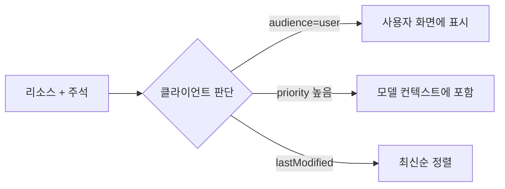

# 리소스 주석

> MCP 리소스·리소스 템플릿·콘텐츠 블록에 붙이는 선택 힌트. `audience`(누구용), `priority`(중요도 0~1), `lastModified`(마지막 수정 시각) 세 가지가 있다.

## 쉽게 말하면
서류철의 포스트잇이다. "이건 사람이 볼 것", "이건 필수(빨간색)", "2025-01-12 수정". 클라이언트는 이 힌트로 무엇을 모델 컨텍스트에 넣을지 고른다.

## 자세히
(MCP 사양 2025-06-18 Resources 기준)
- **audience**: `"user"`, `"assistant"` 배열. 예 `["user","assistant"]`는 둘 다에게 유용.
- **priority**: 0.0~1.0. 1은 사실상 필수, 0은 전혀 선택.
- **lastModified**: ISO 8601 시각(예 `2025-01-12T15:00:58Z`).
- 활용: 대상별 필터링, 컨텍스트에 넣을 우선순위 결정, 최신순 정렬·표시.
- 주석은 도구 결과의 이미지·리소스 링크·임베디드 리소스 같은 콘텐츠 블록에도 쓸 수 있다.
- 힌트일 뿐 강제가 아니다. 비신뢰 서버가 준 priority를 맹신하면 컨텍스트가 조작될 수 있다([MCP 신뢰 경계](#mcp-trust-boundary)). 도구의 Tool annotations는 신뢰 서버가 아니면 신뢰하지 말라고 사양에 명시돼 있다.

## 그림으로 보기


## 예시
```json
{"uri":"file:///project/README.md","name":"README.md",
 "annotations":{"audience":["user"],"priority":0.8,"lastModified":"2025-01-12T15:00:58Z"}}
```
## 헷갈리는 것과 비교
| 개념 | 차이 |
| --- | --- |
| 리소스 주석 | 데이터의 대상·중요도·갱신 시각 |
| [Tool annotations](#mcp-tool-annotations) | 도구의 성격(읽기 전용·파괴적 등) |
| 메타데이터(mimeType, size) | 데이터 형식 설명 |

## 더 읽을거리
- [MCP 사양: Resources — Annotations](https://modelcontextprotocol.io/specification/2025-06-18/server/resources) — 정의와 예시
