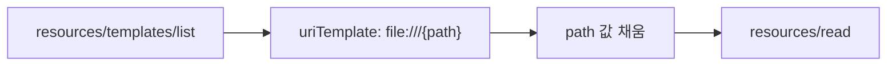
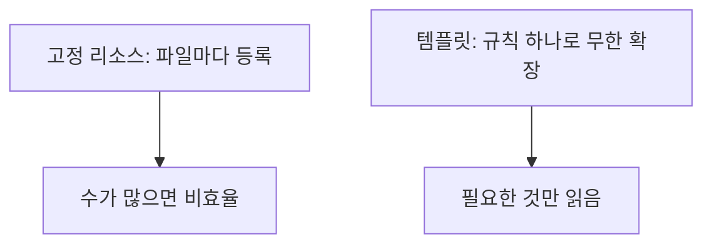

# 리소스 템플릿 (Resource Templates)

> 리소스 템플릿은 `file:///{path}`처럼 URI 템플릿(RFC 6570)으로 매개변수화된 리소스를 서버가 한꺼번에 노출하는 방법이다.

## 쉽게 말하면
도서관에서 책 한 권마다 안내문을 만들 수 없으니 "서가번호/{번호}"라는 주소 양식 하나만 알려 주는 것이다. 번호만 채우면 어떤 책이든 찾아간다.

## 자세히
MCP 명세 2025-06-18 Resources 문서 기준:
- `resources/templates/list`로 템플릿 목록을 요청(페이지네이션 지원). 응답의 `resourceTemplates`에 `uriTemplate`, `name`, `title`, `description`, `mimeType`이 있다. 예: `uriTemplate: "file:///{path}"`.
- 템플릿 인자는 **completion API**로 자동완성할 수 있다([MCP 자동완성](#mcp-completion)).
- 고정 리소스는 `resources/list`, 읽기는 `resources/read`(`uri` 지정). 리소스 내용은 `text` 또는 `blob`(base64).
- 주석: `audience`(user·assistant), `priority`(0.0~1.0), `lastModified`. 흔한 URI 스킴은 `https://`(클라이언트가 직접 가져올 수 있을 때만), `file://`, `git://`, 사용자 정의(RFC3986 준수).
- 보안: 서버는 **모든 URI 검증(MUST)**, 민감 리소스 접근 통제, 권한 확인. 오류: 리소스 없음 `-32002`.
- 리소스는 **애플리케이션 주도**(호스트 앱이 컨텍스트에 넣을지 결정)라는 점이 모델 주도인 도구와 다르다.

## 그림으로 보기



## 예시
```json
{"resourceTemplates": [{"uriTemplate": "file:///{path}", "name": "Project Files", "description": "Access files in the project directory", "mimeType": "application/octet-stream"}]}
```
고객 DB를 `crm://customers/{id}` 템플릿으로 노출하면 모델·사용자가 ID만 바꿔 읽는다(예시 설계).

## 헷갈리는 것과 비교
| 개념 | 차이 |
|---|---|
| 리소스 | 읽을 수 있는 데이터 한 건 |
| 리소스 템플릿 | 매개변수화된 리소스 규칙 |
| [도구](#mcp-tools) | 모델이 호출하는 동작 |
| [구독](#mcp-subscriptions) | 리소스 변경 알림 받기 |

## 더 읽을거리
- [MCP Resources 명세 (2025-06-18)](https://modelcontextprotocol.io/specification/2025-06-18/server/resources) — 템플릿, 읽기, 구독, URI 스킴, 보안.
