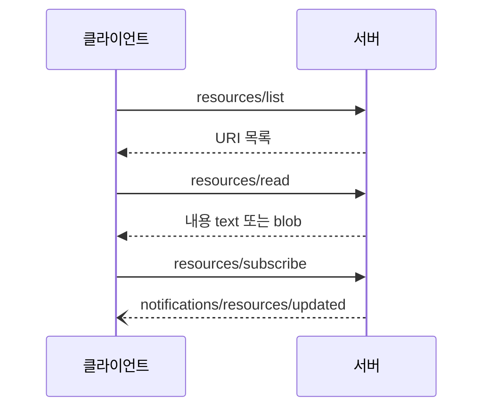
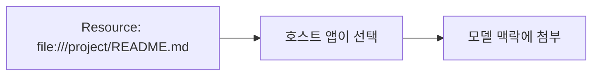

# MCP Resources

> MCP Resources는 서버가 파일, DB 스키마, 앱 데이터 같은 맥락 정보를 URI로 식별해 노출하는 읽기용 프리미티브다. 어떤 것을 모델 맥락에 넣을지는 호스트 앱이 정한다.

## 쉽게 말하면
도서관의 자료 목록이다. 각 자료에 청구기호(URI)가 있고, 사서(앱)가 어떤 자료를 책상에 올려 줄지 정한다. 자료는 읽기만 하고 행동(대출 처리)은 도구(Tools)가 한다.

## 자세히
MCP 스펙 2025-06-18 기준:
- **앱 주도(application-driven)**: 목록/트리 UI에서 사용자가 고르게 하거나, 검색·필터, 휴리스틱·모델의 선택으로 자동 포함하는 방식을 앱이 정한다([MCP 프리미티브](#mcp-primitives)).
- 서버는 `resources` capability를 선언하고 선택적으로 `subscribe`(개별 리소스 변경 알림)와 `listChanged`(목록 변경 알림)를 지원한다.
- 메시지: `resources/list`(목록, 페이지네이션), `resources/read`(내용 읽기), `resources/templates/list`(URI 템플릿, RFC 6570), `resources/subscribe`와 `notifications/resources/updated`.
- 정의 필드: `uri`, `name`, `title`, `description`, `mimeType`, `size`. 내용은 `text` 또는 base64 `blob`.
- 주석: `audience`(user/assistant), `priority`(0.0~1.0), `lastModified`.
- URI 스킴: `https://`(클라이언트가 직접 가져올 수 있을 때만), `file://`, `git://`, 사용자 정의(RFC 3986 준수).
- 오류: 없는 리소스 `-32002`, 내부 오류 `-32603`.
- 보안: 서버는 URI를 반드시 검증하고 민감 리소스에는 접근 통제와 권한 확인을 한다([MCP 보안](#mcp-security)).

## 그림으로 보기

## 예시
- 코드 서버가 `file:///project/src/main.rs`를 노출 → 사용자가 선택창에서 골라 대화에 첨부.
- `file:///{path}` 같은 템플릿으로 경로 인자를 받아 어떤 파일이든 요청.

## 헷갈리는 것과 비교
| 개념 | 차이 |
|---|---|
| [MCP Tools](#mcp-tools) | 행동 실행, 모델이 결정 |
| Resources | 읽기용 맥락, 앱이 결정 |
| [MCP Prompts](#mcp-prompts) | 템플릿, 사용자가 선택 |

## 더 읽을거리
- [MCP Specification: Resources](https://modelcontextprotocol.io/specification/2025-06-18/server/resources) — 메시지·URI·주석·오류.
