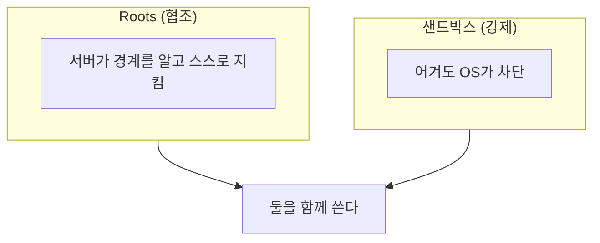

# Roots와 샌드박스

> Roots는 "이 폴더에서 일해 달라"고 서버에 알리는 협조 규약이고, 샌드박스는 OS 수준에서 실제로 접근을 막는 격리다. 둘은 같은 것이 아니다.

## 쉽게 말하면
Roots는 출입증에 적힌 "3층만 이용 가능" 안내문이다. 지키라고 부탁하는 문구다. 샌드박스는 3층 외에는 문이 아예 잠겨 있는 건물이다. 안내문만으로는 마음먹은 사람을 막지 못한다.

## 자세히
MCP Roots 명세(2025-06-18) 기준:
- 클라이언트가 파일시스템 "roots"를 서버에 노출해 작업 경계를 알린다. 서버는 `roots/list`로 받고, 변경은 `notifications/roots/list_changed`로 통지된다. root의 `uri`는 현재 명세상 `file://` URI여야 한다(MUST).
- 서버는 root 경계를 존중하고 모든 경로를 roots와 대조한다(SHOULD) — 즉 **서버의 자발적 준수에 기대는 약속**이다. 명세는 접근을 강제하는 장치를 정의하지 않는다(해석: 명세에 강제 수단이 쓰여 있지 않다).
- 클라이언트는 적절한 권한의 root만 노출하고, URI를 검증해 [경로 탈출](#path-traversal)을 막고, 접근 통제를 구현해야 한다(MUST).
- **샌드박스**: 컨테이너, OS 권한, seccomp, 읽기 전용 마운트처럼 서버 프로세스가 roots를 어겨도 막히게 하는 강제 격리. 악의적이거나 버그 있는 서버에 대비한다.
- 실무 원칙: roots는 "의도 전달", 샌드박스는 "강제". 신뢰하지 않는 서버는 샌드박스에서 돌리고 최소 권한 마운트만 준다.

## 그림으로 보기

## 예시
파일 MCP 서버를 Docker로 띄우고 `-v ~/project:/work:ro`처럼 프로젝트 폴더만 읽기 전용으로 마운트한 뒤, 클라이언트는 root로 `file:///work`만 노출한다. 서버가 `../../etc`를 시도해도 컨테이너 밖은 보이지 않는다.

## 헷갈리는 것과 비교
| 개념 | 차이 |
|---|---|
| Roots | 경계 선언. 강제 없음 |
| 샌드박스 | 실제 격리 |
| 도구 권한 허용 목록 | 어떤 도구를 쓸지의 제한. 파일 경계와는 별개 |

## 더 읽을거리
- [MCP Roots 명세](https://modelcontextprotocol.io/specification/2025-06-18/client/roots) — 보안 고려사항과 가이드
- [OWASP Path Traversal](https://community.owasp.org/attacks/Path_Traversal) — 정규화·격리 방어
