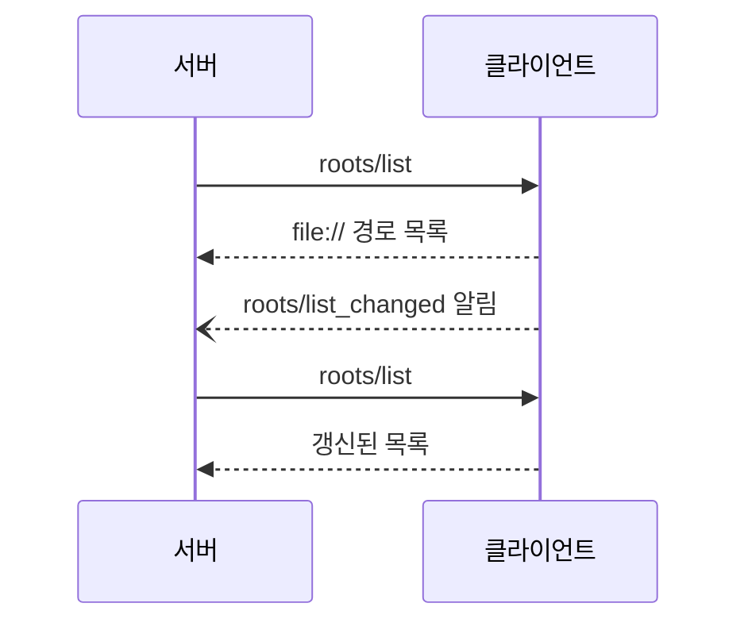
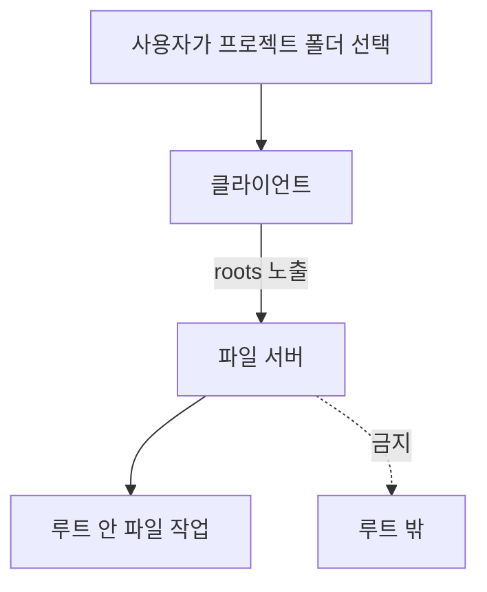

# MCP Roots

> 클라이언트가 서버에게 "이 폴더들 안에서만 일해라"라고 알려 주는 작업 경계. `roots/list`로 `file://` URI 목록을 준다.

## 쉽게 말하면
이삿짐센터 직원(서버)에게 "이 집, 이 방들만 들어가세요"라고 출입 허가 구역을 그려 주는 일이다. 직원은 구역 밖을 건드리지 않는 것이 약속이고, 집주인(클라이언트·사용자)은 어느 방을 열어 줄지 정한다.

## 자세히
- 클라이언트가 `capabilities: {"roots": {"listChanged": true}}`를 선언한다. `listChanged`는 목록이 바뀔 때 알림을 보낸다는 뜻.
- 서버가 `roots/list`를 요청 → `{"roots":[{"uri":"file:///home/user/projects/myproject","name":"My Project"}]}`. 현재 스펙(2025-06-18)에서 `uri`는 반드시 `file://`이고 `name`은 선택.
- 목록이 바뀌면 `notifications/roots/list_changed` → 서버가 다시 `roots/list`.
- 미지원 클라이언트는 `-32601`(Method not found), 내부 오류는 `-32603`.
- 클라이언트 MUST: 권한 있는 루트만 노출, 경로 탈출(path traversal) 검증, 접근 제어. SHOULD: 노출 전 사용자 동의.
- 서버 SHOULD: capability 확인, 루트 밖 작업 금지, 루트가 사라질 때 대응.
- 주의: roots는 **협조 규약**이다. 강제 격리는 OS 권한·샌드박스가 따로 해야 한다(해석).

## 그림으로 보기

## 예시
- 코드 편집 서버가 `file:///home/me/frontend`, `file:///home/me/backend` 두 루트만 확인하고 그 안에서만 검색한다.
- IDE에서 다른 폴더를 열면 `list_changed`가 가고 서버가 목록을 새로 읽는다.

## 헷갈리는 것과 비교
| 개념 | 차이 |
|---|---|
| Roots | 서버가 일할 **경로 범위**(클라이언트가 제공) |
| [MCP Resources](#mcp-resources) | 서버가 클라이언트에 주는 **데이터** |
| 샌드박스 | 실제로 막는 장치. roots는 알려 주는 규약 |

## 더 읽을거리
- [MCP Roots 스펙(2025-06-18)](https://modelcontextprotocol.io/specification/2025-06-18/client/roots) — 메시지·보안 지침
