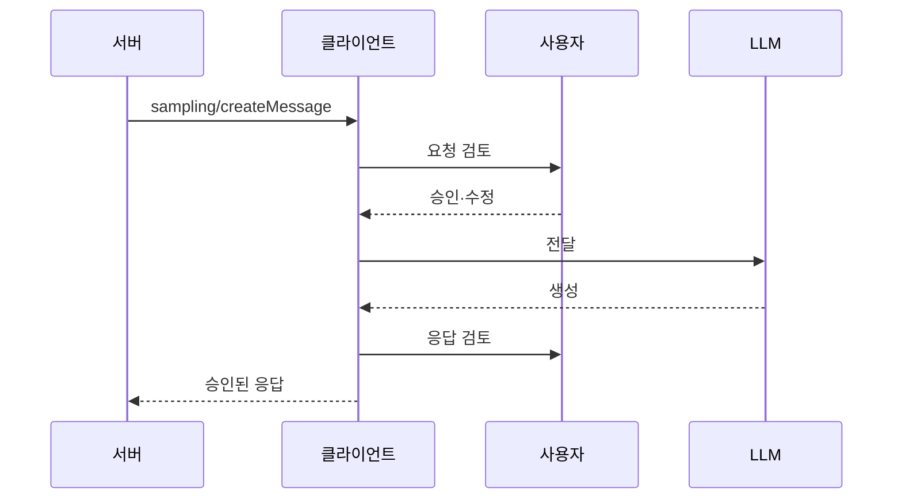

# Sampling 사람 검토(HITL)

> MCP 서버가 클라이언트에게 LLM 호출을 부탁할 때(sampling), 요청과 응답을 사람이 보고 거부·수정할 수 있게 하는 UI 설계 원칙이다.

## 쉽게 말하면
비서(서버)가 "사장님 이름으로 이 메일을 대신 써서 보내도 될까요?"라고 초안을 가져온다. 사장님(사용자)이 초안을 보고 고치거나 거절하고, 나간 답장도 다시 확인한다. 요청을 볼 기회와 답을 볼 기회, 두 번의 관문이 있다.

## 자세히
MCP 명세 2025-06-18 Sampling 기준:
- 서버가 `sampling/createMessage`로 생성을 요청하면, 클라이언트가 모델 접근·선택·권한을 쥔다. 서버에 API 키가 필요 없다.
- 보안과 신뢰를 위해 **항상 사람이 개입해 거부할 수 있어야 한다(SHOULD)**. 애플리케이션이 할 일: 요청을 쉽게 검토하는 UI, 전송 전 프롬프트 열람·수정, 생성 응답을 전달 전에 검토.
- 흐름: 서버 요청 → 사용자 승인/수정 → LLM → 응답을 사용자에게 보여 승인/수정 → 서버로 반환.
- 거부 시 오류를 돌려준다(예: "User rejected sampling request", 예시 코드 -1).
- 함께 권장: 메시지 내용 검증, 속도 제한(rate limit), 민감 데이터 적절 처리(MUST).
- UI 설계 포인트(주장·권고 수준): 어느 서버가 요청했는지 표시, 모델·토큰 상한 표시, "항상 허용"은 신뢰 서버에만, 요청 빈도 경고.
- 명세는 UI 형태를 강제하지 않는다.

## 그림으로 보기

## 예시
리서치 서버가 "이 문서를 요약해 줘"라고 요청하면 Claude Desktop 같은 클라이언트가 팝업으로 프롬프트를 보여 준다. 사용자가 개인정보가 섞인 부분을 지우고 승인한다. 참고: [Human-in-the-loop](#human-in-the-loop), [MCP 프롬프트 보안](#mcp-prompt-security).

## 헷갈리는 것과 비교
| 개념 | 차이 |
|---|---|
| [Human-in-the-loop](#human-in-the-loop) | 일반 원칙. 여기선 sampling 요청에 적용 |
| sampling | 서버→클라이언트 LLM 호출 요청 |
| elicitation | 서버→사용자 정보 입력 요청 |

## 더 읽을거리
- [MCP Sampling 명세](https://modelcontextprotocol.io/specification/2025-06-18/client/sampling) — 흐름도와 보안 고려사항
