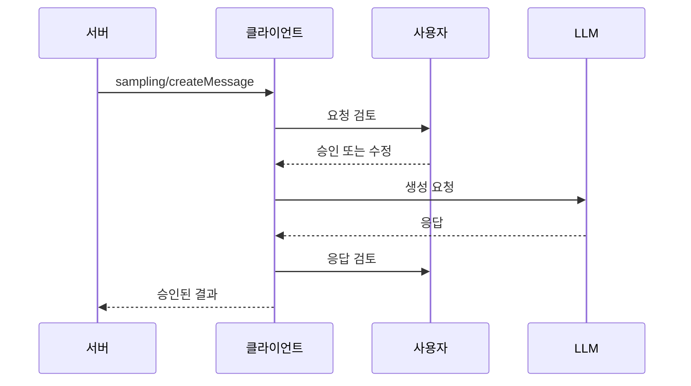
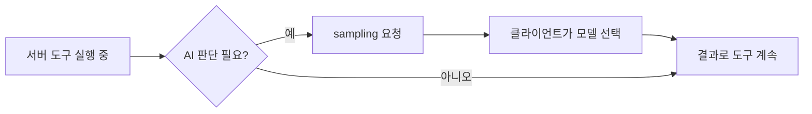

# MCP Sampling

> MCP 서버가 `sampling/createMessage`로 클라이언트에게 "당신의 LLM으로 한 번 생성해 달라"고 요청하는 기능. 서버에 API 키가 없어도 AI를 쓸 수 있다.

## 쉽게 말하면
식당 주방(서버)이 직접 요리사를 고용하지 않고, 홀(클라이언트)에게 "저쪽 전문 셰프에게 이 주문 좀 넘겨 줘"라고 부탁하는 모습이다. 홀은 손님(사용자)에게 "이 주문 보내도 될까요?"라고 확인한 뒤에야 셰프(LLM)에게 넘긴다. 비용과 모델 선택권은 홀이 쥐고 있다.

## 자세히
- 클라이언트가 초기화 때 `capabilities: {"sampling": {}}`를 선언해야 쓸 수 있다(MUST). 스펙 2025-06-18 기준.
- 요청에는 `messages`, `systemPrompt`, `maxTokens`, [modelPreferences](#model-preferences-mcp)가 들어간다. 메시지 내용은 텍스트·이미지·오디오(base64) 가능.
- 응답은 `role: assistant`, `content`, 실제로 쓴 `model`, `stopReason`(예: `endTurn`).
- 사람 개입(SHOULD): 요청 프롬프트를 보고 고칠 수 있게 하고, 생성 결과도 서버에 돌려주기 전에 검토하게 한다. 거부하면 에러를 돌려준다.
- 보안: 사용자 승인 UI, 내용 검증, 속도 제한, 민감 정보 취급 주의.
- 의미: MCP 서버 기능 안에 LLM 호출이 **중첩**되어 서버가 에이전트처럼 동작할 수 있다.

## 그림으로 보기

## 예시
- 회의록 서버가 긴 텍스트를 받아 sampling으로 요약을 맡기고, 요약을 리소스로 저장한다. 서버는 모델 키·비용 없음.
- 요청 JSON: `{"method":"sampling/createMessage","params":{"messages":[{"role":"user","content":{"type":"text","text":"프랑스 수도는?"}}],"maxTokens":100}}`

## 헷갈리는 것과 비교
| 개념 | 차이 |
|---|---|
| Sampling | 서버 → 클라이언트 LLM 호출 요청 |
| [MCP Tools](#mcp-tools) | 클라이언트(모델)가 서버 기능을 호출 |
| [Elicitation](#mcp-elicitation) | 모델이 아니라 **사람**에게 입력을 요청 |

## 더 읽을거리
- [MCP Sampling 스펙(2025-06-18)](https://modelcontextprotocol.io/specification/2025-06-18/client/sampling) — 메시지 형식·보안 항목
