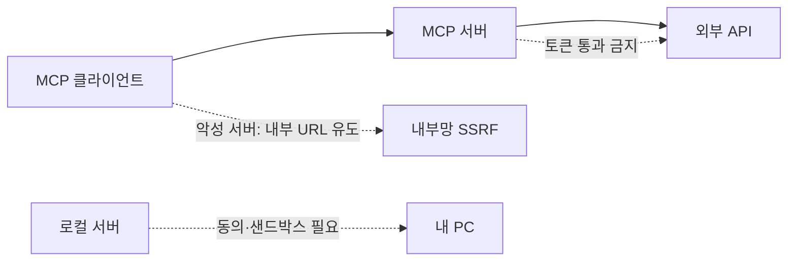
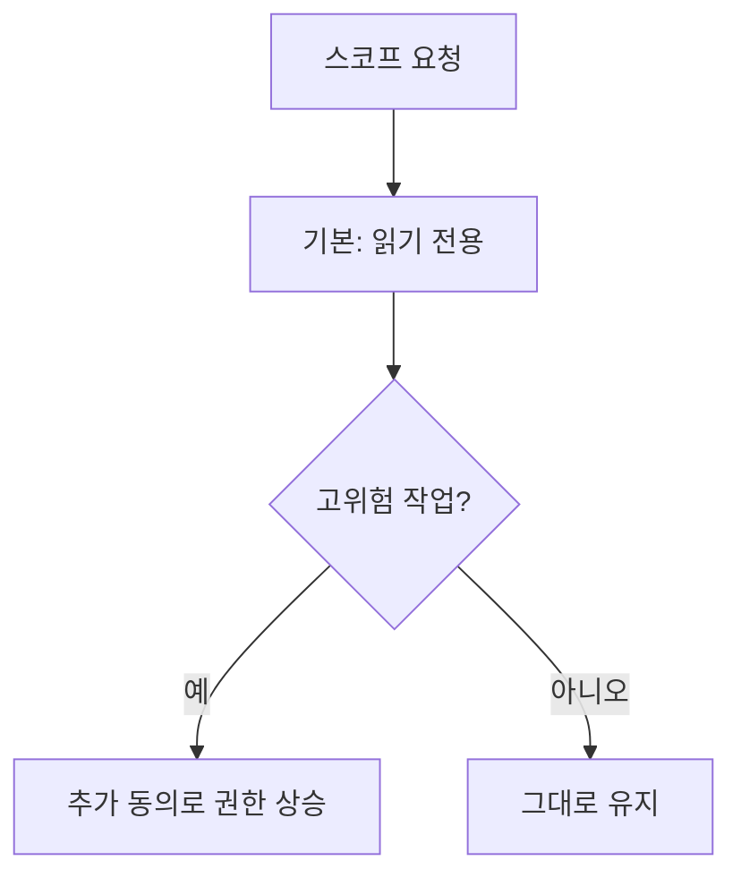

# MCP 보안

> MCP 보안은 AI가 외부 도구·데이터에 연결될 때 생기는 공격(권한 도용, 토큰 오용, 내부망 접근, 악성 로컬 서버 등)과 그 방어 원칙이다. 공식 명세에 "Security Best Practices" 문서가 따로 있다.

## 쉽게 말하면
MCP 서버를 연결하는 건 직원에게 사무실 열쇠 꾸러미를 맡기는 일이다. 열쇠가 너무 많거나(과한 권한), 아무 열쇠나 받아 쓰거나(토큰 통과), 출처 모를 직원을 들이면(악성 로컬 서버) 사고가 난다.

## 자세히
MCP 공식 Security Best Practices(명세 2025-11-25 기준 링크, 2026-11 확인)가 다루는 공격과 대응:
- **Confused deputy(혼동된 대리인)**: 정적 client ID + 동적 클라이언트 등록 + 동의 쿠키가 겹치면 공격자가 사용자 동의 없이 인가 코드를 받는다. 대응: 클라이언트별 동의 저장, 동의 화면(클라이언트 이름·스코프·redirect_uri 표시), redirect_uri **정확 일치**, `state` 검증, `__Host-` 쿠키.
- **토큰 통과(token passthrough)**: MCP 서버가 자기에게 발급되지 않은 토큰을 받아 하위 API로 넘기는 안티패턴. 명세가 금지한다("MUST NOT accept any tokens not explicitly issued for the MCP server"). 감사 추적·통제 우회 문제를 만든다.
- **SSRF**: 악성 서버가 OAuth 메타데이터 URL을 내부 주소(`169.254.169.254` 클라우드 메타데이터 등)로 채워 클라이언트가 내부망을 호출하게 한다. 대응: HTTPS 강제, 사설 IP 차단, 리다이렉트 검증, 이그레스 프록시. IP 검증을 직접 구현하지 말 것(인코딩 우회).
- **세션 하이재킹**: 세션 ID를 추측·탈취해 사칭하거나 악성 이벤트 주입. 대응: 세션을 인증에 쓰지 않고 모든 요청 검증, 안전한 난수 ID, 사용자 정보에 바인딩.
- **로컬 MCP 서버 침해**: 설정에 악성 시작 명령이 들어가면 임의 코드 실행. 대응: 실행할 명령을 그대로 보여 주고 명시적 동의, 샌드박스, stdio 전송 사용.
- **OAuth 인가 URL 검증**: `javascript:` 등 위험한 스킴 거부, 셸로 URL 열지 않기.
- **스코프 최소화**: `*`·`admin:*` 같은 포괄 스코프를 처음부터 요청하지 않고 필요할 때 점진적으로 올린다.

## 그림으로 보기

## 예시
- 점검 질문: ① 이 서버를 내가 직접 실행하는가, 명령이 보이는가 ② 요청 스코프가 필요 최소인가 ③ 토큰을 그대로 하위 API에 넘기지 않는가.
- 팀 도입 규칙 예: 승인된 서버 목록만 허용, 새 로컬 서버는 샌드박스에서만 실행.

## 헷갈리는 것과 비교
| 개념 | 차이 |
|---|---|
| MCP 보안 | 프로토콜·연결 계층의 인증·권한 문제 |
| [프롬프트 주입](#prompt-injection) | 도구가 가져온 내용이 모델 지시를 바꾸는 공격 |
| [MCP](#mcp) | 보안이 적용되는 대상 프로토콜 |
| [허용 목록 검증](#allow-list-validation) | URL·입력을 허용된 것만 통과시키는 방어 기법 |

## 더 읽을거리
- [MCP Security Best Practices](https://modelcontextprotocol.io/specification/2025-06-18/basic/security_best_practices) — 공격별 흐름도와 필수(MUST) 대응.
