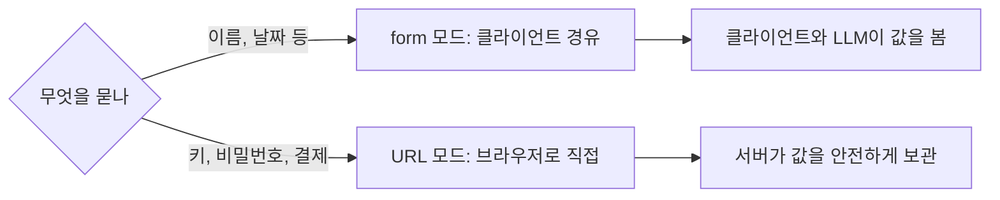
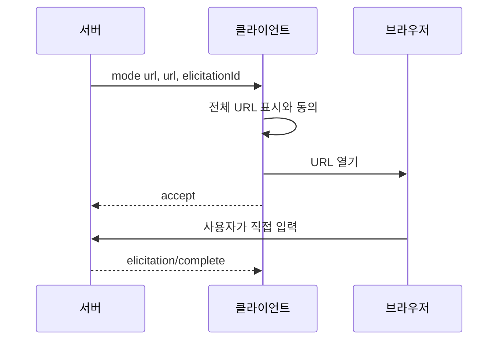

# 민감 정보 요청 금지

> MCP 서버는 form 모드 elicitation으로 비밀번호·API 키·토큰·결제 정보를 요청하면 안 된다(MUST NOT). 이런 정보는 URL 모드로 클라이언트와 LLM을 거치지 않고 받아야 한다.

## 쉽게 말하면
은행 창구 직원이 고객에게 "비밀번호를 이 종이에 적어 주세요" 하면 종이가 옆 사람 눈에 띄고 복사될 수 있다. 그래서 은행은 비밀번호를 가림막이 있는 별도 단말기에 직접 입력하게 한다. form 모드는 종이, URL 모드는 가림막 단말기다.

## 자세히
스펙 2025-11-25(확인 2026-11-12).
- 금지 대상: 비밀번호, API 키, 액세스 토큰, 결제 자격증명처럼 **접근·결제를 승인하는 비밀**. 이름·이메일·사용자명 같은 일반 연락처·프로필 정보는 범주상 금지가 아니고 서버 재량(사용자가 검토·거절 가능).
- 이유: form 모드 데이터는 클라이언트를 통과한다. 로그·LLM 컨텍스트·중간 서버로 새어 나갈 수 있다.
- 대안: **URL 모드**(`mode:"url"`, `url`, `elicitationId`). 사용자가 서버의 HTTPS 페이지에서 직접 입력하고, 값은 클라이언트에 노출되지 않는다.
- URL 안전 규칙: URL에 민감 정보·개인정보를 넣지 않고, 미리 인증된 URL을 주지 않는다. 클라이언트는 URL을 미리 가져오지 않고, 전체 URL을 보여 주고 동의를 받은 뒤, 클라이언트·LLM이 내용을 볼 수 없는 방식으로 연다.
- 피싱 방어: URL을 연 사람이 요청을 시작한 사용자와 같은지 서버가 확인해야 한다(예: 세션 쿠키의 `sub`와 비교).
- 제3자 OAuth 때 서버가 클라이언트 토큰을 그대로 넘기는 token passthrough는 금지.

## 그림으로 보기

## 예시
- 금지: `{"properties":{"apiKey":{"type":"string"}}}` 폼으로 외부 서비스 API 키를 묻기.
- 올바름: `https://mcp.example.com/connect?elicitationId=...` URL 모드로 보내 그 페이지에서 OAuth 승인이나 키 입력을 하게 하고, 서버가 사용자 신원에 묶어 저장.

## 헷갈리는 것과 비교
| 개념 | 차이 |
|---|---|
| form 모드 | 클라이언트를 통과. 비밀 요청 금지 |
| URL 모드 | 대역 밖(out-of-band). 비밀·OAuth용 |
| MCP 인가 | 클라이언트↔서버 인증. URL 모드는 서버↔제3자 인증용이며 이를 대체하지 못함 |
| [accept·decline·cancel](#elicitation-actions) | 두 모드 공통 응답 액션 |

## 더 읽을거리
- [MCP Elicitation 스펙 2025-11-25](https://modelcontextprotocol.io/specification/2025-11-25/client/elicitation) — 경고 박스, URL 모드, 보안 고려사항
