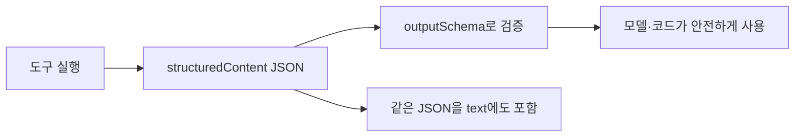
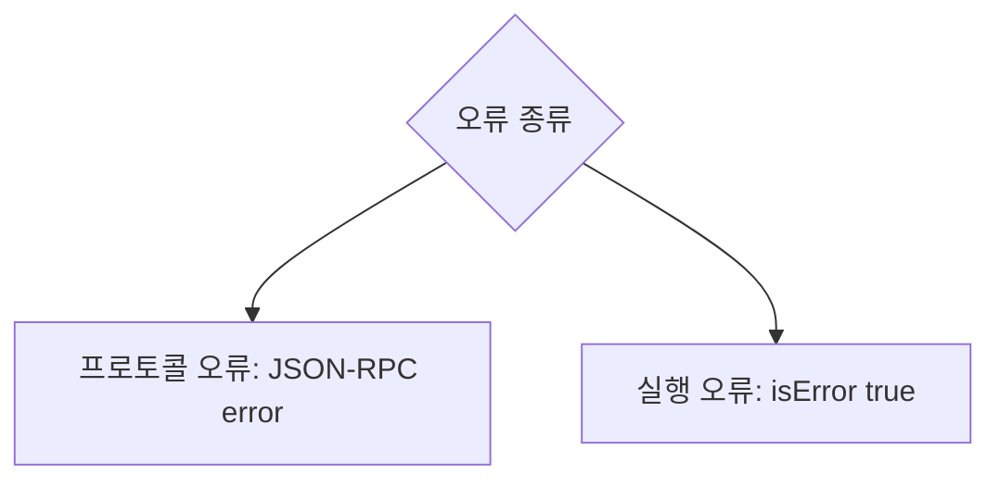

# 구조화된 도구 결과 (outputSchema·structuredContent)

> MCP 도구가 결과를 자유 텍스트 대신 JSON 객체(`structuredContent`)로 돌려주고, `outputSchema`로 그 형태를 선언해 검증할 수 있게 하는 기능이다.

## 쉽게 말하면
주문 결과를 "손글씨 메모"가 아니라 "항목이 정해진 양식지"로 받는 것이다. 어디에 온도가, 어디에 습도가 적혔는지 틀리지 않고 읽을 수 있다.

## 자세히
MCP 명세 2025-06-18 Tools 문서 기준:
- 결과는 **비구조화**(`content`: text·image·audio·resource_link·embedded resource 배열)와 **구조화**(`structuredContent`: JSON 객체)로 나뉜다.
- 하위 호환: 구조화 결과를 돌려주는 도구는 **같은 JSON을 직렬화해 TextContent에도 함께 넣는 것이 SHOULD**.
- `outputSchema`(선택)가 있으면 서버는 스키마에 맞는 결과를 **반드시** 줘야 하고, 클라이언트는 **검증해야 한다(SHOULD)**. 효과: 엄격한 검증, 언어별 타입 정보, LLM의 올바른 해석 유도, 문서화.
- 주의(명세 노트): `structuredContent`는 서버가 만든 결과 데이터이며, LLM의 "structured outputs"(스키마 제약 생성)와는 **무관**하다. 후자는 [제약 디코딩](#structured-output-decoding).
- 오류: 프로토콜 오류(JSON-RPC, 알 수 없는 도구·잘못된 인자)와 도구 실행 오류(`isError: true`, API 실패·업무 로직 오류)가 구분된다.

## 그림으로 보기



## 예시
```json
{
  "result": {
    "content": [{"type": "text", "text": "{\"temperature\": 22.5, \"conditions\": \"Partly cloudy\", \"humidity\": 65}"}],
    "structuredContent": {"temperature": 22.5, "conditions": "Partly cloudy", "humidity": 65}
  }
}
```
날씨·재고 조회 도구가 숫자 필드를 확실히 돌려줘야 후속 자동화가 깨지지 않는다.

## 헷갈리는 것과 비교
| 개념 | 차이 |
|---|---|
| structuredContent | 서버가 반환하는 JSON 결과 |
| outputSchema | 그 JSON의 형태 선언 |
| [제약 디코딩](#structured-output-decoding) | 모델 출력 토큰을 스키마로 제한 |
| `content` 텍스트 | 사람·모델이 읽는 비구조화 결과 |

## 더 읽을거리
- [MCP Tools 명세 (2025-06-18)](https://modelcontextprotocol.io/specification/2025-06-18/server/tools) — structuredContent, outputSchema, 오류 처리.
