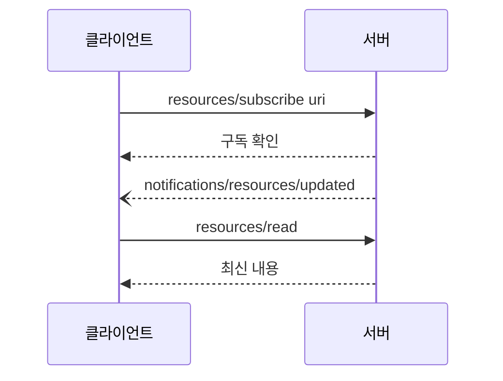
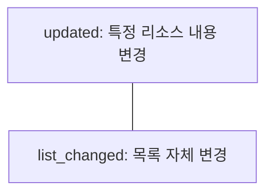

# 리소스 구독 (Subscriptions)

> 클라이언트가 특정 리소스를 구독해 두면, 그 리소스가 바뀔 때 서버가 알림을 보내 최신 컨텍스트를 유지하게 해 주는 MCP 기능이다.

## 쉽게 말하면
신문을 매일 사러 가는 대신 구독하면 새 호가 나올 때 집으로 알려 주는 것과 같다. 알림이 오면 그때 새 신문(내용)을 읽는다.

## 자세히
MCP 명세 2025-06-18 Resources 문서 기준:
- 서버가 `resources` capability에서 `subscribe: true`를 선언해야 한다. `subscribe`와 `listChanged`는 각각 선택 사항(둘 다 없음·하나만·둘 다 가능).
- **구독**: `resources/subscribe`(`uri` 지정). **변경 알림**: 서버가 `notifications/resources/updated`(`uri` 포함)를 보낸다. 알림에는 새 내용이 없고, 클라이언트가 다시 `resources/read`로 읽는다.
- **목록 변경**: `listChanged`를 선언한 서버는 리소스 목록이 바뀌면 `notifications/resources/list_changed`를 보낸다(개별 리소스 수정과는 다른 알림).
- 흐름: list → read → subscribe → (변경) updated 알림 → read. 구독 해제 메시지는 이번에 열어 본 페이지에 나오지 않았다.
- 활용: 로그 파일·대시보드·문서처럼 자주 바뀌는 맥락을 매번 폴링하지 않고 갱신. 단 알림이 잦으면 호스트가 읽기 빈도를 조절해야 한다(일반적 설계 고려).

## 그림으로 보기



## 예시
```json
{"jsonrpc": "2.0", "id": 4, "method": "resources/subscribe", "params": {"uri": "file:///project/src/main.rs"}}
```
```json
{"jsonrpc": "2.0", "method": "notifications/resources/updated", "params": {"uri": "file:///project/src/main.rs"}}
```
에이전트가 열어 둔 설계 문서가 수정되면 알림을 받아 다시 읽는 식으로 쓴다.

## 헷갈리는 것과 비교
| 개념 | 차이 |
|---|---|
| resources/subscribe | 개별 리소스 변경 구독 |
| list_changed | 리소스 목록 변경 알림 |
| 폴링 | 클라이언트가 주기적으로 확인 |
| [리소스 템플릿](#mcp-resource-templates) | 리소스를 찾는 주소 규칙 |

## 더 읽을거리
- [MCP Resources 명세 (2025-06-18)](https://modelcontextprotocol.io/specification/2025-06-18/server/resources) — 구독·알림 메시지와 capability.
