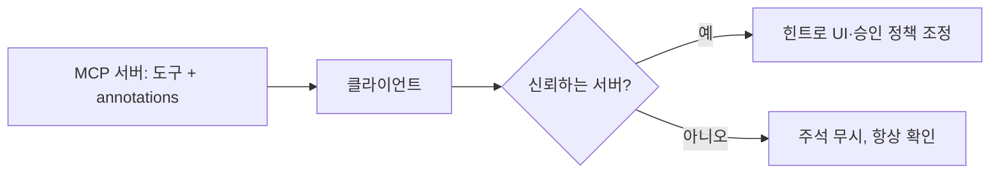
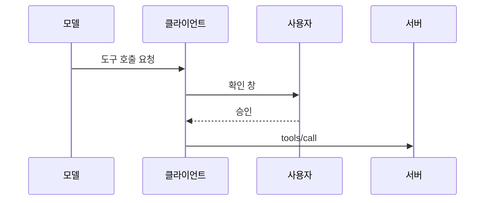

# Tool annotations (도구 주석)

> MCP 도구 정의에 붙는 선택적 메타데이터로, 도구가 읽기 전용인지·파괴적인지 같은 성격을 알려 주는 힌트다. 단, 신뢰할 수 있는 서버가 아니면 믿으면 안 된다.

## 쉽게 말하면
약병에 붙은 "주의: 졸음 유발" 라벨 같은 것이다. 라벨이 있으면 쓰는 쪽이 조심할 수 있지만, 출처가 의심스러운 약병의 라벨은 그대로 믿어선 안 된다.

## 자세히
MCP 명세 2025-06-18 Tools 문서 기준:
- 도구 정의 필드: `name`, `title`(선택), `description`, `inputSchema`, `outputSchema`(선택), **`annotations`**(도구 동작을 설명하는 선택적 속성).
- **경고(MUST)**: 클라이언트는 **신뢰할 수 있는 서버에서 온 것이 아니면 annotations를 신뢰하지 않는 것으로 간주**해야 한다.
- 안전 원칙: 도구는 모델이 자동으로 호출하므로 **항상 사람이 거부할 수 있어야 한다(SHOULD)**. UI는 어떤 도구가 노출되는지 보여 주고, 호출 시 시각적 표시와 확인 창을 제공한다.
- 보안: 서버는 입력 검증·접근 통제·호출 빈도 제한·출력 정화, 클라이언트는 민감 작업 확인·입력 표시·결과 검증·타임아웃·감사 로그를 한다.
- Anthropic의 도구 작성 글은 MCP 서버에서 annotations로 파괴적 변경이나 오픈월드 접근이 필요한 도구를 표시하라고 권한다. 필드 이름(`readOnlyHint` 등) 자체는 이번에 연 페이지에 나열되지 않아 확인하지 못했다.
- 그래서 annotations는 "UI·승인 정책을 위한 힌트"이지 보안 경계가 아니다. 진짜 방어는 서버 권한 제한과 [허용 목록 검증](#allow-list-validation)이다.

## 그림으로 보기



## 예시
```json
{
  "name": "delete_file",
  "description": "Delete a file from the project",
  "inputSchema": {"type": "object", "properties": {"path": {"type": "string"}}, "required": ["path"]},
  "annotations": {"destructive": true}
}
```
(`annotations`의 정확한 키 이름은 명세 스키마를 확인할 것 — 위 키는 설명용 예시다.) 파일 삭제 도구에는 항상 사용자 확인을 거는 정책을 둔다.

## 헷갈리는 것과 비교
| 개념 | 차이 |
|---|---|
| annotations | 도구 성격을 알리는 힌트(신뢰 불가) |
| 콘텐츠 annotations | 결과 항목의 audience·priority 등 표시 정보 |
| 권한 통제 | 서버가 실제로 막는 장치 |
| [도구 설명](#mcp-tool-description-design) | 모델이 읽고 고르는 자연어 설명 |

## 더 읽을거리
- [MCP Tools 명세 (2025-06-18)](https://modelcontextprotocol.io/specification/2025-06-18/server/tools) — 도구 필드, 신뢰 경고, 보안 고려.
- [Writing tools for agents (Anthropic)](https://www.anthropic.com/engineering/writing-tools-for-agents) — annotations 활용 권고.
