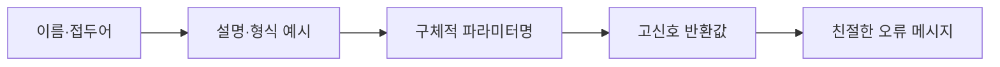
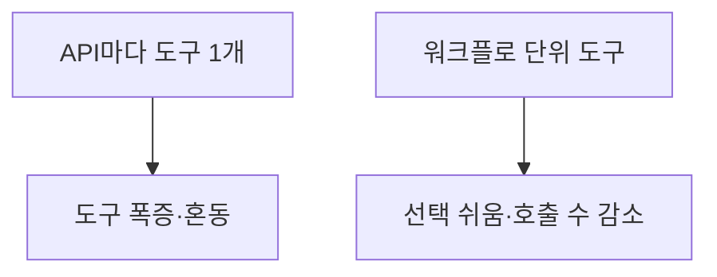

# 도구 설명 설계

> 모델이 도구를 정확히 고르고 인자를 맞게 채우도록, 도구의 이름·설명·파라미터·반환값을 신입 팀원을 온보딩하듯 구체적으로 쓰는 설계 요령이다.

## 쉽게 말하면
신입사원에게 업무 도구 사용법을 적어 줄 때 "검색"이라고만 쓰지 않고 "고객 ID로 최근 주문을 찾는다, 날짜는 YYYY-MM-DD"처럼 쓰는 것과 같다. 설명이 구체적일수록 실수가 준다.

## 자세히
Anthropic "Writing tools for agents" 기준:
- **이름 짓기**: 서비스·리소스별 접두어로 묶는다(`asana_search`, `jira_search`, `asana_projects_search`). 접두어 vs 접미어 방식은 모델마다 결과가 달라 시험해 본다.
- **설명**: 특수한 질의 형식·용어·리소스 관계를 풀어 쓰고, 입출력은 엄격한 데이터 모델로 정의한다. 문구 몇 단어가 큰 차이를 만든다 — 설명을 다듬어 Claude Sonnet 3.5가 SWE-bench Verified에서 당시 최고 성능을 냈다고 소개한다.
- **파라미터**: `user`보다 `user_id`처럼 구체적으로.
- **반환값**: `uuid` 같은 저수준 ID보다 이름·파일 종류 같은 고신호 필드. 암호 같은 ID를 읽을 수 있는 이름으로 바꾸면 환각이 줄었다. `response_format`(concise/detailed)을 두면 한 예에서 토큰이 약 1/3.
- **토큰 효율**: 페이지네이션·범위·필터·잘라내기에 합리적 기본값. Claude Code는 도구 응답을 기본 25,000토큰으로 제한. 잘랐다면 좁히는 방법을 알려 준다. 오류 메시지는 무엇이 틀렸고 어떻게 고치는지 올바른 예시와 함께.
- **무엇을 만들까**: API 엔드포인트마다 감싸지 말고 고영향 워크플로 몇 개에. `list_contacts`보다 `search_contacts`, 여러 단계를 `get_customer_context` 한 번으로 묶기.

## 그림으로 보기

## 예시
나쁜 예: `name: "search"`, `description: "검색"`, 파라미터 `q`.
좋은 예: `name: "crm_search_customers"`, `description: "이름·이메일로 고객을 찾아 최근 주문 3건을 함께 반환. 날짜는 YYYY-MM-DD"`, 파라미터 `customer_email`, `response_format: concise|detailed`.

## 헷갈리는 것과 비교
| 개념 | 차이 |
|---|---|
| 도구 설명 | 모델이 읽고 선택하는 자연어 |
| [annotations](#mcp-tool-annotations) | 성격 힌트(파괴적 등) |
| [스키마 출력](#mcp-structured-output) | 결과 형태 선언 |
| 프롬프트 엔지니어링 | 도구 설명도 그 일부라는 관점 |

## 더 읽을거리
- [Writing tools for agents (Anthropic)](https://www.anthropic.com/engineering/writing-tools-for-agents) — 이름·설명·반환값·토큰 효율 가이드.
- [MCP Tools 명세](https://modelcontextprotocol.io/specification/2025-06-18/server/tools) — 도구 필드 정의.
