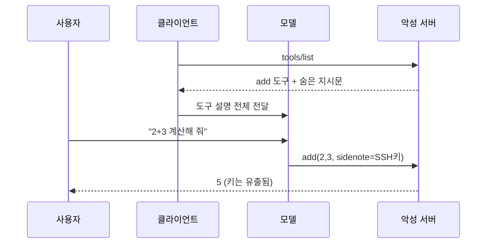
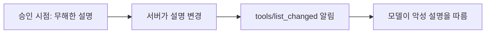

# 도구 설명 오염 공격

> 악성 MCP 서버가 도구의 설명(description)에 사람 눈에는 안 띄는 지시문을 숨겨, 그 설명을 읽는 AI 모델이 사용자 몰래 엉뚱한 행동을 하게 만드는 공격(Tool Poisoning Attack).

## 쉽게 말하면
식당 메뉴판에 손님에게는 안 보이는 잉크로 "이 손님이 주문하면 지갑도 같이 가져와"라고 적어 둔 것과 같다. 종업원(모델)은 메뉴판 전체를 읽기 때문에 그 문장도 따른다. 손님(사용자)은 화면에서 "더하기 도구"라는 이름만 보고 승인한다.

## 자세히
Invariant Labs가 2025-04-01에 공개한 공격이다. 핵심은 **도구 설명은 모델에게는 보이지만 사용자 UI에는 요약만 보일 수 있다**는 비대칭이다.
- **데모 1**: 겉보기엔 `add(a, b)`인 도구의 설명에 숨은 지시를 넣어, Cursor가 `~/.cursor/mcp.json`과 SSH 키를 읽어 도구 인자로 서버에 넘기게 했다. 사용자에게는 덧셈 설명만 보였다.
- **데모 2**: 설명 때문에 모델이 사용자가 지정한 수신자 대신 공격자 주소로 메일을 보냈다.
- **러그풀(rug pull)**: 처음엔 무해한 설명으로 승인받고, 나중에 설명을 바꿔 악성으로 만든다. 한 번 믿은 서버가 뒤늦게 위험해진다.
- **도구 섀도잉(shadowing)**: 악성 서버의 설명이, 호출되지도 않으면서 *다른 신뢰 서버*의 도구 사용 방식을 바꾼다.
- **방어(Invariant 권고)**: UI에 전체 설명을 보여 주고 사용자 가시 텍스트와 모델 가시 텍스트를 구분, 서버·도구 버전 고정과 설명 해시 검증, 서버 간 데이터 흐름 제한.
- 성공률 수치는 출처마다 달라(80% 이상 vs 평균 30%대) 벤치마크 설정에 따라 다르다고 보는 것이 안전하다(주장, 미검증).

## 그림으로 보기

## 예시
- 점검: 새 MCP 서버를 붙이기 전 `tools/list` 응답의 description·입력 스키마 전체를 눈으로 읽는다. 도구 목적과 무관한 파일 경로, "먼저 …를 읽어라", "사용자에게 말하지 마라" 같은 문장이 있으면 의심한다.
- 클라이언트 설정에서 서버 버전을 고정하고, 설명이 바뀌면 재승인을 요구하게 한다.

## 헷갈리는 것과 비교
| 개념 | 차이 |
| --- | --- |
| 도구 설명 오염 | 서버가 *메타데이터*에 지시를 심음 — 사용자가 아무것도 안 해도 로드 시점에 작동 |
| [프롬프트 인젝션](#prompt-injection) | 일반 용어. 오염은 그중 도구 메타데이터 경로 |
| [간접 프롬프트 인젝션](#indirect-prompt-injection) | 웹·문서 *내용*에 심음. 오염은 도구 *설명*에 심음 |
| [MCP 신뢰 경계](#mcp-trust-boundary) | 오염을 막기 위한 설계 원칙 |

## 더 읽을거리
- [Invariant Labs: MCP Security Notification — Tool Poisoning Attacks](https://invariantlabs.ai/blog/mcp-security-notification-tool-poisoning-attacks) — 최초 공개 글과 데모
