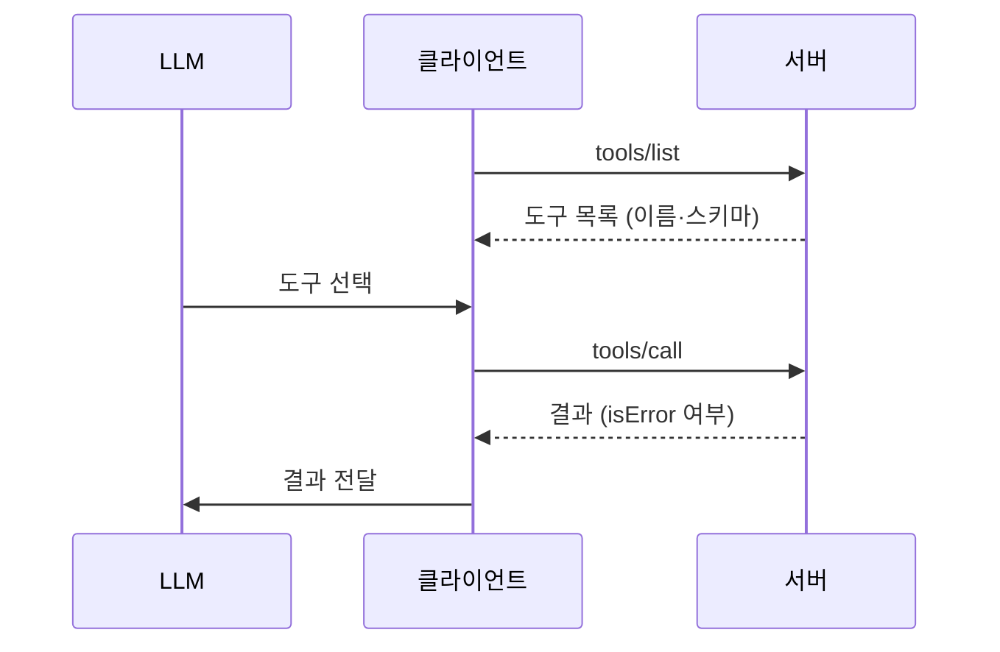
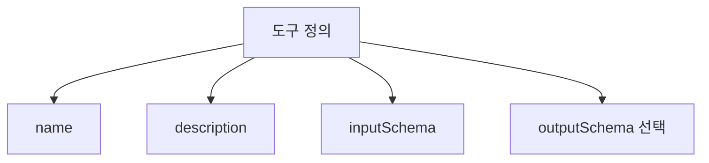

# MCP Tools

> MCP Tools는 MCP 서버가 LLM에 노출하는 실행 가능한 함수다. 이름·설명·입력 스키마로 정의하고 `tools/list`로 찾고 `tools/call`로 호출한다.

## 쉽게 말하면
공구 벽에 걸린 도구에 이름표와 사용 설명서가 붙어 있다. 모델은 설명서를 읽고 상황에 맞는 도구를 골라 필요한 값을 채워 달라고 요청한다. 실제 작업은 서버가 하고 결과를 돌려준다.

## 자세히
MCP 스펙 2025-06-18 기준:
- **모델이 통제**하는 프리미티브([MCP 프리미티브](#mcp-primitives))다. 단 안전을 위해 사람이 거부할 수 있어야(SHOULD) 하며, 노출된 도구 표시, 호출 표시, 확인 창을 권장한다([휴먼 인 더 루프](#human-in-the-loop)).
- 서버는 `tools` capability를 선언하고, 목록이 바뀌면 알리는 `listChanged`를 줄 수 있다.
- **정의 필드**: `name`(필수 식별자), `title`, `description`, `inputSchema`(JSON Schema, [JSON Schema](#json-schema)), 선택 `outputSchema`, `annotations`. 신뢰된 서버가 아니면 annotations는 신뢰하지 않는다(MUST).
- **결과**: `content`(text·image·audio·resource_link·embedded resource) 또는 `structuredContent`(JSON 객체). 구조화 결과는 호환을 위해 텍스트로도 직렬화해 준다.
- **오류 두 종류**: 프로토콜 오류(알 수 없는 도구, 잘못된 인자 → JSON-RPC error)와 도구 실행 오류(`isError: true`, API 실패 등).
- 보안: 서버는 입력 검증·접근 제어·호출 제한·출력 정제, 클라이언트는 민감 작업 확인·입력 표시·타임아웃·로그를 해야 한다([MCP 보안](#mcp-security)).

## 그림으로 보기



## 예시
```json
{"name":"get_weather","description":"Get current weather information for a location",
 "inputSchema":{"type":"object","properties":{"location":{"type":"string"}},"required":["location"]}}
```
모델이 `{"location":"New York"}`로 호출하면 서버가 날씨 텍스트를 `content`로 돌려준다.

## 헷갈리는 것과 비교
| 개념 | 차이 |
|---|---|
| MCP Tool | 서버가 노출한 함수(표준 프로토콜) |
| [Tool Use](#tool-use) | 모델이 함수를 부르는 일반 개념 |
| Resource | 읽기 맥락. 행동을 하지 않음 |

## 더 읽을거리
- [MCP Specification: Tools](https://modelcontextprotocol.io/specification/2025-06-18/server/tools) — 메시지·스키마·오류·보안 규정.
