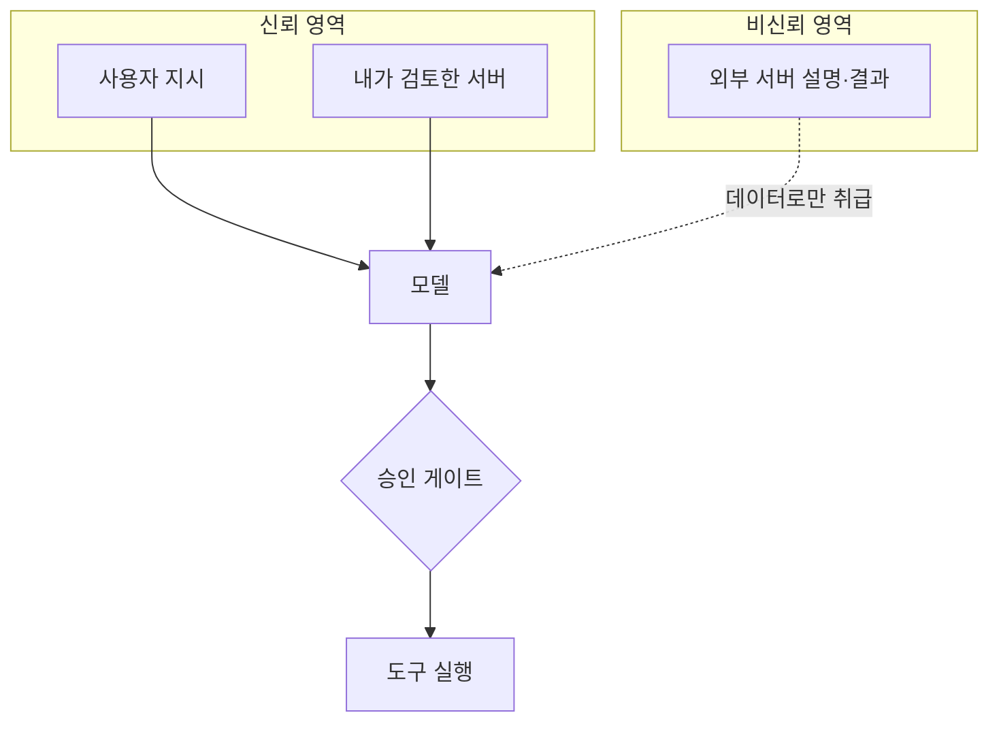

# MCP 신뢰 경계

> 모델 컨텍스트에 들어오는 정보를 "내가 통제하는 것"과 "남이 통제하는 것"으로 나누고, 후자가 지시·권한을 얻지 못하게 선을 긋는 설계 원칙.

## 쉽게 말하면
회사 출입문과 같다. 사원증이 있는 사람(신뢰 서버)은 사무실까지 들어오지만, 방문객(비신뢰 서버)은 로비에서 안내만 받는다. 방문객이 "사장님이 금고를 열라고 했어요"라고 말해도 그대로 따르면 안 된다.

## 자세히
- MCP 서버가 주는 **도구 이름·설명·스키마·어노테이션·결과**는 전부 서버가 쓴 글이다. 서버가 내 것이 아니면 이 글은 *데이터*이지 *명령*이 아니다.
- 신뢰 수준을 구분하는 기준: ① 내가 직접 만들거나 코드를 검토한 서버(신뢰), ② 공식·평판 있는 서버지만 업데이트가 바뀔 수 있음(조건부), ③ 출처 불명 서버(비신뢰).
- 실무 원칙(Invariant Labs 권고 등에서 도출):
  - **최소 권한**: 서버마다 접근 가능한 폴더·토큰을 따로 준다. 한 서버의 도구가 다른 서버 데이터를 읽지 못하게 한다.
  - **버전 고정·변경 감지**: 설명 해시를 저장하고 바뀌면 재승인([러그풀](#mcp-rug-pull) 방어).
  - **사람 승인**: 파괴적·외부 전송 도구는 호출 인자 전체를 보여 주고 승인받는다.
  - **어노테이션 불신**: `readOnlyHint` 같은 힌트는 비신뢰 서버에서는 보안 판단에 쓰지 않는다([Tool annotations](#mcp-tool-annotations)).
  - **서버 간 데이터 흐름 분리**: 민감 데이터를 읽은 뒤 외부 전송 도구를 부르는 조합을 막는다.

## 그림으로 보기

## 예시
- 회사 내부 DB 서버와 커뮤니티가 만든 "날씨" 서버를 한 에이전트에 같이 붙일 때, 날씨 서버가 DB 도구를 호출하도록 유도하지 못하게 권한을 나누고 DB 도구는 항상 승인을 요구한다.
- 점검 질문: "이 텍스트를 쓴 사람이 누구인가? 그가 내 에이전트에게 명령할 권한이 있는가?"

## 헷갈리는 것과 비교
| 개념 | 차이 |
| --- | --- |
| 신뢰 경계 | 정보의 출처에 따른 권한 구분(설계 원칙) |
| [도구 설명 오염](#mcp-tool-poisoning) | 경계가 없을 때 생기는 대표 공격 |
| [MCP 보안](#mcp-security) | 인증·전송 보안까지 포함한 상위 주제 |
| [프롬프트 인젝션](#prompt-injection) | 신뢰 경계를 넘어 들어온 텍스트가 명령처럼 작동하는 현상 |

## 더 읽을거리
- [Invariant Labs: Tool Poisoning Attacks](https://invariantlabs.ai/blog/mcp-security-notification-tool-poisoning-attacks) — 신뢰 경계 부재의 사례와 권고
