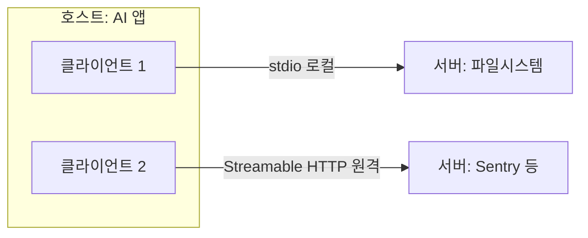
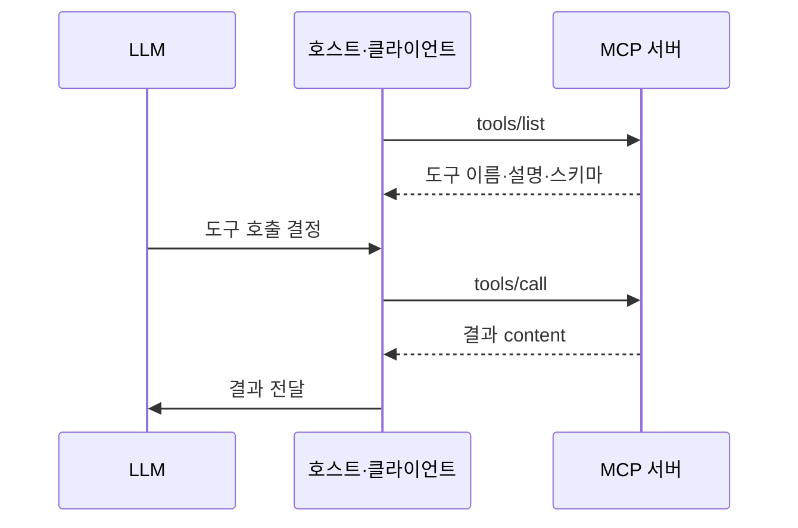

# MCP(Model Context Protocol)

> MCP는 AI 앱(Claude, ChatGPT, VS Code 등)이 외부 데이터·도구·워크플로에 접속하는 방식을 표준화한 오픈소스 프로토콜이다. 공식 문서는 "AI 앱을 위한 USB-C 포트"에 비유한다.

## 쉽게 말하면
예전에는 기기마다 충전 단자가 달라 케이블이 서랍 가득했다. USB-C 하나로 통일되자 어떤 기기든 어떤 충전기에 꽂을 수 있게 됐다. MCP도 같다. 도구(캘린더, DB, 노션 등)를 한 번 MCP 서버로 만들어 두면, MCP를 지원하는 어떤 AI 앱에서도 같은 방식으로 꽂아 쓴다. 앱마다 따로 연동을 짤 필요가 없다("build once, integrate everywhere").

## 자세히
MCP 공식 문서(프로토콜 버전 2026-07-28 기준, 2026-11 확인):
- **참여자**: **호스트**(Claude Code·VS Code 같은 AI 앱) / **클라이언트**(서버 하나당 하나씩 호스트가 만드는 연결 담당) / **서버**(컨텍스트를 제공하는 프로그램, 로컬이든 원격이든).
- **두 계층**: 데이터 계층(JSON-RPC 2.0 기반 메시지, 기능 탐색, 프리미티브, 알림)과 전송 계층. 전송은 **stdio**(같은 PC의 프로세스, 네트워크 오버헤드 없음)와 **Streamable HTTP**(원격, HTTP POST + 선택적 SSE, OAuth 권장).
- **서버 프리미티브 3가지**: **Tools**(AI가 호출하는 실행 함수), **Resources**(맥락용 데이터: 파일·DB 레코드), **Prompts**(재사용 프롬프트 템플릿). 각각 `tools/list`·`tools/call`처럼 목록·호출 메서드가 있다. 도구 정의에는 `name`·`description`·JSON Schema `inputSchema`가 들어간다.
- **클라이언트 프리미티브**: Elicitation(서버가 사용자에게 추가 입력·확인 요청). Sampling과 Logging은 이 버전에서 deprecated.
- **무상태·탐색**: 이 버전의 MCP는 요청마다 프로토콜 버전·기능을 담는 무상태 방식이고, `server/discover`로 서버가 지원하는 버전·기능을 알아볼 수 있다.
- **알림**: 도구 목록 변경 등을 `subscriptions/listen` 스트림으로 받는다(옵트인, 최선 노력 전달).
- MCP는 컨텍스트를 주고받는 규약일 뿐, 앱이 LLM을 어떻게 쓰는지는 정하지 않는다.

## 그림으로 보기

## 예시
- 에이전트가 구글 캘린더·노션 MCP 서버에 연결해 일정과 문서를 함께 다룬다(공식 문서의 활용 예).
- Claude Code가 Figma MCP로 디자인을 읽어 웹앱을 생성한다(공식 문서의 예).
- 자기 DB용 서버를 만들 때: 쿼리 도구(Tools) + 스키마(Resources) + 사용 예시(Prompts)를 한 서버에 담는다.

## 헷갈리는 것과 비교
| 개념 | 차이 |
| --- | --- |
| [도구 스키마 설계](#function-calling-schema) | 도구 하나의 정의 방식. MCP는 그 도구를 앱에 연결하는 표준 규약 |
| [도구 사용](#tool-use) | 상위 개념. 모델이 외부 함수를 호출하는 능력 |
| REST API | 사람 개발자용 인터페이스. MCP는 AI 앱이 기능을 탐색·호출하도록 맞춘 규약 |

## 더 읽을거리
- [What is MCP?](https://modelcontextprotocol.io/docs/getting-started/intro) — 개념·생태계
- [MCP Architecture overview](https://modelcontextprotocol.io/docs/learn/architecture) — 참여자·프리미티브·메시지 예시
