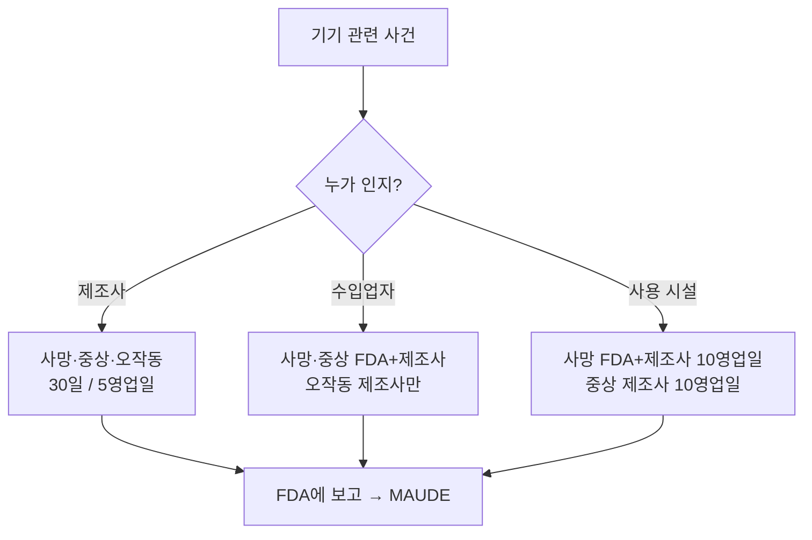

# MDR 이상 사례 보고

> Medical Device Reporting. 21 CFR Part 803에 따라 제조사·수입업자·기기 사용 시설(병원 등)이 의료기기와 관련된 **사망, 중상, 특정 오작동**을 FDA 등에 의무적으로 보고하는 제도. 보고 데이터는 MAUDE에 모인다.

## 쉽게 말하면
자동차 사고 신고 의무와 같다. 사고가 나면 제조사와 병원이 정해진 기한 안에 신고하고, 그 신고들이 쌓여 "이 기기에 반복되는 문제가 있는가"를 찾을 수 있게 된다.

## 자세히
출처: FDA "Mandatory Reporting Requirements: Manufacturers, Importers and Device User Facilities"(열어서 읽음).
- **제조사**: 사망, 중상, 재발하면 사망·중상을 일으키거나 기여할 가능성이 있는 오작동을 보고한다. 인지한 날부터 **30 달력일** 이내, FDA가 지정했거나 실질적 해악의 비합리적 위험을 막기 위한 시정이 필요한 사건은 **5 영업일** 이내. 서식은 Form FDA 3500A 또는 전자 동등물이다.
- **수입업자**: 사망·중상은 FDA와 제조사에 30 달력일 이내, 오작동은 제조사에만 30 달력일 이내.
- **기기 사용 시설**(병원, 외래 수술 시설, 요양원, 외래 진단·치료 시설, 의사 개인 진료실 제외): 기기 관련 **사망**은 FDA와 제조사에 **10 영업일** 이내, **중상**은 제조사에 10 영업일 이내(제조사를 모를 때만 FDA에). 오작동 보고는 의무가 아니며 MedWatch로 자발적 보고 가능. 매년 1월 1일까지 전년도 사망·중상 보고 연보(Form FDA 3419) 제출.
- **전자 제출**: 제조사와 수입업자는 eMDR로 제출(최종 규칙 2015-08-14 발효).
- **AI 기기에서의 의미(해설)**: 알고리즘의 오류가 환자 피해로 이어진 경우도 같은 틀로 보고된다. 다만 AI 오류가 보고로 이어지려면 사용 시설이 그것을 기기 문제로 인식해야 하므로 과소 보고 가능성이 있다는 점은 별도 확인이 필요하다(이 FDA 페이지의 내용이 아님).
- 규정 해석은 FDA의 MDR 도움말 창구에 문의하라고 페이지가 안내한다.

## 그림으로 보기

## 예시
- 영상 AI가 위험 소견을 놓쳐 환자가 악화됐고 병원이 기기 관련 중상으로 판단: 병원이 제조사에 10영업일 안에 보고, 제조사는 30일 안에 FDA에 보고.
- 점검: 병원 내부에 AI 오류를 기기 이상 사례로 판정해 보고하는 절차와 담당자가 있는가?

## 헷갈리는 것과 비교
| 개념 | 차이 |
|---|---|
| MDR | 의무 보고 제도 |
| [MAUDE](#maude) | 보고가 쌓이는 공개 DB |
| MedWatch | 자발적 보고 창구 |
| [이상 사례 보고(519)](#adverse-event-reporting) | MDR의 법적 근거 조항 |

## 더 읽을거리
- [Mandatory Reporting Requirements (FDA)](https://www.fda.gov/medical-devices/postmarket-requirements-devices/mandatory-reporting-requirements-manufacturers-importers-and-device-user-facilities) — 보고 주체·기한·서식(열어서 확인)
