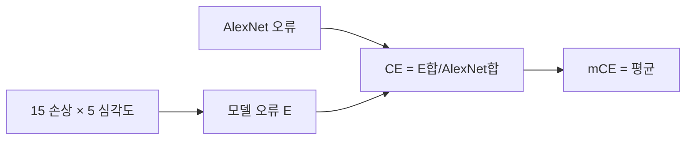
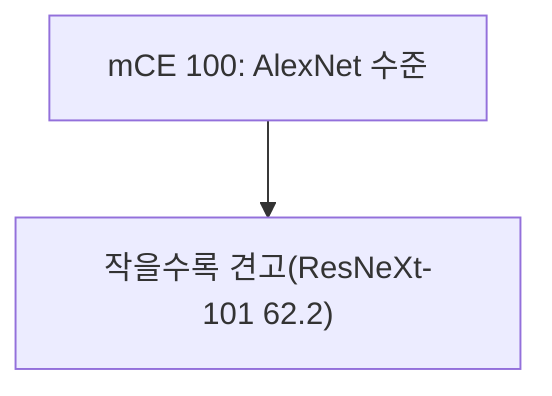

# mCE(평균 손상 오류)

> ImageNet-C에서 모델의 손상 견고성을 AlexNet 대비 상대값으로 나타낸 지표다. 15가지 손상 유형 각각의 오류를 AlexNet 오류로 나눠 평균한다(Hendrycks & Dietterich, 2019).

## 쉽게 말하면
안개·잡음·흐림이 낀 사진에서 얼마나 틀리는지를 "기준 모델(AlexNet)의 몇 %"로 환산한 점수다. 100이면 AlexNet과 같고 작을수록 견고하다.

## 자세히
(arXiv 1903.12261을 하위 에이전트가 원문으로 읽은 노트 기준.)
- **ImageNet-C**: 15가지 손상 × 5단계 심각도.
- **정의**: 손상 c에 대해 CE = Σ_s E^f_{s,c} / Σ_s E^AlexNet_{s,c}(심각도별 오류 합의 비), **mCE = 15개 CE의 평균**. **상대 mCE**는 깨끗한 데이터 오류를 뺀 값.
- **표 1 mCE**: AlexNet 100, VGG-19 88.9, ResNet-50 76.7, ResNeXt-101 62.2(상대 80.1). 상대 mCE는 AlexNet→ResNet에서 거의 변하지 않았고(ResNet-50 105.0) 깨끗한 정확도가 오른 만큼 손상 견고성은 오르지 않았다는 해석.
- **기타**: CLAHE 전처리 76.7→74.5, 노이즈 제거 전처리는 오히려 82.1로 악화.
- **주의**: 다른 논문(AugMix)의 ResNet-50 표준 mCE는 80.6으로 학습 설정에 따라 달라진다.

## 그림으로 보기

## 예시
- 사내 이미지 모델을 안개·잡음 변형 세트로 평가해 기준 모델 대비 상대 오류를 표로 보고.
- 교육 활용: 상대 지표가 절대 정확도와 다른 점을 토론.

## 헷갈리는 것과 비교
| 개념 | 차이 |
|---|---|
| mCE | 손상 평균 오류(AlexNet 정규화) |
| [Flip Rate](#flip-rate) | 섭동 시퀀스에서 예측이 뒤집히는 비율 |
| 적대적 정확도 | 최악 공격에서의 정확도 |

## 더 읽을거리
- [Benchmarking Neural Network Robustness (arXiv 1903.12261)](https://arxiv.org/abs/1903.12261) — ImageNet-C·mCE.
