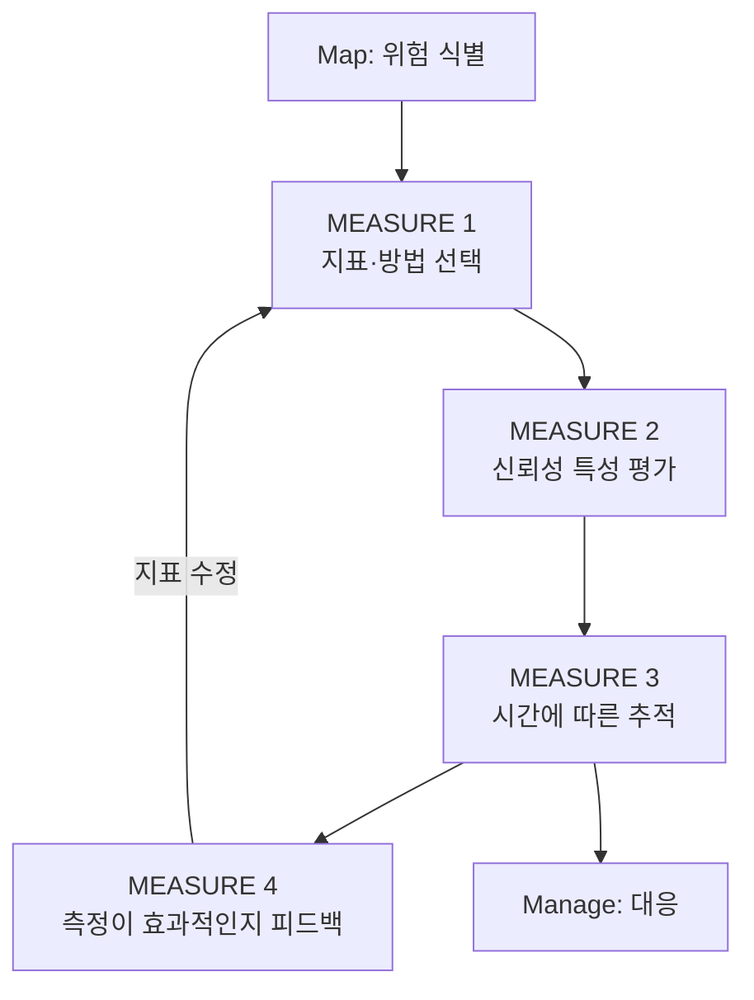

# MEASURE 함수

> NIST AI 위험관리 프레임워크(AI RMF 1.0)의 네 기능(Govern·Map·Measure·Manage) 중 하나. Map에서 찾아낸 AI 위험을 도구·지표·시험으로 분석·평가·추적하고, 그 측정 자체가 잘 작동하는지도 점검하는 단계.

## 쉽게 말하면
병원에서 문진(Map)으로 의심 부위를 찾은 뒤 혈액검사·영상검사로 수치를 얻는 단계다. 한 번 재고 끝이 아니라 정기검진처럼 반복하고, "이 검사법이 정말 맞는 검사인가"도 되돌아본다.

## 자세히
출처: NIST AIRC Playbook의 Measure 페이지(열어서 읽음). 전체 틀 설명과 TEVV는 [NIST AI RMF Measure](#nist-ai-rmf-measure), [TEVV](#tevv)에 있다.
- **MEASURE 1 — 방법과 지표 선택**: 가장 중요한 위험에 맞는 측정 방식을 고르고(1.1), 지표와 통제가 계속 맞는지 주기적으로 재검토(1.2).
- **MEASURE 2 — 신뢰성 특성 평가**: 타당하고 신뢰할 수 있음(2.5, 개발 조건을 벗어난 일반화의 한계 문서화), 보안·회복탄력성(2.7, 적대적 예시·데이터 오염 등), 공정성·편향(2.11, 집단별·교차 집단 피해 평가) 등.
- **MEASURE 3 — 위험 추적**: 식별된 위험을 시간에 따라 추적하는 체계. 3.1 정기 식별·추적을 위한 방법·인력·문서, 3.2 평가하기 어려운 환경에서의 추적 방식, 3.3 최종 사용자·영향받는 공동체가 문제를 신고하고 결과에 이의 제기하는 피드백 절차.
- **MEASURE 4 — 측정의 효과 피드백**: 측정 방식을 배치 맥락과 연결(4.1), 신뢰성 측정 결과를 배치 맥락·수명주기 전반에서 정리(4.2), 관련 행위자 협의를 통한 성능 향상·저하 확인(4.3). 각 하위 문장은 도구가 잘렸으므로 요지만 옮겼다.
- **성격**: 자발적 틀이며 Playbook 항목은 제안 행동이다. 하위 항목 수는 자료마다 달라(22개 vs 17개 설명) 정확한 수는 NIST AI 100-1 표에서 확인해야 한다.

## 그림으로 보기

## 예시
- 고객 상담 챗봇: 1.1로 오답률·유해 응답률 지표 선택 → 2.11로 연령·언어 집단별 격차 측정 → 3.1로 월별 추적 → 3.3으로 고객 신고 창구 → 4.1로 지표가 실제 현업 불만과 맞는지 검토.
- 교육 활용: 각 카테고리를 한 줄 질문으로 바꿔 팀 워크숍 체크리스트로 쓴다.

## 헷갈리는 것과 비교
| 개념 | 차이 |
|---|---|
| Map | 위험을 찾는 맥락 파악 단계 |
| Manage | 측정된 위험에 우선순위·대응 |
| [TEVV](#tevv) | 측정 활동 묶음(시험·평가·검증·확인) |
| [벤치마크](#ai-evaluation) | 일반 성능 점수, Measure는 맥락별 위험 근거 |

## 더 읽을거리
- [NIST AIRC Playbook — Measure](https://airc.nist.gov/AI_RMF_Knowledge_Base/Playbook/Measure) — 카테고리·하위 항목 원문과 제안 행동(열어서 확인)
- [NIST AI RMF 1.0 (AI 100-1)](https://doi.org/10.6028/NIST.AI.100-1) — 원문(이번엔 열지 못함)
