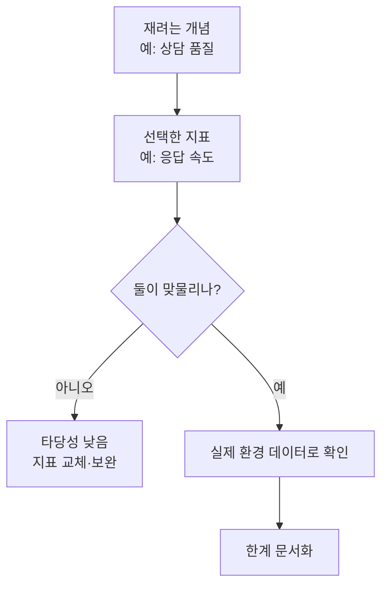

# 측정 타당성

> 지표가 재려는 것을 실제로 재고 있는가. 숫자가 높아도 엉뚱한 것을 재고 있다면 그 숫자는 의미가 없다.

## 쉽게 말하면
체중계로 키를 재려는 것과 같다. 아무리 정밀해도 목적에 안 맞는 도구다. AI에서는 "벤치마크 점수가 높다 = 업무에 쓸 만하다"가 늘 성립하지 않는다.

## 자세히
- **NIST AI RMF(2026-11-15 확인)**: 지표는 과학적·법적·윤리적 규범에 맞아야 하고, 가장 중요한 위험을 우선 측정하며 측정 못 하는 위험은 문서화(MEASURE 1). 타당성은 MEASURE 2.5에서 다룬다: 시스템이 타당하고 신뢰할 수 있음을 입증하고, **개발 조건을 넘어 일반화되는 데 한계가 있음을 문서화**한다. 지표·TEVV 프로세스 자체도 평가 대상(2.13). 측정 방식이 배치 맥락에 맞는지 도메인 전문가·사용자와 연결(4.1), 결과가 수명주기 동안 의도한 성능을 반영하는지 검증(4.2).
- **타당성의 일반적 구분(교육용 설명, NIST 페이지 정의 아님)**: 내용 타당성(필요한 영역을 다 덮는가), 구성 타당성(재려는 개념을 제대로 재는가), 준거 타당성(실제 결과와 관련 있는가), 생태학적 타당성(실제 환경에서도 성립하는가).
- **흔한 문제**: 벤치마크 오염(학습 데이터에 시험 문제가 있음), 대리 지표(클릭률로 만족도 대체), 분포 이동(시험 데이터와 운영 데이터가 다름), 평가 모델 편향([위치 편향](#position-bias-judge)).
- **점검 질문**: 이 지표가 나빠지면 실제 업무에서 무슨 문제가 생기는가? 시험 데이터가 실제 사용자 입력을 닮았는가? 사람 판단과 얼마나 일치하는가([Cohen's kappa](#cohens-kappa))?

## 그림으로 보기

## 예시
- 요약 모델을 ROUGE 점수로만 평가 → 점수는 높지만 핵심 수치가 빠진 요약. 내용 타당성이 낮은 사례. 필수 항목 체크리스트([기준표 채점](#rubric-grading))를 추가.
- 영어 벤치마크 점수로 한국어 상담 품질을 추정 → 일반화 한계를 문서에 명시.

## 헷갈리는 것과 비교
| 개념 | 차이 |
|---|---|
| 타당성 | 올바른 것을 재는가 |
| 신뢰성 | 반복해도 같은 값이 나오는가 |
| 정확도 | 맞힌 비율 |
| [TEVV](#tevv) | 이를 점검하는 활동 묶음 |

## 더 읽을거리
- [NIST AI RMF Core](https://airc.nist.gov/airmf-resources/airmf/5-sec-core/) — MEASURE 1·2.5·4 조항
- [AI RMF: Trustworthiness](https://airc.nist.gov/airmf-resources/airmf/3-sec-characteristics/) — 타당성·신뢰성 정의
