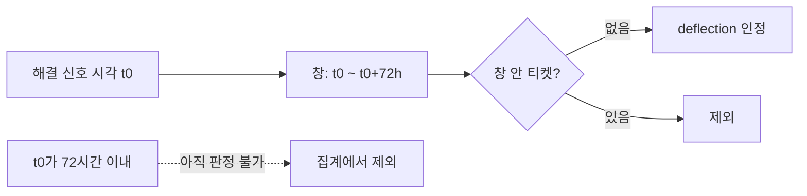

# 측정 창 (72시간)

> 셀프서비스·챗봇 해결을 인정하기 전에 "같은 사용자가 일정 시간 안에 티켓을 만들지 않는지" 지켜보는 **관찰 기간**. Metabase 지표 문서는 72시간을 "합리적 기본값"으로 제시한다. 창을 중간에 바꾸면 성과가 실제와 무관하게 오르내린다.

## 쉽게 말하면
택배를 보낸 뒤 "3일 안에 반품이 없으면 성공"으로 센다고 하자. 기준을 일주일로 늘리면 반품이 더 잡혀 성공률이 떨어진다. 배송이 나빠진 것이 아니라 자의 눈금을 바꾼 탓이다.

## 자세히
출처: Metabase "Deflection rate" 지표 페이지(본문 확인, 2026-11-18). 시뮬레이션은 직접 만든 **가상 데이터**이며 실제 측정값이 아니다.
- **창의 역할**: 해결 신호(예: "도움이 됐다")를 받은 뒤 같은 사용자가 창 안에 티켓을 열면 그 건은 deflection으로 인정하지 않는다. 지표식은 deflection = 셀프서비스 해결 ÷ (셀프서비스 해결 + 생성된 티켓).
- **페이지의 권고**: 72시간은 벤치마크가 아닌 "sane default". 창을 넓히면 비율이 기계적으로 낮아져 퇴보처럼 보일 수 있으니 **고정**하라고 한다. 창이 닫히지 않은 최근 이벤트는 후속 티켓을 볼 수 없으므로 `NOW() - 72시간` 이전 건만 점수화한다(성숙도 가드).
- **시뮬레이션 결과(가상)**: 사용자 10,000명, 35%가 해결 후 같은 문제로 티켓을 연다고 가정(지연은 평균 60시간의 지수분포). 창별 deflection:

| 창 | 창 안 티켓 비율 | deflection |
|---|---|---|
| 24시간 | 약 12.0% | 약 88.0% |
| 72시간 | 약 24.5% | 약 75.5% |
| 168시간 | 약 33.4% | 약 66.6% |

  같은 사용자 행동인데 창 설정만으로 88%에서 67%까지 달라졌다. 이것이 창 변경이 가짜 추세를 만드는 방식이다.
- **고르는 기준(제안)**: 제품의 재방문 주기에 맞춘다. 월 1회 쓰는 서비스에 24시간 창은 너무 짧다. 선택 후 문서화하고 비교 기간 동안 유지한다.
- **창 이후도 본다**: 창 직후의 재문의는 [재문의율](#reopened-as-ticket)로 별도 점검한다.
- **해결 인정 방식과의 관계**: Intercom류 "가정된 해결"은 대화 이탈을 해결로 보는데, 창과 신호 정의가 벤더마다 다르다([해결률](#resolution-rate)).

## 그림으로 보기


## 예시
```python
import random
random.seed(7)
N = 10000
delays = [random.expovariate(1/60) if random.random() < 0.35 else None for _ in range(N)]
for w in (24, 72, 168):
    tickets = sum(1 for d in delays if d is not None and d <= w)
    print(w, (N - tickets) / N)     # 창이 길수록 deflection이 내려감
```
교육 활용: KPI 보고서에서 "측정 창이 언제 바뀌었는가"를 확인하는 습관을 가르치는 사례.

## 헷갈리는 것과 비교
| 개념 | 차이 |
|---|---|
| 측정 창 | 해결 인정을 위해 지켜보는 기간 |
| 성숙도 가드 | 창이 안 닫힌 최근 건을 집계에서 빼는 규칙 |
| [재문의율](#reopened-as-ticket) | 창 이후의 같은 주제 재방문 |
| [응대 전환율 deflection](#deflection-rate) | 창을 전제로 계산하는 지표 |

## 더 읽을거리
- [Metabase: Deflection rate](https://www.metabase.com/metrics/deflection-rate) — 72시간 기본값, 성숙도 가드, 창 변경의 함정
