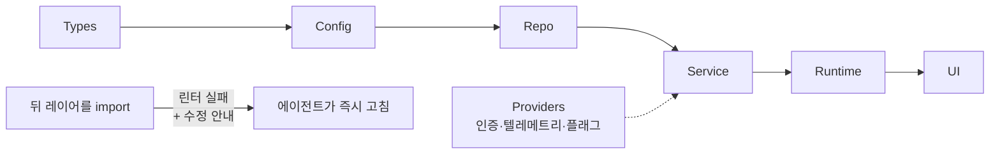
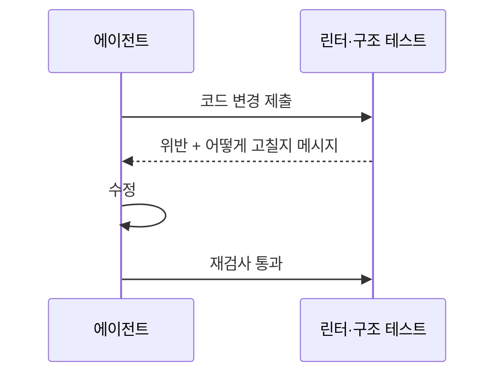

# 기계적 제약 (린터·구조 테스트)

> 에이전트에게 "이렇게 하라"고 **글로 부탁하는 대신, 어기면 자동으로 실패하는 검사(린터·구조 테스트·CI)** 로 규칙을 강제하는 것. 하네스 엔지니어링의 핵심 도구이며, **구현 방식이 아니라 지켜야 할 불변식**을 강제하고 오류 메시지에 수정 방법을 적어 에이전트에게 바로 알려 준다.

## 쉽게 말하면
고속도로에 "천천히 가세요"라는 안내문만 붙이는 것과 과속 단속 카메라를 다는 것의 차이다. 글로 된 지침은 잊히고 낡지만, 카메라(자동 검사)는 모든 차에 항상 작동한다.

## 자세히
(OpenAI, "Harness engineering: leveraging Codex in an agent-first world", 2026-02-11 원문 기준)
- **왜 필요한가**: 문서만으로는 에이전트가 만든 코드베이스의 일관성이 유지되지 않는다. 에이전트는 저장소의 기존 패턴(나쁜 것 포함)을 복제해 **드리프트**가 생긴다. 불변식을 강제하면 속도를 내면서도 기반이 무너지지 않는다.
- **레이어 규칙 예**: 각 업무 도메인을 `Types → Config → Repo → Service → Runtime → UI` 고정 레이어로 나누고, 코드는 **앞쪽 레이어로만 의존**하게 한다. 인증·커넥터·텔레메트리·기능 플래그 같은 횡단 관심사는 `Providers` 단일 인터페이스로만 들어온다. 이를 **커스텀 린터와 구조 테스트**로 강제한다(린터도 Codex가 작성).
- **취향 불변식**: 구조화 로깅, 스키마·타입 이름 규칙, 파일 크기 제한 등도 정적 검사로 강제. 반면 데이터 형태는 **경계에서 파싱하라**고만 요구하고 어떤 라이브러리를 쓸지는 지정하지 않는다("불변식을 강제하되 구현을 미세 관리하지 않는다").
- **오류 메시지가 곧 지시문**: 린트가 커스텀이므로 **에러 메시지에 수정 방법(remediation)을 써서 에이전트 컨텍스트에 주입**한다. 문서로 부족하면 규칙을 코드로 승격시킨다.
- **원칙**: "경계는 중앙에서 강제하고, 내부는 자율"을 허용한다. 사람 수백 명일 때나 하던 아키텍처 규율이 에이전트에게는 **초기 전제조건**이라고 설명한다.
- **직접 만든 작은 예**(Python `ast`로 import 방향을 검사하는 20줄짜리 스크립트를 실행): `repo` 레이어가 `service`를 import하는 파일을 찾아 종료 코드 1과 함께 "공통 로직을 앞 레이어로 옮기거나 Providers를 거쳐라"는 수정 안내를 출력했다. 같은 구조에서 `ui → service`처럼 앞으로 향하는 의존은 통과했다.
- 한계: 원문은 한 저장소(OpenAI 내부 신제품)의 경험이며 일반화에는 비슷한 투자가 필요하다고 스스로 밝힌다. 과한 규칙은 사람 입장에서 "까다롭다"고 느껴질 수 있다.

## 그림으로 보기



## 예시
```python
# layer_lint.py — 레이어 방향 검사(요지)
LAYERS = ["types", "config", "repo", "service", "runtime", "ui"]
# import한 레이어의 순서가 내 레이어보다 뒤이면 실패하고
# "공통 로직을 앞 레이어로 옮기거나 Providers를 거쳐라"를 출력
```
- 비개발자 교육: "AI에게 규칙을 부탁하는 문서(AGENTS.md)와, 어기면 빌드가 실패하는 자동 검사를 구분해서 설계한다."

## 헷갈리는 것과 비교
| 개념 | 차이 |
|---|---|
| 기계적 제약 | 자동 검사로 강제(어기면 실패) |
| 지침 문서(AGENTS.md) | 읽고 따르길 기대(낡을 수 있음) |
| [테스트 조작 방지](#test-tampering) | 검증 수단 자체가 훼손되지 않게 지키기 |
| [하네스](#harness) | 이런 제약·루프·문서를 묶은 실행 틀 |

## 더 읽을거리
- [OpenAI: Harness engineering — leveraging Codex in an agent-first world](https://openai.com/index/harness-engineering/) — 레이어 린터·구조 테스트·드리프트 대응 원문.
