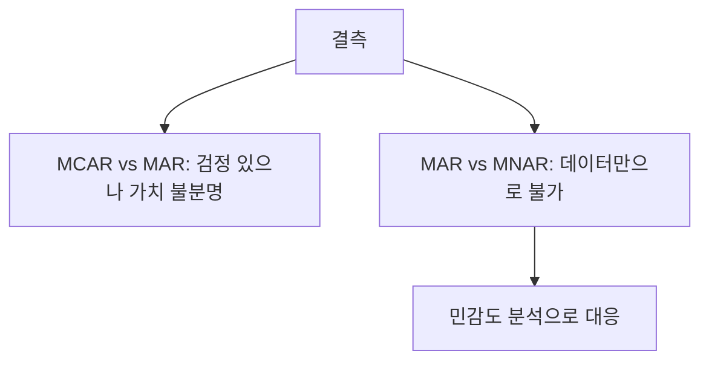

# 결측 메커니즘 진단

> 결측이 MCAR·MAR·MNAR 중 무엇인지 데이터만으로 구분할 수 있는지에 대한 문제다. MCAR 대 MAR은 검정이 있으나 실용 가치가 불분명하고, MAR 대 MNAR는 관측 데이터만으로는 검정이 불가능하다.

## 쉽게 말하면
"왜 빈칸이 생겼는가"는 빈칸 안에 답이 있어서 빈칸만 보고는 알 수 없다. 빈칸의 이유를 알려면 데이터 밖의 지식(도메인 이해, 추가 조사)이 필요하다.

## 자세히
(FIMD 2.2절을 하위 에이전트가 원문으로 읽은 노트 기준. Little 1988 검정과 Rubin 1976 원문은 열지 못해 미확인.)
- **FIMD 2.2.4 요지**: MCAR 대 MAR을 가르는 검정은 있지만 "실용 가치가 불분명"(Enders 2010 인용). **MAR 대 MNAR는 필요한 정보가 결측이라 검정이 "가능하지 않다"**.
- **시뮬레이션(FIMD)**: 이변량 정규, 상관 0.5, n=300. MCAR은 Pr=0.5, MAR은 logit=Y1, MNAR은 logit=Y2로 결측 생성 — 메커니즘에 따라 관측 분포가 달라지지만 관측 데이터만으로 MNAR를 확정하기는 어렵다.
- **위키백과 요약**: MAR은 통계적으로 검증이 불가능하다는 취지.
- **실무(제안)**: ① 도메인 지식으로 결측 이유를 문서화 ② 결측 지시자와 다른 변수의 관계 탐색(MAR 단서) ③ MAR 가정으로 주 분석을 하고 MNAR 시나리오로 민감도 분석 ④ 결측 발생 과정 자체를 줄이는 수집 설계.

## 그림으로 보기

## 예시
- 소득 무응답이 소득이 높아서인지(MNAR) 직업 때문인지(MAR)는 재조사 없이는 모른다.
- 교육 활용: 빈칸 이유 3가지 시나리오를 시뮬레이션으로 체험.

## 헷갈리는 것과 비교
| 개념 | 차이 |
|---|---|
| 메커니즘 진단 | 결측 이유 판별 시도 |
| [민감도 분석](#sensitivity-analysis-mnar) | 가정이 틀릴 때 결과 변화 확인 |
| MCAR 검정 | MCAR 여부만 검정 |

## 더 읽을거리
- [FIMD 2.2절](https://stefvanbuuren.name/fimd/sec-idconcepts.html) — 결측 메커니즘 개념.
