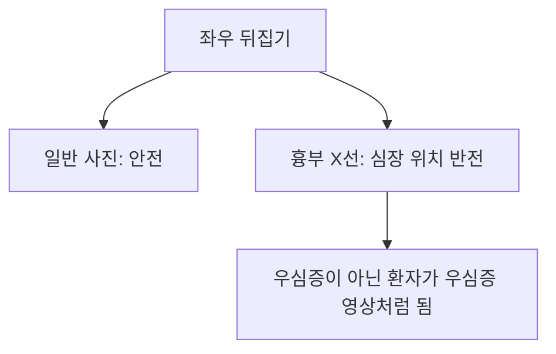
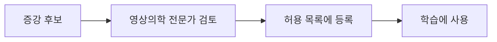

# 의료 영상 뒤집기 위험

> 좌우 뒤집기(horizontal flip)는 일반 사진에서 안전한 증강이지만, **의료 영상에서는 해부학적 좌우가 의미를 갖기 때문에** 라벨이 달라지거나 현실에 없는 영상을 만들 수 있다. 의료 영상 증강은 영상의학 전문가와 상의해 허용 목록으로 관리한다.

## 쉽게 말하면
고양이 사진을 거울에 비춰도 고양이다. 그러나 가슴 X선을 거울에 비추면 심장이 오른쪽에 있는 사람의 영상이 된다. 그런 사람은 극히 드물어서, 모델이 "심장은 왼쪽"이라는 정상 구조를 잘못 배우거나 현실에 없는 영상으로 훈련하게 된다.

## 자세히
(Chest X-ray COVID-19 연구들을 점검한 체크리스트 논문, arXiv 2012.08333 PDF 본문을 직접 읽음)
- 논문의 서술: CT·X선은 촬영 과정이 표준화돼 있어서 **회전·뒤집기 증강이 실제 데이터셋에는 자연스럽게 나타나지 않는 영상**을 만든다. 수평 뒤집기는 신중해야 하고 구체적인 제한이 있다.
- 제한점 두 가지(논문): ① 대부분의 병변은 좌우 폐에 비슷하게 나타나지만 **심장 모양이 바뀌는 경우(예: 우심증, dextrocardia)** ② **특정 폐엽에 영향을 주는 병변**은 폐 해부가 좌우 다르므로(예: 엽성 폐렴, 엽성 무기폐) 영향을 받는다. 이런 제한은 모델 설계에서 고려해야 한다.
- 다른 증강도 주의: 회전은 늑골횡격막각(costophrenic recess)이 이미지 밖으로 나갈 수 있어 신중해야 하고, 밝기·대비는 폐 구조가 가려지지 않게 제한적으로만 바꾼다. 확대·자르기로 폐만 남기는 것은 COVID-19 예측에서는 허용 가능하다고 한다.
- 핵심 권고: **모든 증강 방법은 영상의학 전문가와 상의**해야 하며, 연구 분야를 알지 못하면 문제를 푸는 대신 편향을 실수로 넣을 수 있다.
- 리뷰 측면: 논문은 리뷰한 연구들의 증강 평가 기준으로 수평 뒤집기를 쓴 경우 "N"으로 표시했다(안전하지 않은 사례로 취급).
- 실무(제안): ① 우심증 등 좌우 구조가 라벨에 영향을 주는 과제에서는 뒤집기를 끈다 ② 뒤집을 때 좌우 위치가 라벨인 경우 라벨(좌/우)도 함께 바꾼다 ③ 뒤집기 전후 표본을 전문가가 점검한다([증강 샘플 점검](#augmentation-sample-review)) ④ 효과는 검증 세트에서 측정한다. (이 글은 논문의 주장 요약이며 직접 실험이 아니다.)

## 그림으로 보기

## 예시
- 폐 병변의 좌/우 위치를 예측하는 모델: 뒤집기는 라벨(좌↔우)도 함께 바꿔야 한다.
- 교육: "라벨 보존 변환은 도메인이 정한다."

## 헷갈리는 것과 비교
| 개념 | 차이 |
|---|---|
| 일반 사진 뒤집기 | 라벨 보존, 안전 |
| 의료 영상 뒤집기 | 해부학 좌우가 의미, 주의 |
| [라벨 보존 변환](#label-preserving-transform) | 변환이 라벨을 바꾸지 않는지 판단하는 기준 |
| [증강 허용 목록](#augmentation-allowlist) | 도메인별 안전한 변환만 관리 |

## 더 읽을거리
- [Checklist for responsible deep learning modeling of medical images based on COVID-19 detection studies (arXiv 2012.08333)](https://arxiv.org/abs/2012.08333) — 증강의 의료적 안전성 논의(PDF 본문 읽음).
