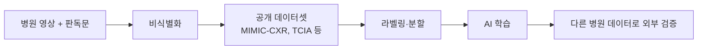

# 의료 영상 데이터셋

> 영상 AI 학습·평가에 쓰는 공개 의료 영상 모음. 접근 조건, 라벨 방식, 출처 병원의 편향이 성능과 일반화에 큰 영향을 준다.

## 쉽게 말하면
요리사가 한 가게의 재료만 써서 배우면 다른 시장에선 헤맨다. 영상 AI도 한두 병원의 사진으로만 배우면 다른 병원 장비에서 흔들린다.

## 자세히
출처: PhysioNet MIMIC-CXR 페이지와 TCIA 소개 페이지(2026-11-15 확인).
- **MIMIC-CXR**: 보스턴 Beth Israel Deaconess Medical Center의 흉부 X선. v2.0.0 기준 377,110장, 227,835건의 영상 검사. 각 검사에 방사선과 의사가 쓴 자유 문장 판독문이 있고(규칙 기반+신경망으로 비식별화), 영상 라벨 방법은 페이지에 서술이 없었다. **접근**: 자격 심사를 받은(credentialed) 사용자만, CITI 연구 윤리 교육 수료와 데이터 사용 계약(DUA) 서명이 필요. 라이선스 PhysioNet Credentialed Health Data License 1.5.0.
- **TCIA(The Cancer Imaging Archive)**: 2010년부터 암 관련 의료 영상을 비식별화해 공개. 현장 비식별화 후 TCIA가 2차 검토(DICOM PS3.15 기준). 대부분 공개 CC BY 4.0, 일부는 NIH 정책에 따른 제한 접근. Imaging Data Commons에서 DICOM 제공, 조직병리는 별도 포털. 주석·분할·방사체학 특징은 "분석 결과" 데이터셋으로 공개. NCI 암영상프로그램 후원, Frederick National Laboratory가 관리. 페이지에는 데이터 규모 수치가 없다.
- **데이터셋 선택 기준(일반 요령)**: 라벨의 출처(판독문 자동 추출은 노이즈가 있음), 환자·장비·병원의 다양성, 비식별화·라이선스, 학습/검증 분할의 환자 단위 분리, 시간적 분리 외부 검증.
- **편향 위험**: 단일 병원·단일 장비, 특정 인구 구성. 규제 심사에서도 다기관·하위 집단 평가가 중요([임상 근거](#clinical-validation-evidence)).

## 그림으로 보기

## 예시
- 흉부 X선 분류 모델: MIMIC-CXR로 사전 학습하고 자체 병원 데이터로 외부 검증. 접근 전 CITI 교육 수료와 DUA 서명 일정 확보.
- 종양 분할: TCIA에서 CC BY 4.0 컬렉션을 받아 DICOM 파이프라인으로 처리.

## 헷갈리는 것과 비교
| 개념 | 차이 |
|---|---|
| 공개 데이터셋 | 연구용 접근 가능 |
| 임상 검증 데이터 | 규제 제출용, 독립 수집 |
| [FDA AI 기기 목록](#fda-ai-enabled-device-list) | 허가 기기 명부(데이터셋 아님) |

## 더 읽을거리
- [PhysioNet: MIMIC-CXR](https://physionet.org/content/mimic-cxr/2.1.0/) — 규모·접근·라이선스
- [The Cancer Imaging Archive](https://www.cancerimagingarchive.net/about-the-cancer-imaging-archive-tcia/) — 비식별화·컬렉션 구조
