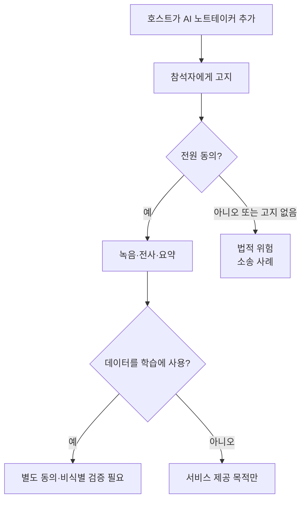

# 회의 AI 노트테이커

> Zoom·Teams·Meet 같은 화상 회의에 들어가 음성을 녹음·전사하고 요약·실행 항목을 뽑아 주는 AI 서비스(Otter, Fireflies, Granola 등). 편리하지만 **누구의 동의를 어떻게 받느냐**가 법적 쟁점이다. (법률 자문 아님)

## 쉽게 말하면
회의에 조용한 서기가 한 명 더 앉아 있는 것과 같다. 서기를 부른 사람은 알지만, 다른 참석자는 그 서기가 모든 말을 받아 적고 회사 서버로 보낸다는 사실을 모를 수 있다.

## 자세히
출처: IT월드 기사 두 편(열어서 확인). 소송은 모두 계속 중이며 위법 여부는 확정되지 않았다.
- **Otter.ai(Brewer v. Otter.ai, 2025-08 제기, 캘리포니아 연방법원)**: 동의 없는 통화·회의 녹음과 그 데이터로 음성 인식 AI를 학습한다는 혐의. 원고 주장: Notetaker는 호스트에게만 동의를 묻고, 초대 없이 Meet·Zoom·Teams에 들어가며, 참석자 목록에 일반 사용자처럼 표시되고, 설정을 바꾸지 않으면 개인정보 정책 링크가 없다. Otter는 사용자가 고지·동의 책임을 지며 학습은 비식별 데이터로 하고 사용자가 동의란을 체크한다고 반박했다. 이후 기사(2026년 중)는 판사가 주요 청구의 각하 신청을 기각했지만 범위는 줄었다고 전한다.
- **Fireflies(일리노이)**: 생체 음성 지문을 동의 없이 수집했다는 BIPA 위반 혐의. **Microsoft Teams(워싱턴주)**: 실시간 전사가 BIPA 위반이라는 혐의. **Granola**: 모든 참여자가 인지하지 못한 채 작동해 ECPA 위반, 대화 데이터를 동의 없이 학습에 썼다는 혐의(기사 기준 가장 최근).
- **설계 차이**: Granola는 워터마크·팝업 고지가 기본 꺼짐이고 켜는 책임은 사용자에게 있다. 원고는 Read가 비계정 참석자에게 녹음 중단 권한을 주는 점과 대비했다.
- **전문가 권고(기사 인용)**: 가장 엄격한 법 기준에 맞추고, 참석자 전원 동의(서면이 더 확실)를 받으며, 승인된 도구만 쓰고, 녹취록 활용 범위를 제한하는 내부 AI 노트 정책을 둔다. 고지만 하고 실질 동의가 없거나 몰래 녹음하는 방식은 피한다.
- **한국 맥락**: 참석자인 사용자가 직접 녹음하는 것은 [당사자 녹음 원칙](#party-recording-rule)상 대체로 허용된다고 보나, 업체 서버 전송·AI 학습은 [음성 개인정보](#voice-personal-data) 요건과 별개이며, 외국계 서비스에 대한 한국 판례는 확인하지 못했다.

## 그림으로 보기

## 예시
- 사내 정책: "고객사 회의에는 승인된 도구만 사용, 시작 시 구두 고지와 채팅 공지, 반대 시 녹음 중단, 전사본은 90일 후 삭제."
- 외부 미팅 안내 문구: "이 회의는 AI 도구로 녹음·요약됩니다. 원치 않으시면 알려 주세요."

## 헷갈리는 것과 비교
| 개념 | 차이 |
|---|---|
| [CIPA 소송](#cipa-lawsuits) | 캘리포니아 도청법 소송, 노트테이커 소송의 한 근거 |
| [당사자 녹음 원칙](#party-recording-rule) | 한국에서 참석자 본인 녹음의 법적 취급 |
| [전원 동의](#all-party-consent) | 미국 일부 주의 동의 규칙 |
| BIPA | 일리노이 생체정보법, 음성 지문이 쟁점 |

## 더 읽을거리
- [오터, 개인정보 침해 혐의로 집단소송 직면 (IT월드)](https://www.itworld.co.kr/article/4042642/오터-개인정보-침해-혐의로-집단소송-직면.html) — 소송 주장과 Otter의 동의 설계(열어서 확인)
- [동의 없는 녹음이 불러온 법정 다툼 (IT월드)](https://www.itworld.co.kr/article/4220445/동의-없는-녹음이-불러온-법정-다툼-ai-노트-필기-앱의.html) — 4개 업체 소송 비교와 권고(열어서 확인)
