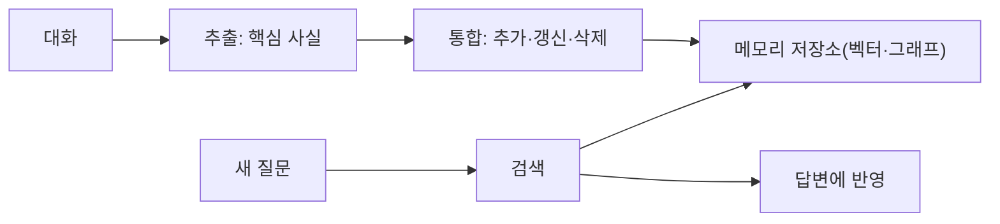
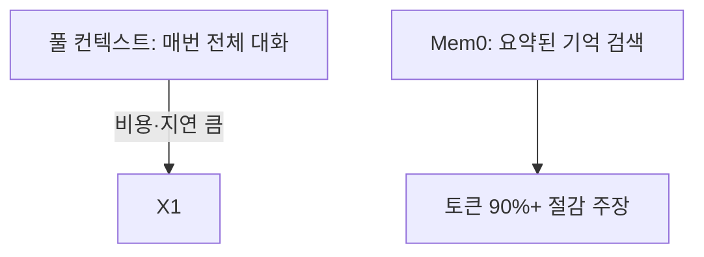

# Mem0

> **Mem0**는 대화에서 핵심 정보를 **추출·통합·검색**해 LLM이 여러 세션에 걸쳐 일관되게 답하도록 돕는 장기 메모리 시스템이다(arXiv 2504.19413, 2025-04).

## 쉽게 말하면
상담원이 고객과 통화할 때마다 전체 통화 녹취를 처음부터 다시 듣는 대신, 고객 카드에 "중요한 사실"만 정리해 두고 필요할 때 꺼내 보는 방식이다.

## 자세히
(논문 초록 확인, 갱신 방식은 검색 요약 기반)
- **구조**: 진행 중인 대화에서 핵심 정보를 동적으로 **추출·통합·검색**. 고정 컨텍스트 창을 넘는 장기 다중 세션 대화에서 응답 일관성을 목표로 한다. **그래프 메모리** 변형은 대화 요소 간 관계를 표현한다.
- **평가**: LOCOMO 벤치마크(단일 홉·시간·다중 홉·오픈 도메인 질문)에서 OpenAI 베이스라인 대비 LLM 심판 점수 **상대 26% 향상**, 그래프 변형은 기본 구성보다 약 **2%** 높다.
- **효율**: 전체 대화를 처리하는 풀 컨텍스트 방식 대비 **p95 지연 91% 감소**, **토큰 비용 90% 이상 절감**(OpenAI 대비 수치가 아님).
- **갱신 단계**: 새 사실을 추가·갱신·삭제할지 LLM이 결정한다는 보도가 있다. PyPI 안내(2026-04)에는 갱신·삭제 없이 **추가만** 하는 새 알고리즘이 소개된다(검색 요약만 확인).
- 점수는 저자·제품 측 보고이므로 내 데이터로 재검증해야 한다(권고).

## 그림으로 보기



## 예시
```python
from mem0 import Memory      # 개념 예시, 사용 전 공식 문서 확인
m = Memory()
m.add("저는 채식을 합니다", user_id="u1")
print(m.search("식당 추천해 줘", user_id="u1"))
```

## 헷갈리는 것과 비교
| 개념 | 차이 |
|---|---|
| Mem0 | 대화 기억 추출·검색 계층 |
| RAG | 외부 문서 지식 검색 |
| [LangGraph 스토어](#langgraph-store) | 프레임워크의 장기 저장소 |
| [오래된 메모리](#memory-staleness) | Mem0가 다루는 갱신 문제 |

## 더 읽을거리
- [Mem0: Building Production-Ready AI Agents with Scalable Long-Term Memory](https://arxiv.org/abs/2504.19413)
