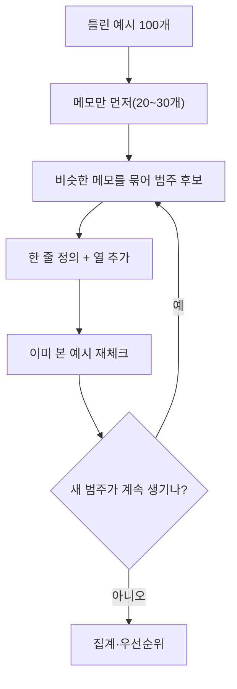
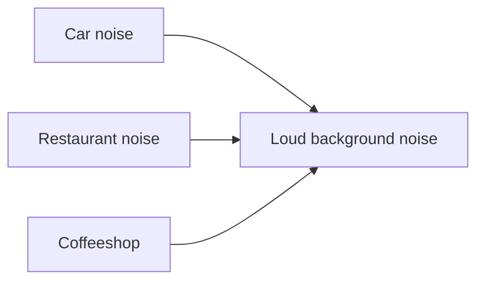

# 메모 먼저 범주화

> 오류 범주를 미리 정해 놓고 끼워 맞추지 말고, **틀린 예시를 보며 한 줄 메모(사유)를 먼저 적고, 반복되는 메모를 묶어 범주로 만든다.** 범주는 데이터를 보면서 만들어지고 바뀐다.

## 쉽게 말하면
고객 불만 메일을 읽으며 "배송 늦음", "상자 찌그러짐", "문자 안 옴" 같은 메모를 달다 보면 "배송 문제"라는 큰 묶음이 저절로 보인다. 처음부터 "불만 유형 5개"를 정해 두면 그 5개에 안 맞는 중요한 패턴을 놓친다.

## 자세히
- **Ng의 설명(Machine Learning Yearning 초안 15장, 본문 확인)**: 범주(개·큰 고양이·흐림)를 먼저 만들고 손으로 분류할 수도 있지만 "실제로는 예시를 보기 시작하면 새 오류 범주를 제안하고 싶어진다". 예: 열두 장쯤 보다가 인스타그램 필터 사진에서 오류가 많다는 걸 알고 "Instagram" 열을 추가한다. 사람이 그 사진을 어떻게/과연 맞힐 수 있었을지 자문하면 새 범주와 해결책이 떠오른다. 오류 분석은 **반복 과정**이라 처음에 범주가 없어도 괜찮고, 몇 장 보고 범주를 만들고, 분류하다 새 범주가 생기면 이미 본 예시를 새 범주로 다시 본다. 스프레드시트에는 별도의 **Comments(메모)** 열이 있다.
- **메모가 범주가 되는 예(Ng 16·26장 표)**: 훈련 세트 오디오 오류 분석에서 메모가 "Car noise", "Restaurant noise", "Coffeeshop"이면 공통 범주 "Loud background noise"(4개 중 3개 = 75%), "User shouting across living room?"은 "마이크에서 멂"(50%), "빠르게 말함"(25%)으로 묶인다. 한 예시가 여러 범주에 속할 수 있다([중복 오류 범주](#overlapping-error-categories)).
- **절차(권장)**
  1. 틀린 예시를 **무작위로 약 100개** 뽑는다([개발 세트 크기](#dev-set-size-for-small-differences)).
  2. 처음 20~30개는 **범주 없이 메모만** 적는다(원인 추정, 눈에 띄는 특징 한 줄).
  3. 메모를 훑어 비슷한 것끼리 묶어 **범주 후보 3~8개**를 만들고 한 줄로 정의한다([범주 정의 한 줄](#category-definition-one-liner)).
  4. 범주 열을 추가해 이미 본 예시까지 **처음부터 다시 체크**.
  5. 새 범주가 계속 생기면 반복, 거의 안 생기면 종료.
  6. "기타" 범주가 25%를 넘으면 메모를 다시 봐서 쪼갠다(경험 규칙, 근거 없는 권장).
- **좋은 메모**: 입력의 관찰(예: "문장 끝 반어"), 모델 행동(예: "숫자를 단위 없이 반환"), 사람 추정 원인. 나쁜 메모: "이상함", "틀림".
- **LLM 보조**: LLM에게 오류 예시와 메모를 주고 "공통 패턴을 5개로 묶어 이름을 붙여라"를 시키면 초안은 빠르지만 **범주를 사람이 검증**해야 한다(일반 주의).
- **함정**: 빈도가 높은 범주만 보고 상한(ceiling)을 과대 해석하지 않는다. 개선 가능성은 별도로 본다([상한 vs 효율](#improvement-efficiency-vs-ceiling)).

## 그림으로 보기

## 예시
- LLM 요약 오류 40건에 메모: "수치 누락", "날짜 틀림", "없는 인명 추가", "금액 단위 빠짐" → 범주 "수치·날짜 정보 오류"(4건 중 3건), "환각 추가"(1건).
- 표 구조: `id | 메모 | 범주1 | 범주2 | ...`

## 헷갈리는 것과 비교
| 방식 | 특징 |
|---|---|
| 하향식(범주 먼저) | 빠르지만 새 패턴 놓침 |
| 상향식(메모 먼저) | 데이터가 범주를 알려줌 |
| 반복 | 범주를 만들고 재체크 |
| [오류 분석 스프레드시트](#error-analysis-spreadsheet) | 이 과정을 담는 표 |

## 더 읽을거리
- [Andrew Ng, Machine Learning Yearning(초안 PDF) 15·26장](https://home-wordpress.deeplearning.ai/wp-content/uploads/2022/03/andrew-ng-machine-learning-yearning.pdf) — 반복적 범주 발견·Comments 열·오디오 오류 표(본문 열어 확인).
