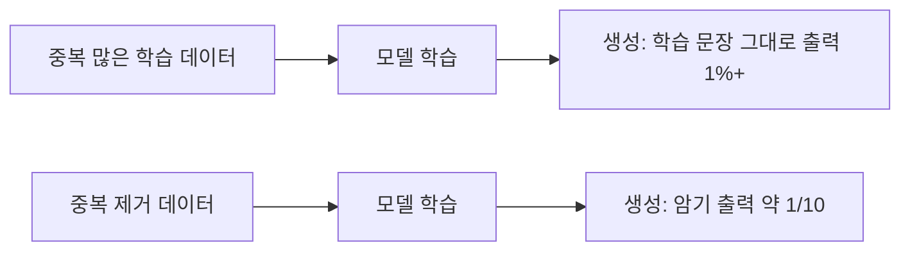
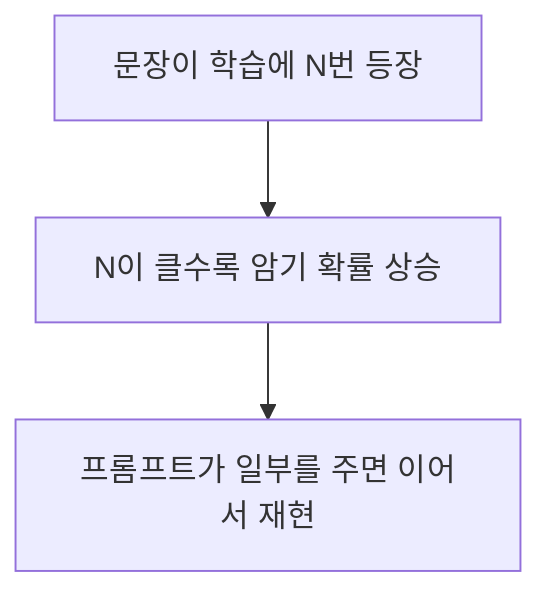

# 중복과 암기

> 학습 데이터에 **같은 문장이 여러 번 들어 있으면 모델이 그 문장을 그대로 외워 출력할 가능성이 커진다.** 중복을 제거하면 이런 "암기 출력"이 눈에 띄게 줄어든다.

## 쉽게 말하면
같은 광고 문구를 하루에 수십 번 들으면 나도 모르게 따라 말하게 된다. 한 번 들은 문장은 못 외워도 반복해서 들은 문장은 그대로 튀어나온다. 모델도 같은 구절을 많이 보면 통째로 외운다.

## 자세히
(Lee 외, arXiv 2107.06499 PDF 본문을 직접 읽음. 영어·C4 기반 소형 XL 모델 실험)
- 설정: 프롬프트 없이 모델에서 샘플 10만 개(각 최대 512토큰)를 생성하고, 생성 토큰이 **학습 데이터에 정확히 들어 있는 50토큰 부분 문자열의 일부**이면 "암기"로 셌다.
- 결과: 원본 데이터로 학습한 모델은 생성 토큰의 1% 넘게가 암기 구간이었고, 정확 부분문자열(ExactSubstr)·근접 중복(NearDup) 제거 데이터로 학습한 모델은 그보다 약 10배 적었다.
- 프롬프트를 주는 경우: 프롬프트가 학습 데이터의 중복 예제에서 나오면 원본 모델이 정답 이어쓰기를 40% 넘게 그대로 재현했다. 제거한 모델도 중복 예제 프롬프트에서 더 자주 베끼지만 훨씬 덜하다.
- 같은 논문의 한계 논의: 출처 표기는 여러 문서에 중복돼 있어 구간을 지우면 내용은 배우되 출처는 못 배울 수 있다. 중복 제거만으로는 비밀번호·진료 기록 같은 개인정보를 없앨 수 없다. 또 암기가 항상 해로운 것도 아니다(문서 검색·폐쇄형 질의응답은 암기가 필요).
- 요약: 중복 제거는 암기를 크게 줄이는 수단이지 프라이버시 해결책이 아니다. [개인정보 보호](#privacy-copyright)는 별도 처리가 필요하다.

## 그림으로 보기

## 예시
- 라이선스 문구·약관이 수만 번 반복된 데이터로 학습하면 빈 프롬프트에서도 그 문구가 튀어나온다.
- 교육: "한 번 읽은 글과 백 번 본 글의 차이"로 설명한다.

## 헷갈리는 것과 비교
| 개념 | 차이 |
|---|---|
| 암기 | 학습 문장을 그대로 재현 |
| 일반화 | 패턴을 배워 새 문장 생성 |
| [정확 부분문자열 제거](#exact-substring-dedup) | 암기를 줄이는 방법 |
| 개인정보 제거 | 중복 제거와 별개 과정 |

## 더 읽을거리
- [Lee 외, Deduplicating Training Data Makes Language Models Better](https://arxiv.org/abs/2107.06499) — 암기 측정 방식과 결과(본문 읽음).
