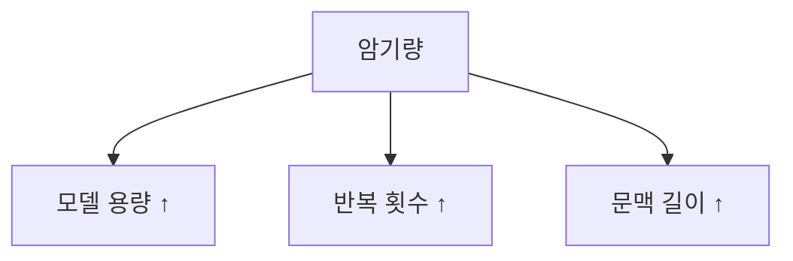
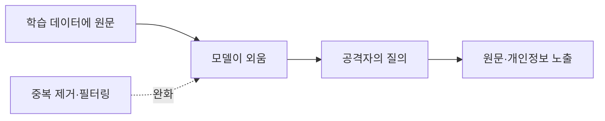

# LLM 암기

> 언어 모델이 학습 텍스트를 일반화해 이해하는 데 그치지 않고, 그대로(verbatim) 기억해 다시 내놓는 현상이다. 개인정보·저작물·시험 문제가 그대로 출력될 수 있어 프라이버시·저작권·평가 오염 문제와 연결된다.

## 쉽게 말하면
학생이 개념을 이해하지 않고 교과서 문단을 통째로 외워 시험지에 그대로 쓰는 것과 같다. 대부분의 문장은 이해로 풀지만, 자주 본 문장이나 아주 특이한 문장은 외워 버린다.

## 자세히
(arXiv 초록 3건을 직접 열어 확인.)
- **추출 공격(Carlini 등, arXiv 2012.07805)**: 공격자가 모델에 질의해 학습 예제를 그대로 되살릴 수 있다. GPT-2에서 **수백 개의 원문 시퀀스**를 추출했다. 개인 정보(이름·전화번호·이메일), IRC 대화, 코드, 128비트 UUID가 포함됐고, **학습 문서에 한 번만 나온 시퀀스도** 추출됐다.
- **세 가지 요인(arXiv 2202.07646)**: 암기량은 로그-선형 관계로 ① **모델 용량**(클수록) ② **학습 데이터 내 반복 횟수**(많을수록) ③ **프롬프트 문맥 길이**(길수록)에 따라 증가한다. 저자들은 암기가 "이전에 알려진 것보다 더 흔하며" 완화책이 없으면 모델이 커질수록 늘 가능성이 높다고 결론.
- **중복 제거와의 관계**: 중복을 제거하면 암기가 약 10배 줄어든다는 보고가 있다([정확 부분 문자열 제거](#exact-substring-dedup): 50토큰 암기 구간 비율 1.926%→0.138%).
- **왜 문제인가(제안)**: ① 프라이버시: 개인정보 노출 ② 저작권: 저작물의 그대로 재생 ③ 평가: 시험 문제를 외워서 점수가 부풀려짐([벤치마크 오염](#benchmark-contamination)과 연결).
- **완화(제안)**: 학습 전 중복 제거·PII 제거, 학습 중 차등 프라이버시, 학습 후 출력 필터링, 암기 탐지 평가를 릴리스 전에 수행.
- 주의: 이번 자료는 초록 수준이라 정량 곡선(예: 크기별 암기율)은 원문 확인이 필요하다.

## 그림으로 보기

## 예시
- 사내 문서로 파인튜닝한 모델에 "고객 이름: 김"까지만 입력하자 실제 고객 이메일이 이어 나오는 상황(가상 예). 학습 전 PII 마스킹과 반복 문서 제거가 필요.
- 교육 활용: 사내 챗봇을 만들 때 "학습시키면 밖으로 새어 나올 수 있다"는 위험을 설명하는 근거.

## 헷갈리는 것과 비교
| 개념 | 차이 |
|---|---|
| 암기 | 학습 텍스트를 그대로 재현 |
| 일반화 | 본 적 없는 입력에도 패턴을 적용 |
| [벤치마크 오염](#benchmark-contamination) | 시험 문제가 학습에 포함됨(암기의 원인 중 하나) |
| 환각 | 사실이 아닌 내용을 만들어 냄(암기와 반대 방향) |

## 더 읽을거리
- [Extracting Training Data from Large Language Models (arXiv 2012.07805)](https://arxiv.org/abs/2012.07805) — GPT-2 추출 공격(초록 확인).
- [Quantifying Memorization Across Neural Language Models (arXiv 2202.07646)](https://arxiv.org/abs/2202.07646) — 세 요인(초록 확인).
- [Deduplicating Training Data Makes Language Models Better (arXiv 2107.06499)](https://arxiv.org/abs/2107.06499) — 중복 제거와 암기(초록 확인).
