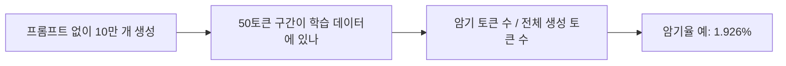
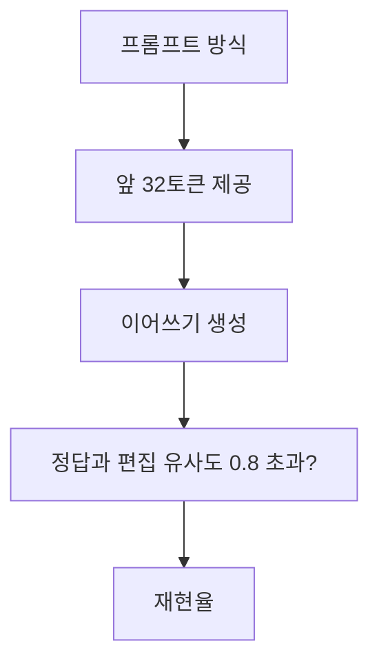

# 암기 측정 방식

> Lee 외(2021)는 모델에 프롬프트 없이 글을 많이 생성시킨 뒤, **학습 데이터에 그대로 들어 있는 50토큰 이상 구간에 속한 토큰의 비율**을 "암기율"로 쟀다. 정확 일치만 세므로 보수적인 하한에 가깝다.

## 쉽게 말하면
학생에게 아무 힌트 없이 글을 쓰게 한 뒤, 쓴 글에서 교과서와 한 글자도 안 틀리고 50단어 이상 같은 부분에 밑줄을 긴다. 전체 글 중 밑줄 친 단어 비율이 암기율이다. 비슷하게 바꿔 쓴 부분은 세지 않는다.

## 자세히
(ar5iv 본문 확인, 영어·C4·1.5B XL 모델)
- **무프롬프트 생성**: 10만 개 시퀀스, 각 최대 512토큰, top-k=50 샘플링. 생성 토큰이 학습 데이터에 정확히 있는 50토큰 부분 문자열에 속하면 암기 토큰. 보고값 = 암기 토큰 / 전체 생성 토큰.
- **일치 찾기**: 학습 데이터를 한 줄로 이어 접미사 배열을 만들고, 이웃 접미사의 공통 접두사가 50 BPE 토큰 이상이면 반복 구간으로 기록한다([접미사 배열](#suffix-array), [LCP](#lcp-array)).
- **50의 근거**: 일치 빈도에 약 10토큰 근처의 "무릎"이 있어 두 배로 보수적으로 잡았다고 논문이 밝힌다([50토큰 임계](#dedup-threshold-50-tokens)).
- **프롬프트 생성**: 예제의 앞 32토큰을 프롬프트로 주고, 생성한 이어쓰기와 정답 이어쓰기의 편집 유사도가 0.8을 넘는지 본다([편집 유사도](#edit-similarity)). 프롬프트 출처는 중복이 있는 학습 예제, 고유 학습 예제, 중복이 있는 검증 예제, 고유 검증 예제 네 가지.
- **직접 시뮬레이션**(파이썬 장난감, 임계 50 대신 20): 무작위 토큰 학습셋에 120토큰 구간을 하나 넣고, 생성 시퀀스 100개(각 512토큰) 중 5개가 그 구간을 그대로 복사. 암기 토큰 600/51,200 = 1.17%. 복사 구간 한가운데 토큰 하나를 바꾸면 595/51,200 = 1.16%로 거의 같았다. 구간이 양쪽 모두 임계보다 길면 한 토큰 변형으로 판정이 거의 안 바뀐다는 뜻이다. 이 값은 측정 로직을 보이는 예시이지 실제 모델 결과가 아니다.
- **한계(해석)**: 정확 일치만 세므로 의역한 암기는 못 잡는다. 따라서 실제 암기는 이 수치 이상일 수 있다. 샘플링 방식(top-k)에 따라 값도 달라진다.

## 그림으로 보기

## 예시
- 사내 모델 점검: 무프롬프트로 수천 개 생성해 학습 말뭉치(색인)와 대조, 암기 토큰 비율을 모델 버전별로 기록.
- 교육: 시뮬레이션 코드를 돌려 임계 길이를 바꾸면 암기율이 어떻게 달라지는지 비교하게 한다.

## 헷갈리는 것과 비교
| 개념 | 차이 |
|---|---|
| 무프롬프트 암기율 | 자연 생성에서 우연히 튀어나오는 정도 |
| 프롬프트 재현율 | 앞부분을 주고 뒷부분이 재현되는지 |
| [추출 공격](#extraction-attack-memorization) | 공격자가 의도적으로 암기를 끌어냄 |
| [중복과 암기](#memorization-from-duplicates) | 이 측정으로 본 중복 제거 효과 |

## 더 읽을거리
- [Deduplicating Training Data Makes Language Models Better](https://ar5iv.labs.arxiv.org/html/2107.06499) — 암기 측정 절·부록(열어 확인).
