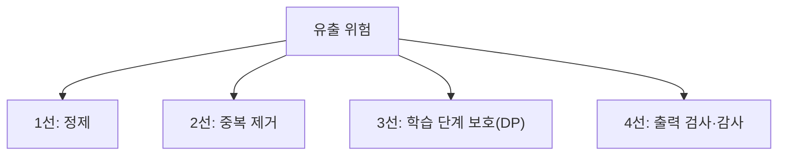

# 암기 완화 방법

> 언어 모델이 학습 문장을 그대로 내놓는 것을 줄이는 방법의 묶음이다. **학습 데이터 정제·중복 제거, 차분 프라이버시 학습, 출력 필터링, 감사**가 대표적이며, 어느 하나도 완전한 해법은 아니라서 겹쳐 쓴다.

## 쉽게 말하면
회사 기밀이 새지 않게 하려면 서류를 아예 안 두거나(데이터 정제), 같은 서류가 여기저기 복사되지 않게 하거나(중복 제거), 직원이 외울 수 없게 훈련하거나(차분 프라이버시), 나가는 문서를 검사하고(출력 필터), 정기 점검을 한다(감사). 한 가지만으로는 구멍이 남는다.

## 자세히
(Carlini 외 2021 arXiv 2012.07805의 "Mitigating Privacy Leakage in LMs" 절과 Lee 외 2021·Carlini 외 2023 본문을 직접 읽음)
1. **데이터 정제**: 개인정보·이용 제한 콘텐츠를 식별해 거른다. 추출된 민감 사례가 민감 정보가 많은 사이트(예: pastebin이 GPT-2 학습 세트에서 12번째로 많은 도메인) 출신이 많았으므로 **출처 선별**도 중요하다. 논문은 정제가 불완전하므로 "첫 방어선이지 완전한 예방이 아니다"라고 쓴다.
2. **중복 제거**: 문서·문단 단위 제거만으로는 한 문서 안의 반복이 남는다. Carlini 2021은 한 문서에 33번 삽입된 URL을 GPT-2 XL이 전부 외운 실험으로 반복의 위험을 보였다. Lee 외 2021은 중복 제거로 암기 출력이 약 10배 감소했다고 보고한다([중복과 암기](#memorization-from-duplicates)). 그러나 Carlini 2023은 몇 번만 중복돼도 암기는 일어난다고 한다.
3. **차분 프라이버시(DP) 학습**: DP-SGD 같은 변형으로 개별 기록의 영향을 수학적으로 제한한다. 단점은 정확도가 떨어지고 긴 꼬리 분포를 잘 못 배운다는 점이다(논문 설명).
4. **다운스트림 제한**: 미세조정이 사전 학습 암기를 일부 "잊게" 할 수 있지만 새 민감 데이터로 새 유출을 만들 수도 있다. 응용에서는 멤버십 추론으로 암기 의심 출력을 걸러 낼 수 있다(신뢰성 있게 탐지될 때).
5. **감사**: 완화 뒤에도 추출 공격 같은 방법으로 모델을 실제로 점검한다. DP를 써도 이론 상한을 보완하려고 감사가 필요하다.
- 논문 결론: 모든 방법이 약점이 있는 불완전한 해법이며, 모델이 클수록 유출이 심해질 것이므로 지금 다뤄야 한다. 2020~2023년 논문 기준이라 이후 개발된 방법은 반영되지 않았다.

## 그림으로 보기

## 예시
- 사내 문서로 미세조정하기 전에: PII 마스킹 → 문서 중복 제거 → 배포 전에 이름·전화번호 프롬프트로 추출 시험.
- 교육: "방어는 한 겹이 아니라 여러 겹"이라는 보안 원칙을 암기 문제에 적용해 가르친다.

## 헷갈리는 것과 비교
| 개념 | 차이 |
|---|---|
| 정제·중복 제거 | 데이터 쪽 대응, 싸고 효과 큼, 완전하지 않음 |
| 차분 프라이버시 | 학습 알고리즘 쪽, 수학적 보장 대신 성능 손실 |
| 출력 필터 | 사후 차단, 탐지 정확도에 의존 |
| [학습 데이터 추출 공격](#training-data-extraction-attack) | 완화 효과를 시험하는 도구 |

## 더 읽을거리
- [Extracting Training Data from Large Language Models (arXiv 2012.07805)](https://arxiv.org/abs/2012.07805) — 완화 전략 절(PDF 본문 읽음).
- [Deduplicating Training Data Makes Language Models Better (arXiv 2107.06499)](https://arxiv.org/abs/2107.06499) — 중복 제거 효과.
