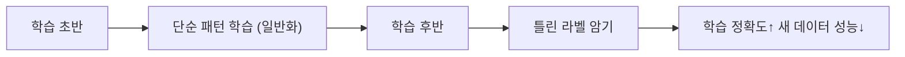
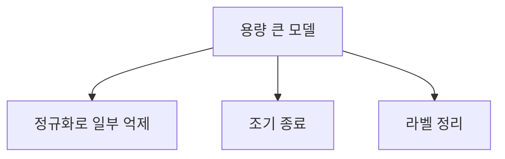

# 노이즈 라벨 암기

> 노이즈 라벨 암기는 충분히 큰 모델이 학습 데이터의 틀린 라벨까지 그대로 맞추도록 학습되는 현상이다. 학습 정확도는 100%에 가까워도 새 데이터에서는 성능이 떨어질 수 있다.

## 쉽게 말하면
시험 범위를 이해하지 않고 문제집의 정답을 통째로 외운 학생과 같다. 문제집의 오타 정답까지 그대로 외우므로, 처음 보는 문제에서는 틀린다.

## 자세히
- **무작위 라벨도 외운다(Zhang 외 2016, arXiv 1611.03530)**: 이미지 분류기가 SGD로 학습 데이터에 무작위로 붙인 라벨을 쉽게 맞추고, 이미지를 무작위 노이즈로 바꿔도 맞춘다. 명시적 정규화는 이 능력에 질적 영향을 거의 주지 못한다고 한다. 두 층 신경망도 파라미터 수가 데이터 수보다 많으면 어떤 유한한 표본도 완벽히 맞출 수 있다는 이론적 구성도 제시한다. 저자들은 용량 한계만으로 일반화를 설명할 수 없다고 주장한다.
- **그래도 단순한 패턴부터 배운다(Arpit 외 2017, arXiv 1706.05394)**: 깊은 신경망은 노이즈를 외울 수 있지만 단순한 패턴을 먼저 배운다. 노이즈 데이터와 실제 데이터에서 최적화 양상이 질적으로 다르고, dropout 같은 정규화는 실제 데이터 일반화는 유지하면서 노이즈 암기는 방해할 수 있다. 암기 정도는 학습 데이터 자체에 달려 있다.
- **라벨 정리와의 연결(해석)**: 모델이 학습 라벨을 외웠다면 학습 데이터에서 계산한 예측은 틀린 라벨을 그대로 따라가 오류를 감춘다. 그래서 라벨 오류 탐지는 교차 검증처럼 학습에 쓰지 않은(out-of-sample) 예측을 써야 한다([cleanlab 문서](https://docs.cleanlab.ai/stable/cleanlab/filter.html)).
- **완화책(해석)**: [조기 종료](#early-stopping-noise), [앙상블](#ensemble-noise-robustness), 라벨 정리, 정규화. 어느 것도 완전한 해법은 아니다.

## 그림으로 보기

## 예시
- 라벨 일부를 일부러 틀리게 섞은 CIFAR-10으로 학습하면 에폭이 늘수록 학습 정확도는 오르고 검증 정확도는 정체하거나 떨어진다(일반적 관찰, 직접 재현은 하지 않음).
- 교육 활용: 외우기와 이해하기의 차이를 비유로 설명하고 "학습 정확도 100%가 좋은 것인가?"를 토론한다.

## 헷갈리는 것과 비교
| 개념 | 차이 |
| --- | --- |
| 노이즈 라벨 암기 | 틀린 라벨까지 맞추는 현상 |
| 일반적인 과적합 | 학습 데이터 특이점에 맞춰짐(노이즈 라벨은 그 한 형태) |
| [조기 종료](#early-stopping-noise) | 암기 전에 멈춤 |
| [앙상블](#ensemble-noise-robustness) | 여러 모델 평균 |

## 더 읽을거리
- [Understanding deep learning requires rethinking generalization (arXiv 1611.03530)](https://arxiv.org/abs/1611.03530) — 무작위 라벨 암기 실험
- [A Closer Look at Memorization in Deep Networks (arXiv 1706.05394)](https://arxiv.org/abs/1706.05394) — 단순 패턴 우선 학습, 정규화 효과
