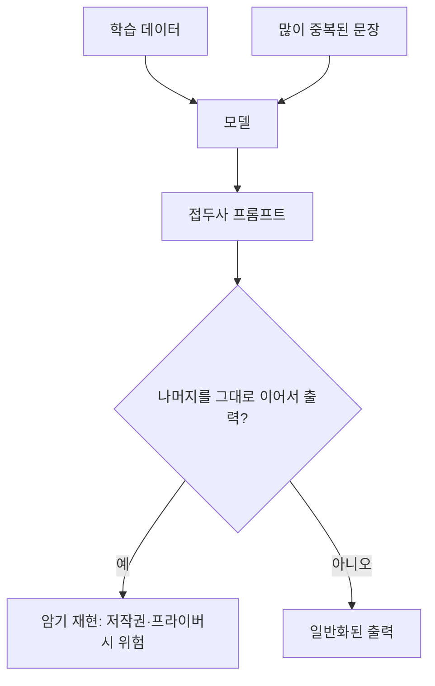
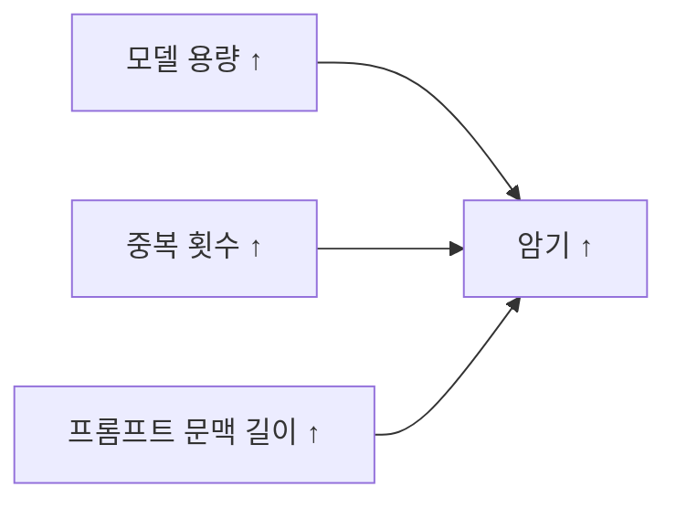

# 암기와 출력 침해

> 언어 모델이 학습 데이터의 문장을 **그대로 외워 두었다가 프롬프트에 따라 그대로 내놓는** 현상과, 그것이 저작권 침해·개인정보 노출·공정성 문제로 이어지는 위험이다. 모델 가중치가 복제물이냐는 법적 질문과 별개로, **출력 단계에서 원문이 재현되는지**는 사실의 문제다.

## 쉽게 말하면
책을 많이 읽은 사람이 요약은 자기 말로 하지만, 여러 번 읽은 구절은 그대로 외워 읊을 수 있다. 처음 몇 단어를 들려주면 나머지를 이어 말하는 식이다. 모델도 같아서, 많이 반복된 문장이 앞부분만 주어지면 그대로 이어서 나올 수 있다.

## 자세히
(Carlini 등 「Quantifying Memorization Across Neural Language Models」(arXiv 2202.07646, ICLR 2023) PDF를 직접 읽어 확인.)
- **측정 방식(논문)**: 학습 데이터에서 접두사(prefix)를 뽑아 모델에 주고, 모델이 나머지(접미사)를 **그대로 재현하는지** 확인해 암기량을 잰다. 모델의 학습 데이터에 접근할 수 있어 이전 연구보다 훨씬 정밀한 하한을 구했다고 한다. 예를 들어 이전 연구는 GPT-2에서 40GB 중 600개를 수작업으로 찾아 학습 데이터의 최소 0.00000015%가 암기됐다는 느슨한 하한을 세웠고, 이 논문은 **60억 파라미터 GPT-J가 학습 데이터 The Pile의 최소 1%를 암기**한다고 보인다.
- **세 가지 로그-선형 관계(논문 초록·본문)**: 암기는 (1) **모델 용량**(같은 모델 계열 안에서 큰 모델이 작은 모델보다 2~5배 더 암기), (2) **중복 횟수**(많이 반복된 예시일수록 추출되기 쉬움), (3) **프롬프트 문맥 길이**(긴 문맥을 주면 훨씬 쉽게 추출, 자릿수 단위로 차이)에 따라 커진다. 논문은 여러 모델 계열에 일반화하면 상황이 더 복잡해진다고도 한다. 모델이 커질수록 완화 조치가 없으면 암기가 더 나빠질 가능성이 높다고 결론 낸다.
- **중복 제거의 효과와 한계(본문)**: 몇 번만 반복된 문자열은 거의 재현되지 않지만 **고도로 중복된 문자열은 확률이 급격히 높아진다**. 데이터 중복 제거가 암기를 줄인다는 이전 연구와 맞는 결과이지만, **중복이 몇 개뿐이어도 암기는 일어나므로 중복 제거만으로 유출을 완전히 막지는 못한다**고 논문이 밝힌다.
- **위험의 종류(논문 서두의 분류)**: 암기는 개인 정보 노출(프라이버시), 품질 저하(반복되는 외우기 쉬운 글은 저품질인 경우가 많음), 공정성(어떤 텍스트는 다른 것보다 더 암기됨)에 해를 준다고 정리한다.
- **저작권 관점(제안)**: 저작물이 출력에 그대로 재현되면 출력 자체가 복제로 문제 될 수 있고, 이 쟁점은 가중치가 복제물이냐는 문제([모델 가중치는 개작인가](#model-weights-derivative-question))와 구분된다. 영국 Getty 판결이 가중치가 침해 복제물이 아니라고 본 것은 이 출력 재현 문제를 다루지 않았다(상위 노드 설명).
- **완화(제안, 논문이 시사하는 방향)**: ① 학습 데이터 **중복 제거**([근접 중복 제거](#near-duplicate-removal)) ② 모델 크기·학습 횟수 조절 ③ 출력 필터(긴 원문 일치 검사) ④ **암기 감사**: 학습 데이터에서 접두사를 뽑아 모델이 이어 쓰는지 점검 ⑤ 민감 데이터는 학습 전 제거([학습 데이터 속 개인정보](#pii-in-training-data)) ⑥ 긴 문맥 프롬프트에서의 재현을 별도로 시험.
- **한계**: 논문의 수치는 GPT-Neo, GPT-J 같은 공개 모델 계열과 The Pile 등 데이터에서 잰 것이고 최신 대형 상용 모델에 그대로 일반화되지 않는다. 이번에 논문 본문의 모든 수치를 확인한 것은 아니다.

## 그림으로 보기

## 예시
- 사내 코드 모델의 암기 감사: 학습 코드에서 앞 50토큰을 프롬프트로 주고 이어지는 100토큰이 그대로 나오는 비율을 측정, 라이선스가 있는 코드나 비밀키가 나오면 데이터에서 제거.
- 교육 소재: "AI가 외운 문장을 그대로 말할 때"를 접두사 이어쓰기 퀴즈로 체험(AI 리터러시).

## 헷갈리는 것과 비교
| 개념 | 차이 |
|---|---|
| 암기와 출력 침해 | 출력이 학습 원문을 재현하는 문제 |
| [모델 가중치는 개작인가](#model-weights-derivative-question) | 가중치 파일의 법적 지위 |
| [근접 중복 제거](#near-duplicate-removal) | 암기를 줄이는 데이터 처리 |
| [학습 장소와 관할](#territorial-training-location) | 어느 나라 법이 적용되나 |

## 더 읽을거리
- [Quantifying Memorization Across Neural Language Models (arXiv 2202.07646)](https://arxiv.org/abs/2202.07646) — 모델 크기·중복·문맥 길이와 암기의 로그-선형 관계(PDF 직접 확인).
