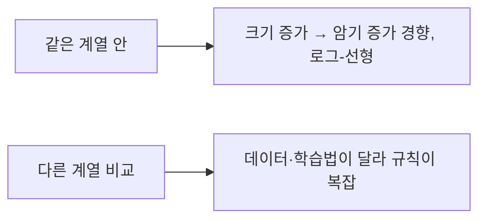
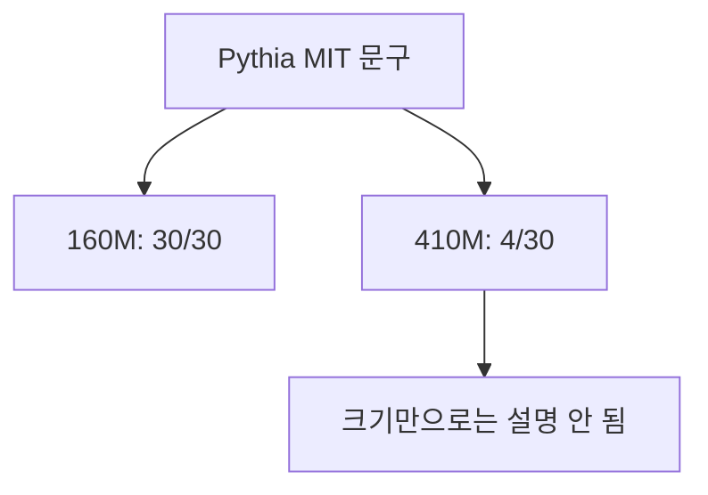

# 모델 계열별 암기 차이

> "모델이 클수록 더 외운다"는 규칙은 **같은 계열(같은 데이터·같은 학습법) 안에서** 비교할 때 깔끔하다. 계열이 다르거나 학습 방식이 다르면 규모와 암기량의 관계가 복잡해진다.

## 쉽게 말하면
같은 학원에서 같은 교재로 공부한 학생들은 공부 시간이 길수록 더 외운다. 하지만 서로 다른 학원 학생을 비교하면 교재·시험 범위가 달라서 "누가 얼마나 외웠나"를 키나 나이로 설명할 수 없다.

## 자세히
- **논문의 단서**(Carlini 외 2022, arXiv 2202.07646 초록 확인): 암기는 모델 크기에 따라 로그-선형으로 늘지만 **모델 계열을 가로지르면 결과가 더 복잡해진다**고 저자들이 밝힌다.
- **직접 실행**(Hugging Face 모델 6종, 그리디, 앞 12토큰만 주고 뒤 30토큰 중 원문과 같은 토큰 수; 텍스트 5개, 각 1회). Pythia는 같은 공개 데이터를 같은 순서로 학습시킨 16개 모델 묶음(70M~12B)이다(arXiv 2304.01373 초록 확인). GPT-2는 다른 계열이다.

| 모델(파라미터) | MIT | Apache | 헌법 전문 | GPL | 게티즈버그 |
|---|---|---|---|---|---|
| distilgpt2 (82M) | 6 | 1 | 3 | 21 | 0 |
| gpt2 (124M) | **30** | **30** | 1 | **30** | 0 |
| gpt2-medium (355M) | 30 | 26 | **30** | 30 | 2 |
| pythia-70m | 0 | 4 | 0 | 30 | 2 |
| pythia-160m | 30 | 4 | 1 | 2 | 0 |
| pythia-410m | **4** | 4 | **30** | **2** | 1 |

- **GPT-2 계열 안**: 82M → 124M → 355M으로 갈수록 대체로 많이 재현했다(MIT 6→30→30, 헌법 3→1→30). 완전히 단조는 아니다(Apache는 355M이 26/30).
- **Pythia 계열 안**: 규모 순서가 뒤집힌다. MIT 문구는 160M은 30/30인데 **410M은 4/30**, GPL은 70M이 30/30이고 160M·410M은 2/30. 더 큰 모델이 덜 외운 것처럼 보인다.
- **해석(가설)**: 크기만으로 암기가 정해지지 않는다. 학습 데이터에 그 문구가 몇 번, 어떤 변형(버전·줄바꿈)으로 들어 있었는지, 학습 순서·토큰 수가 영향을 줄 수 있다. 또 그리디 일치는 **변형 하나**만 달라도 크게 달라지는 민감한 측정이다. 이 실험은 텍스트 5개·1회라 통계가 아니고 원인 규명도 하지 않았다.
- **실무 함의**: "작은 모델은 안전하다"·"큰 모델이 더 위험하다"를 일반화하지 말고, **내 모델·내 데이터로 직접 점검**한다([암기 측정](#memorization-measurement-50token), [여러 길이 프롬프트](#discoverability-phenomenon)).

## 그림으로 보기

## 예시
- 모델 도입 심사: 후보 모델 3종에 같은 약관 문구 10개를 프롬프트해 재현 수를 비교한다. 크기가 아니라 결과로 판단.
- 교육: 위 표의 이상한 칸(410M MIT)을 찾아 가설을 세워 보는 토론.

## 헷갈리는 것과 비교
| 개념 | 차이 |
|---|---|
| 같은 계열 스케일링 | 통제된 비교, 규칙이 선명 |
| 계열 간 비교 | 학습 데이터·순서·토크나이저가 달라 비교 어려움 |
| [암기의 세 요인](#memorization-three-factors) | 크기·반복·문맥 요인 |
| [발견 가능성](#discoverability-phenomenon) | 프롬프트 길이에 따라 달라지는 측정 |

## 더 읽을거리
- [Quantifying Memorization Across Neural Language Models](https://arxiv.org/abs/2202.07646) — 계열 간 결과가 복잡하다는 서술(초록 확인).
- [Pythia: A Suite for Analyzing Large Language Models](https://arxiv.org/abs/2304.01373) — 같은 데이터·순서로 학습한 모델 묶음(초록 확인).
