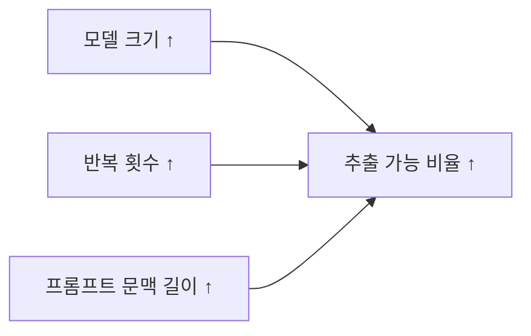
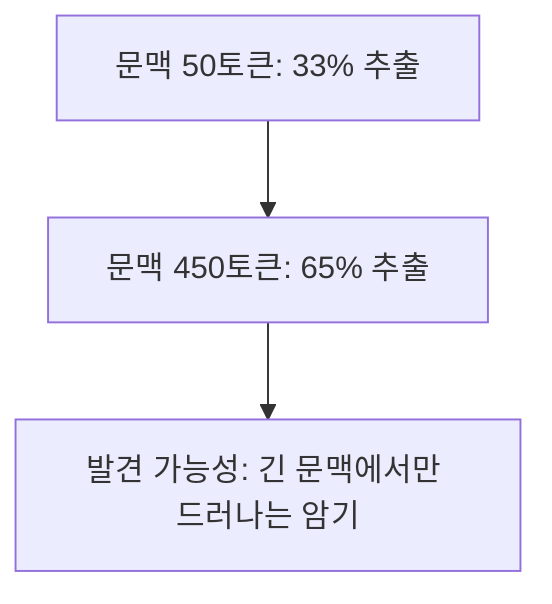

# 암기의 세 요인

> 언어 모델이 학습 문장을 그대로 내놓는 정도는 **모델 크기, 문장이 반복된 횟수, 프롬프트에 준 문맥 길이** 세 가지가 클수록 커지고, 각각 로그 단위로 일정하게(log-linear) 늘어난다.

## 쉽게 말하면
노래 가사를 외우는 것과 같다. 기억력이 좋은 사람(큰 모델)일수록, 같은 노래를 많이 들을수록(반복), 첫 소절을 길게 들려줄수록(문맥) 뒷부분을 줄줄 이어 부른다.

## 자세히
(Carlini 외, ICLR 2023, arXiv 2202.07646 PDF 본문을 직접 읽음. GPT-Neo 계열·The Pile 기준)
- 정의: 어떤 문자열 s가 모델 f에서 **k 토큰 문맥으로 추출 가능**하다는 것은, 학습 데이터에 `[앞 k토큰 + s]`가 있고, 모델이 앞 k토큰을 프롬프트로 받아 **그리디 디코딩**하면 s를 그대로 내놓는 경우다. 논문은 50토큰 접미사를 기준으로 삼았다(약 127자, 25단어).
- ① 모델 크기: 큰 모델이 학습 데이터를 더 많이 외운다. 근사 직선의 R²가 99.8%이고 **모델 크기 10배 증가당 암기 약 19%p 증가**. 학습 데이터가 다른 GPT-2 계열을 같은 프롬프트로 시험한 기준선은 늘지 않아, 단순히 일반화가 좋아진 효과가 아님을 보였다.
- ② 반복 횟수: 2~900번 반복된 문장 버킷(버킷당 1,000문장)에서 반복이 많을수록 추출 확률이 로그 선형으로 커진다. 적게 반복된 문장은 거의 안 외우지만 **몇 번만 중복돼도 암기는 일어나므로 중복 제거로 유출을 완전히 막지 못한다**고 논문은 쓴다([중복과 암기](#memorization-from-duplicates)).
- ③ 문맥 길이: 6B 모델에서 문맥 50토큰이면 평가 시퀀스의 33%, 450토큰이면 65%가 추출 가능했다. 논문은 이를 **발견 가능성(discoverability)** 현상이라 부른다: 어떤 암기는 충분히 긴 문맥을 줄 때만 드러난다. 따라서 짧은 프롬프트로 "안 외웠다"고 결론 내리면 안 된다.
- 한계: 논문은 모델 계열을 바꾸면 상황이 더 복잡해진다고 인정한다. 위 숫자는 이 계열·측정법의 값이다. 초록은 암기가 스케일과 함께 더 심해질 것으로 본다(완화 없이는).

## 그림으로 보기

## 예시
- 사내 모델 점검: 이름·계약 문구 앞부분을 짧게 줘서 안 나온다고 안심하지 말고, 길게 준 프롬프트로도 시험한다.
- 교육: 로그 단위 증가를 "10배 커질 때마다 19%p"라는 한 줄로 설명한다.

## 헷갈리는 것과 비교
| 개념 | 차이 |
|---|---|
| 추출 가능(extractable) | 특정 프롬프트에서 그대로 재현 |
| [학습 데이터 추출 공격](#training-data-extraction-attack) | 프롬프트를 모르는 상태에서 찾는 공격 |
| 일반화 | 새 입력에 잘 맞춤, 암기와 별개로 측정 |

## 더 읽을거리
- [Quantifying Memorization Across Neural Language Models (arXiv 2202.07646)](https://arxiv.org/abs/2202.07646) — 세 요인과 숫자의 원문(PDF 본문 읽음).
