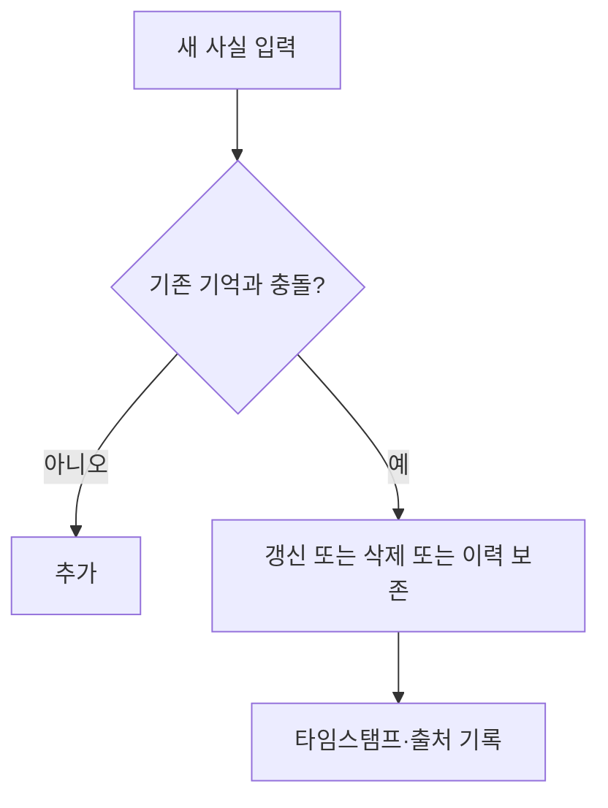
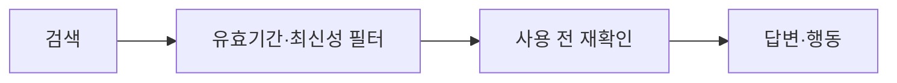

# 오래된 메모리 문제

> 에이전트의 장기 기억은 시간이 지나면 **낡거나 서로 모순**된다. 새 사실로 **갱신·삭제**하거나, 유효기간과 출처를 달아 **검색 시점에 걸러내는** 설계가 필요하다.

## 쉽게 말하면
주소록에 이사 간 친구의 옛 주소와 새 주소가 둘 다 남아 있으면, 편지를 엉뚱한 곳에 보낸다. 기억도 "지금 유효한가"를 관리해야 한다.

## 자세히
- **Mem0**(Chhikara 외, arXiv 2504.19413 초록 확인): 대화에서 핵심 정보를 **추출→통합→검색**하는 메모리 시스템. LOCOMO 벤치마크(단일·시간·다중 홉·오픈 도메인 질문)에서 OpenAI 베이스라인 대비 LLM 심판 점수 **상대 26% 향상**, 그래프 메모리 변형은 약 2% 더 높다. 전체 대화를 매번 넣는 방식 대비 **p95 지연 91% 감소, 토큰 비용 90% 이상 절감**(OpenAI 대비 수치가 아님).
- **갱신 방식**: 검색 요약(VentureBeat 인용)에 따르면 LLM이 새 사실을 **추가·갱신·삭제**할지 판단한다. 한편 PyPI 안내에는 2026-04 신 알고리즘이 갱신·삭제 없이 **추가만(ADD-only)** 하고 기억이 누적된다고 적혀 있다(검색 요약만 확인, 낡은 기억은 검색 단계에서 처리한다는 추정은 미확인).
- **설계 선택지**(일반 지식·권고): ① 덮어쓰기(최신만 유지, 이력 소실) ② 누적+타임스탬프(최신 우선 검색) ③ 유효기간·망각 정책 ④ 중요한 사실은 사용 전 재확인. 모순 감지 시 사용자에게 확인하는 단계를 둔다.
- 위험: 낡은 기억을 "사실"로 믿고 행동. 악의적으로 심은 기억은 [메모리 오염](#memory-injection) 문제.

## 그림으로 보기

## 예시
- 고객이 "배송지를 부산으로 바꿔 달라"고 하면 이전 서울 주소를 삭제하지 않고 이력으로 남기되 현재 값만 검색되게 한다.
- 가격·정책 정보는 90일이 지나면 "확인 필요" 표시.

## 헷갈리는 것과 비교
| 개념 | 차이 |
|---|---|
| 메모리 낡음 | 악의 없이 정보가 시대에 뒤처짐 |
| [메모리 오염](#memory-injection) | 악의적 삽입 |
| 컨텍스트 압축 | 대화 내용을 요약 |
| [메모리 종류](#memory-types) | 어떤 기억을 두는가 |

## 더 읽을거리
- [Mem0: Production-Ready AI Agents with Scalable Long-Term Memory](https://arxiv.org/abs/2504.19413)
