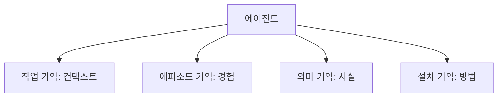
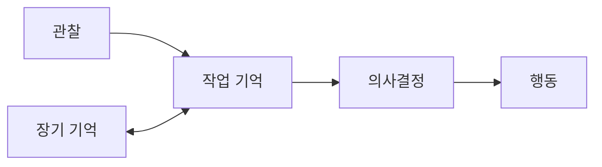

# 메모리 종류(단기·장기·절차)

> 에이전트의 메모리는 **지금 작업용(단기)**, **경험·사실 저장(장기: 에피소드·의미)**, **하는 법(절차)** 으로 나눠 설계한다. 인지과학에서 빌려 온 구분이다.

## 쉽게 말하면
책상 위 메모지(단기), 일기장과 백과사전(장기), 자전거 타는 몸의 감각(절차)이 서로 다르듯, 에이전트도 용도별로 기억을 나눠 두면 필요한 것만 꺼내 쓸 수 있다.

## 자세히
- **CoALA**(Sumers 외, arXiv 2309.02427 초록 확인): 인지과학·기호 AI에서 착안한 언어 에이전트 프레임워크로 **모듈형 메모리**, 내·외부 환경에 작용하는 **구조화된 행동 공간**, 다음 행동을 고르는 **일반 의사결정 과정**의 세 요소로 기존 에이전트를 정리한다. 초록은 메모리 모듈의 이름을 적지 않는다.
- 일반적인 분류(논문 본문 미확인, 일반 지식):
  | 종류 | 담는 것 | 구현 예 |
  |---|---|---|
  | 작업(단기) | 현재 대화·계획 | 컨텍스트 윈도우 |
  | 에피소드 | 과거 경험 사건 | 대화 로그, 벡터 DB |
  | 의미 | 사실·선호 | 프로필, 지식 그래프 |
  | 절차 | 수행 방법·규칙 | 프롬프트, 스킬 파일 |
- 낡은 기억 처리와 오염 위험은 별도 노드에서 다룬다([오래된 메모리](#memory-staleness), [메모리 주입](#memory-injection)).

## 그림으로 보기

## 예시
- 고객 상담 에이전트: 이번 대화(단기), 이 고객의 과거 문의(에피소드), 고객 등급 정책(의미), 환불 처리 절차 문서(절차).
- Claude Code의 `CLAUDE.md`는 절차·선호 기억의 한 형태로 볼 수 있다(해석).

## 헷갈리는 것과 비교
| 개념 | 차이 |
|---|---|
| 컨텍스트 윈도우 | 단기 기억, 용량 한도 |
| RAG | 장기 지식을 검색해 가져오기 |
| 파인튜닝 | 가중치에 지식을 굳히기 |

## 더 읽을거리
- [Cognitive Architectures for Language Agents (CoALA)](https://arxiv.org/abs/2309.02427) — 프레임워크 논문 초록.
