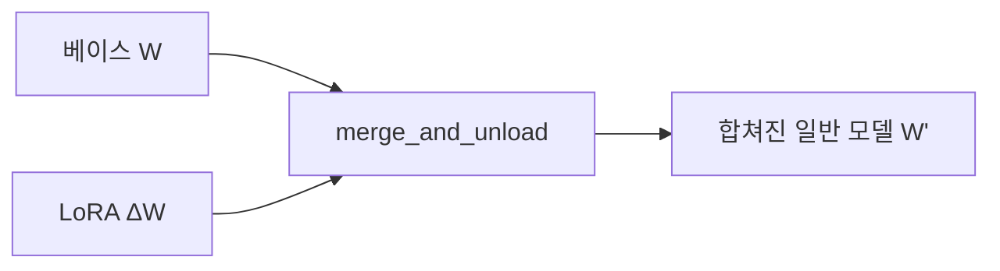
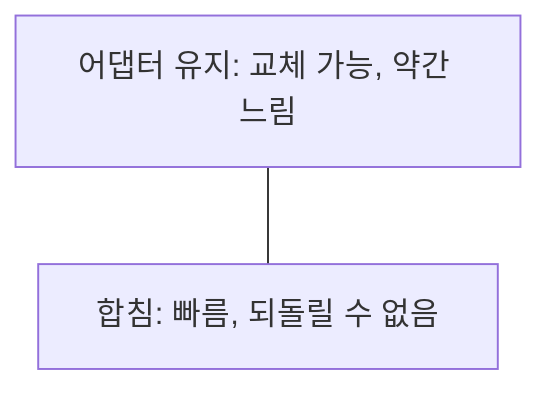

# merge_and_unload

> PEFT의 `merge_and_unload()`는 학습된 LoRA 가중치를 베이스 모델 가중치에 영구적으로 합치고 어댑터 래퍼를 제거해 평범한 모델로 돌려주는 함수다.

## 쉽게 말하면
포스트잇(LoRA)을 책 본문에 인쇄로 합쳐 새 책을 찍는 것과 같다. 이후엔 포스트잇 없이 한 권으로 읽혀 빠르고 배포가 쉽다. 다만 포스트잇을 다시 떼어 낼 수는 없다.

## 자세히
- 개념: LoRA는 `W + (α/r)·B·A` 형태의 업데이트이므로, 이를 `W`에 더해 두면 추론 때 추가 연산이 없다(LoRA의 일반 원리).
- 사용 흐름: 어댑터 로드 → `model = model.merge_and_unload()` → 일반 `transformers` 모델로 `save_pretrained`.
- 장점: 추론 지연이 사라지고, PEFT 없이 배포 가능.
- 단점: 어댑터를 따로 교체·가중치 조절할 수 없다. 4비트 같은 양자화 모델에 합칠 때 정밀도 문제가 생길 수 있어 16비트로 불러 합치는 방식이 흔하다(이번에 문서로 확인하지 않은 일반 실무 지식).
- 여러 어댑터를 섞으려면 먼저 [TIES·DARE](#ties-dare-merging) 같은 병합으로 어댑터를 하나 만든 뒤 `merge_and_unload`를 쓴다.

## 그림으로 보기



## 예시
```python
from peft import PeftModel
model = PeftModel.from_pretrained(base, "my-lora")
merged = model.merge_and_unload()
merged.save_pretrained("merged-model")
```

## 헷갈리는 것과 비교
| 개념 | 차이 |
|---|---|
| merge_and_unload | 어댑터를 베이스에 영구 합침 |
| add_weighted_adapter | 어댑터끼리 합쳐 새 어댑터 생성 |
| [QLoRA](#qlora) | 학습 방식, 합침은 별도 단계 |

## 더 읽을거리
- [HF PEFT LoRA 가이드](https://huggingface.co/docs/peft/developer_guides/lora) — 병합 관련 항목.
- [HF PEFT Model merging](https://huggingface.co/docs/peft/developer_guides/model_merging) — 어댑터 병합.
