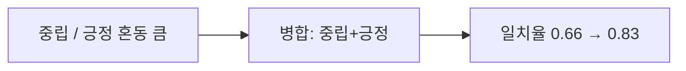
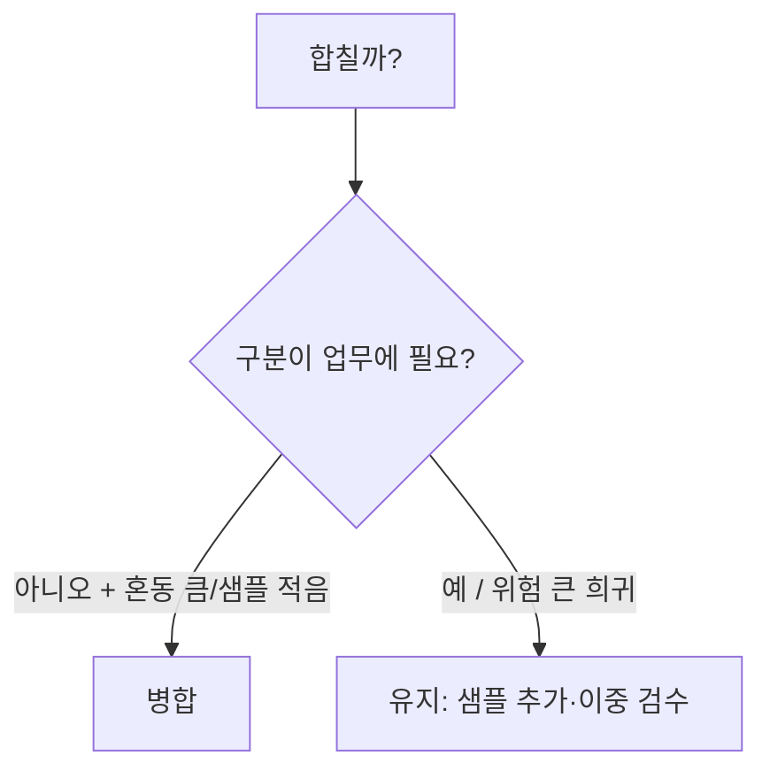

# 희귀 클래스 병합

> 희귀 클래스 병합은 샘플이 너무 적거나 서로 자주 혼동되는 클래스를 의미가 유지되는 범위에서 하나로 합쳐 라벨링 일치도와 학습·평가의 안정성을 높이는 방법이다. 합치면 구분 정보가 사라지므로 합치는 기준을 정해야 한다.

## 쉽게 말하면
식당 후기를 "매우 불만/불만/보통/만족/매우 만족"으로 나누기 어렵다면 "불만/보통/만족"으로 합치는 것과 같다. 세밀한 구분을 포기하는 대신 판정이 안정적이다.

## 자세히
- **직접 계산(앞서 본 [라벨러 간 혼동 행렬](#annotator-confusion-matrix)의 가상 300건 표, 두 라벨러의 3클래스(부정·중립·긍정) 일치율 0.66, kappa 0.491)**:

| 클래스 구성 | 일치율 | kappa |
| --- | --- | --- |
| 3클래스(부정/중립/긍정) | 0.660 | 0.491 |
| 중립+긍정 병합(부정 / 그 외) | 0.830 | 0.593 |
| 부정+중립 병합(그 외 / 긍정) | 0.783 | 0.537 |

  혼동이 가장 큰 쌍(중립↔긍정: 38건과 13건)을 합치자 일치율이 0.66→0.83, kappa가 0.491→0.593으로 올랐다. 합칠 쌍은 혼동 행렬의 큰 비대각선 칸에서 고른다. 병합으로 kappa가 크게 오르지 않는 것은 한 클래스가 커져 우연 일치도 함께 늘기 때문이다([kappa와 클래스 불균형](#kappa-class-imbalance)). (가상 데이터 계산이다.)
- **병합 기준(해석)**: ① 의미상 같은 상위 개념으로 묶인다(예: "배송 지연"+"배송 오류" → "배송 문제") ② 둘의 구분이 업무 결정에 필요 없다 ③ 샘플 수가 너무 적어 학습·평가에서 신뢰할 수 없다([폴드에 클래스가 빠질 때](#missing-class-in-fold), [클래스별 최소 보존](#min-examples-per-class)) ④ 혼동이 지침으로도 해결되지 않는다.
- **하지 말아야 할 때(해석)**: 위험이 큰 희귀 클래스(사기·안전 문제)는 적더라도 합치지 않는다. 합치면 가장 중요한 신호가 묻힌다. 대신 샘플을 더 모으거나 이중 검수·표본 확대를 쓴다.
- **운영(해석)**: 병합은 규칙 변경이므로 버전을 올리고 영향 분석·재라벨 절차를 따른다([규칙 변경 영향 분석](#impact-analysis-for-rule-change)). 필요하면 상위·하위 이중 라벨(계층)로 두어 나중에 다시 나눌 수 있게 한다.

## 그림으로 보기

## 예시
- 고객 문의 20개 유형 중 샘플 30개 미만인 4개 유형을 상위 "기타 문의"로 병합하되, "사기 의심"은 유지한다.
- 교육 활용: 혼동 행렬을 보고 병합할 쌍을 정한 뒤 일치율 변화를 계산한다.

## 헷갈리는 것과 비교
| 개념 | 차이 |
| --- | --- |
| 병합 | 클래스 수 감소, 구분 정보 손실 |
| 계층 라벨 | 상위·하위를 모두 보존 |
| [클래스별 최소 보존](#min-examples-per-class) | 표시된 오류 후보 삭제 시 하한 |
| [폴드에 클래스가 빠질 때](#missing-class-in-fold) | 샘플이 적을 때 생기는 문제 |

## 더 읽을거리
- [scikit-learn 모델 평가: confusion matrix](https://scikit-learn.org/stable/modules/model_evaluation.html#confusion-matrix) — 혼동 행렬 읽기
- [Interrater reliability: the kappa statistic (McHugh, 2012)](https://pmc.ncbi.nlm.nih.gov/articles/PMC3900052/) — 우연 일치와 kappa
