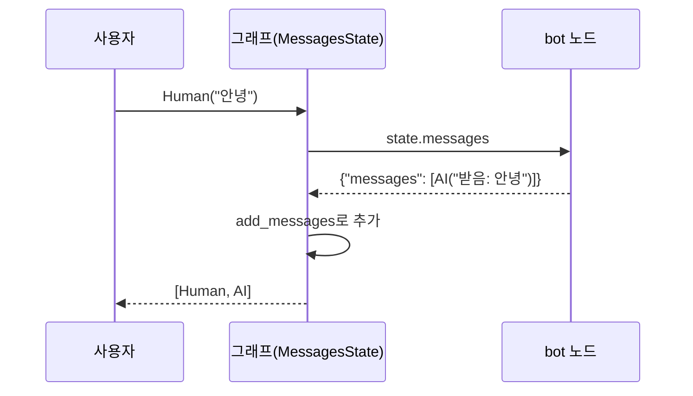
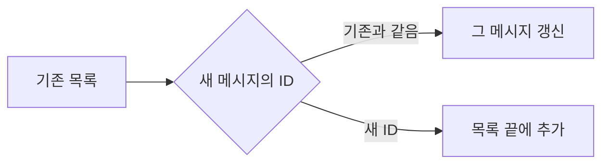

# MessagesState와 add_messages

> 챗봇처럼 **대화 메시지 목록을 상태로 들고 다니는** LangGraph 그래프를 위한 기본 부품. `MessagesState`는 `messages` 키 하나를 가진 미리 만들어진 상태이고, 그 키에는 새 메시지를 **추가**하고 같은 ID는 **갱신**하는 `add_messages` 리듀서가 붙어 있다.

## 쉽게 말하면
단체 채팅방 기록 같은 것이다. 새 발언은 맨 아래에 이어 붙고(추가), 누군가 "방금 그 말 수정할게요"라고 하면 같은 번호의 발언이 새 내용으로 바뀐다(갱신). 이 기록 관리 규칙이 `add_messages`다.

## 자세히
(LangGraph 공식 문서 Graph API + 직접 실행, langgraph 1.2.24)
- **`MessagesState`**: `messages` 키 하나를 가진 상태이며 `add_messages` 리듀서를 쓴다. 필요하면 **상속해서 필드를 더 추가**한다.
- **`add_messages`** 동작(문서): 새 메시지를 **추가**하고, 같은 **ID**의 메시지는 **기존 것을 갱신**한다. `operator.add`는 이어 붙이기만 가능하다([리듀서](#langgraph-reducer)).
- **직접 실행 결과**:

| 실험 | 결과 |
|---|---|
| 노드가 `AIMessage("받음: 안녕")`을 반환, 입력 `HumanMessage("안녕")` | 결과 `messages`: Human("안녕"), AI("받음: 안녕") — 각 메시지에 ID가 자동으로 붙음 |
| 입력을 튜플 `("user", "두번째")`로 | 메시지 객체로 변환되어 Human("두번째"), AI("받음: 두번째") |
| `add_messages([Human("원본", id="1")], [Human("수정됨", id="1")])` | `['수정됨']` (같은 ID → 갱신) |
| 같은 호출에서 `id="2"`인 "추가" | `['원본', '추가']` (다른 ID → 추가) |

- **왜 ID 갱신이 필요한가**: 사람 승인 후 메시지를 고치거나, 오래된 메시지를 삭제·요약으로 교체할 때 ID로 지목해 바꾼다.
- **노드 작성 요령**: 노드는 **새로 만든 메시지만** 반환한다(`{"messages":[AIMessage(...)]}`). 전체 목록을 다시 반환하지 않는다 — 리듀서가 알아서 합친다.
- **주의**: 메시지가 계속 쌓이면 컨텍스트가 커져 비용·한계 문제가 생기므로 요약·잘라내기를 설계한다([토큰 예산](#token-budget)).
- 한계: 버전별로 메시지 클래스(`langchain_core.messages`)와 약식 입력 형식이 달라질 수 있다.

## 그림으로 보기



## 예시
```python
from langgraph.graph import StateGraph, START, END, MessagesState
from langchain_core.messages import AIMessage

def bot(state: MessagesState):
    last = state["messages"][-1].content
    return {"messages": [AIMessage(content=f"받음: {last}")]}

g = StateGraph(MessagesState)
g.add_node("bot", bot); g.add_edge(START, "bot"); g.add_edge("bot", END)
app = g.compile()
print(app.invoke({"messages": [("user", "안녕")]})["messages"])
```

## 헷갈리는 것과 비교
| 개념 | 차이 |
|---|---|
| `MessagesState` | `messages` 키 하나+add_messages가 붙은 기본 상태 |
| 일반 `TypedDict` 상태 | 직접 키와 리듀서를 정의 |
| [리듀서](#langgraph-reducer) | 합치는 규칙 전반 |
| [LangGraph 상태](#langgraph-state) | 그래프가 들고 다니는 데이터 구조 |

## 더 읽을거리
- [LangGraph: Graph API](https://docs.langchain.com/oss/python/langgraph/graph-api) — MessagesState와 add_messages.
