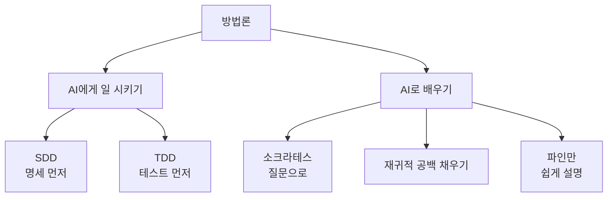
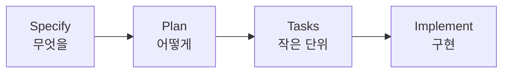

# 방법론

> AI와 일하고 AI로 배울 때 결과를 안정시키는 "일하는 방식" 모음. 도구가 아니라 **순서와 습관**이다.

## 쉽게 말하면
같은 요리사도 레시피 없이 즉흥으로 하면 들쭉날쭉하다. 먼저 레시피(명세)를 쓰고, 맛 기준(테스트)을 정하고, 모르는 부분은 질문으로 채우는 습관이 있으면 AI와도 일이 안정된다.

## 자세히
이 가지의 다섯 방법론은 두 부류다.
- **AI에게 일 시키는 방법**
  - [SDD(명세 주도 개발)](#sdd): 코드 전에 명세를 쓰고 AI가 거기서 구현. GitHub Spec Kit(오픈소스, MIT, 2025-09 공개)은 Specify → Plan → Tasks → Implement 단계를 게이트로 나눈다.
  - [TDD(테스트 주도 개발)](#tdd): 실패하는 테스트를 먼저 쓰고 통과시키는 순서. AI가 만든 코드를 검증할 기준이 생긴다.
- **AI로 배우는 방법**
  - [소크라테스 논증법](#socratic-method): AI가 답 대신 질문으로 이끌게 한다.
  - [재귀적 공백 채우기](#recursive-gap-filling): 모르는 부분을 찾아 쪼개고 반복해서 메운다.
  - [파인만 기법](#feynman-technique): 쉬운 말로 설명해 보며 막히는 곳을 찾는다.

공통점은 **"AI가 내 이해와 검증을 대신하지 않게 한다"** 는 것이다([리터러시](#literacy)와 연결).

## 그림으로 보기

## 예시
- 새 기능: 명세(spec.md) 작성 → AI에게 plan·tasks 생성 → 작업 하나씩 구현·테스트.
- 공부: "내가 이해한 걸 설명할 테니 틀린 곳만 질문으로 짚어 줘."

## 헷갈리는 것과 비교
| 개념 | 먼저 쓰는 것 | 목적 |
| --- | --- | --- |
| SDD | 명세 | 무엇을 만들지 합의 |
| TDD | 테스트 | 맞는지 자동 확인 |
| 파인만 | 쉬운 설명 | 내 이해의 구멍 찾기 |

## 더 읽을거리
- [GitHub Spec Kit](https://github.github.com/spec-kit/) — SDD 툴킷 공식 사이트
- [GitHub 블로그: Spec-driven development with AI (2025-09-02)](https://github.blog/2025-09-02-spec-driven-development-with-ai-get-started-with-a-new-open-source-toolkit/) — 소개 글
