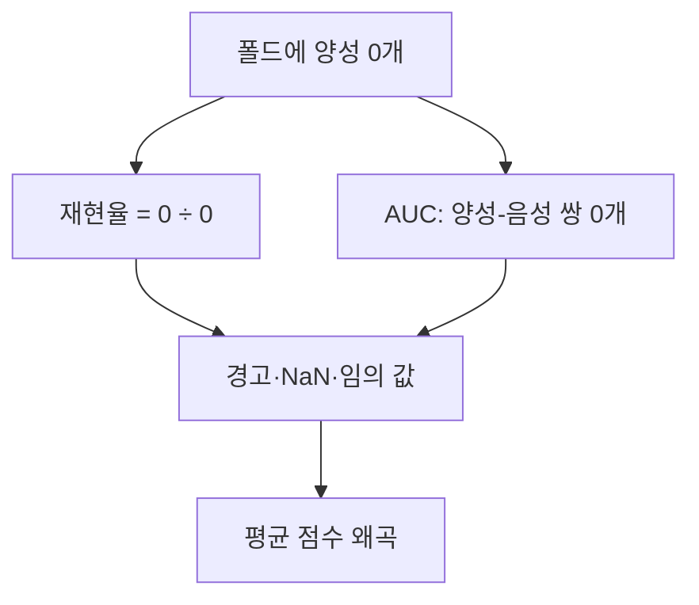

# 클래스 누락 시 지표 미정의

> 교차검증 폴드나 작은 평가 세트에 양성(또는 어떤 클래스)이 하나도 없으면 재현율·AUC 같은 지표는 0으로 나누는 계산이 되어 값이 정의되지 않는다. 이때 도구가 경고를 내고 NaN이나 0 같은 임의의 값을 채우면 평균 점수가 왜곡된다.

## 쉽게 말하면
"환자 중 몇 명을 찾아냈나(재현율)"는 환자가 한 명도 없는 병동에서는 계산할 수 없다. 이 병동의 점수를 0점으로 쳐서 평균에 넣으면 전체 평균이 부당하게 낮아지고, 100점으로 쳐도 부당하다.

## 자세히
- **어떤 지표가 깨지나(정의에서 따라오는 것, 직접 확인)**: 재현율 = TP ÷ (TP + FN)에서 실제 양성이 없으면 분모가 0이다. AUC는 양성과 음성의 모든 쌍을 비교하는 값이라 한쪽 클래스가 없으면 쌍이 0개라 정의되지 않는다. 앞선 [RepeatedStratifiedKFold](#repeated-stratified-kfold)의 직접 실험에서 양성 6개를 5겹으로 나누면 폴드에 양성이 1~2개뿐이라 AUC가 불안정했고, 일반 KFold에서는 양성이 없는 폴드도 생길 수 있다.
- **scikit-learn 문서 확인 범위(모델 평가 문서, 열람)**: F1은 참양성·거짓양성·거짓음성이 모두 없으면 정의되지 않으며 기본적으로 0으로 계산하고 `zero_division` 매개변수로 이 동작을 바꿀 수 있다고 한다. `class_likelihood_ratios`는 0으로 나누기가 발생하면 `UndefinedMetricWarning`을 내고 교차검증 폴드 평균을 오염시키지 않도록 기본적으로 NaN을 반환한다고 한다. `r2_score`는 목표가 상수이면 비유한 값이 되며 기본으로 완벽한 예측에는 1.0, 아니면 0.0으로 바꾸고 `force_finite=False`로 원래 정의(−inf)를 쓸 수 있다. 이번 조사에서 `roc_auc_score`가 한 클래스만 있을 때의 정확한 오류 문구와 정밀도·재현율의 `zero_division` 선택지(warn·0·1·NaN)는 문서에서 확인하지 못했다.
- **채우는 값에 따라 평균이 달라진다(해석)**: 정의되지 않은 폴드를 0으로 채우면 평균이 낮아지고, 1로 채우면 높아지며, 제외하면 남은 폴드만의 평균이 된다. 어떤 선택도 기본이 되지 못하므로 보고서에 방식을 적는다.
- **예방(해석)**: ① [층화 분할](#cv-splitter-selection)로 폴드마다 양성이 들어가게 한다 ② 폴드 수를 양성 개수에 맞춰 줄인다(양성이 6개면 5겹은 폴드당 1~2개뿐이라 위험) ③ [반복 층화 K겹](#repeated-stratified-kfold)이나 부트스트랩으로 변동을 본다 ④ 모든 폴드의 지표 값을 목록으로 출력해 NaN이나 이상치를 눈으로 확인한다.
- **원칙**: 지표가 정의되지 않았다는 사실 자체가 "표본이 너무 작다"는 신호다. 값을 채워 넣기보다 데이터를 늘리거나 평가 설계를 바꾼다.

## 그림으로 보기

## 예시
- 희귀 사건 40건뿐인 데이터를 10겹으로 나누면 폴드당 4건 정도라 일부 폴드의 AUC가 매우 불안정해진다. 5겹 층화 5번 반복으로 바꾼다.
- 교육 활용: 폴드별 지표를 표로 출력해 NaN이 하나라도 있으면 평균을 믿지 않는 습관을 가르친다.

## 헷갈리는 것과 비교
| 개념 | 차이 |
| --- | --- |
| [층화 K겹과 희귀 클래스](#n-splits-vs-rare-class) | 상위 주제 |
| 지표 값 0 | 계산은 되는데 못 맞힘. 미정의는 계산 자체가 안 됨 |
| [희귀 클래스 평가법](#rare-class-evaluation) | 극소수 클래스를 별도 지표로 평가 |
| `zero_division` | 일부 지표에서 0으로 나눌 때 값을 정하는 옵션 |

## 더 읽을거리
- [scikit-learn: Metrics and scoring](https://scikit-learn.org/stable/modules/model_evaluation.html) — F1의 `zero_division`, `class_likelihood_ratios`의 경고
