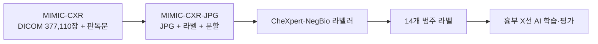
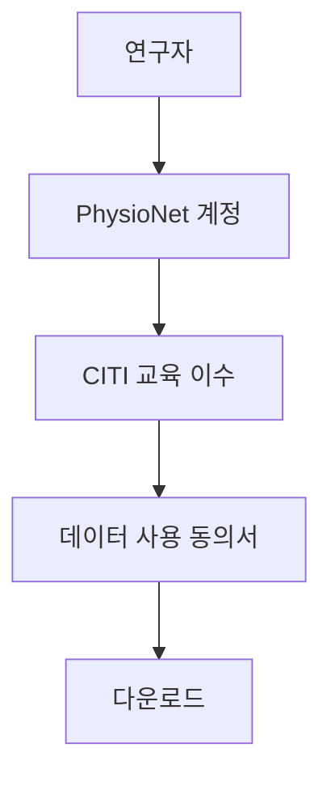

# MIMIC-CXR

> 미국 보스턴의 Beth Israel Deaconess Medical Center 응급실 환자의 흉부 X선 영상(377,110장, 227,835건 검사)과 영상의학 판독문을 모은 공개 데이터셋. 등록·교육·동의를 마친 연구자만 받을 수 있다. 흉부 X선 AI 연구의 표준 자원 중 하나다.

## 쉽게 말하면
흉부 X선 AI를 만들려면 "사진"과 "의사가 쓴 판독문"이 쌍으로 대량 필요하다. 이 데이터셋은 한 병원이 2011~2016년에 쌓은 응급실 X선과 판독문을 개인정보를 지운 채 연구용으로 내놓은 것이다. 누구나 내려받는 파일이 아니라 "연구자 자격 확인" 절차를 통과해야 한다.

## 자세히
출처: PhysioNet의 MIMIC-CXR v2.1.0 페이지와 MIMIC-CXR-JPG v2.1.0 페이지(둘 다 직접 읽음, 2026-11-17 열람).
- **구성**: DICOM 형식 흉부 X선 **377,110장**, 방사선 검사 **227,835건**. 환자당 여러 검사가 있고 검사당 영상이 여러 장일 수 있다. 판독문은 비식별화된 텍스트 파일이며 검사 하나에 하나. 기관: Beth Israel Deaconess Medical Center(보스턴), 2011~2016년 응급실 환자.
- **버전**: v2.1.0, 2024-07-23 공개. 이 버전에서 비식별화된 의료진 식별자가 추가됐다.
- **MIMIC-CXR-JPG**: 같은 영상을 JPG로 변환(손실 압축, 히스토그램 평활화, 16비트→12비트)하고 **구조화 라벨**을 더한 파생본. 라벨은 규칙 기반 도구 **CheXpert**와 **NegBio**가 판독문에서 뽑았으며 227,827건 검사, 14개 범주(13개 소견과 "소견 없음", 예: 무기폐·심비대·폐렴·기흉·지지 기구). 값은 1.0 있음, 0.0 없음, -1.0 불확실, 공백 언급 없음. 테스트 세트에는 방사선과 의사 1명이 직접 단 라벨 파일이 있어 라벨러 평가에 쓴다. train·validate·test 분할 파일과 메타데이터(촬영 자세 AP·PA·측면, 영상 크기, 검사 날짜의 상대적 순서)도 포함.
- **환자 수**: 페이지에 명시되지 않았다. 폴더 구조(최상위 10개 폴더에 각 약 6,500 환자 하위 폴더)로 보아 약 6만5천 명 안팎으로 추정되나 확인한 수치는 아니다.
- **접근 조건**: PhysioNet 자격 확인 사용자(credentialed)만. CITI "Data or Specimens Only Research" 교육을 이수하고 데이터 사용 동의서에 서명, PhysioNet Credentialed Health Data License 1.5.0을 따른다.
- **주의할 한계(이 글의 정리)**: ① 한 병원·응급실 환자 편향 ② 라벨은 규칙 기반 도구가 판독문에서 뽑은 것이라 오류·불확실 라벨(-1)이 있다 ③ 영상 모델의 외부 병원 성능은 별도 검증이 필요하다([외부 병원 성능 하락](#external-validation-drop) 참고).

## 그림으로 보기

## 예시
- 기흉·폐렴 탐지 모델을 학습할 때 JPG 판본과 라벨 파일, 지정된 분할로 같은 기준에서 비교한다.
- 교육 자료로 쓸 때는 접근 규정상 원본을 수강생과 공유할 수 없으므로 공개된 소량 샘플이나 합성 데이터를 대신 쓴다(라이선스 확인 필요).

## 헷갈리는 것과 비교
| 개념 | 차이 |
|---|---|
| MIMIC-CXR | 원본 DICOM과 판독문 |
| MIMIC-CXR-JPG | JPG + 구조화 라벨 + 분할 |
| [TCIA](#tcia) | 암 영상 공개 아카이브 |
| [의료 영상 데이터셋](#medical-imaging-datasets) | 상위 개념 |

## 더 읽을거리
- [MIMIC-CXR v2.1.0 (PhysioNet)](https://physionet.org/content/mimic-cxr/2.1.0/) — 구성·접근 조건(직접 읽음)
- [MIMIC-CXR-JPG v2.1.0 (PhysioNet)](https://physionet.org/content/mimic-cxr-jpg/2.1.0/) — JPG·라벨·분할(직접 읽음)
