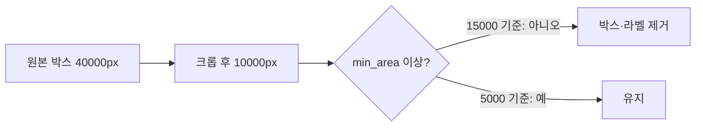
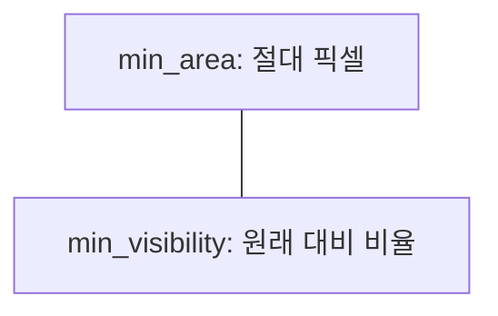

# min_area 필터

> 증강(자르기 등) 뒤 **박스 면적(픽셀)이 기준보다 작은 박스를 라벨에서 제거**하는 설정이다. Albumentations에서는 `BboxParams(min_area=…)`로 지정한다.

## 쉽게 말하면
사진을 잘랐더니 사람의 손가락 끝만 남았다고 하자. "이 정도 크기 미만은 사람으로 치지 않는다"는 기준을 정해 두면 의미 없는 조각을 정답에서 뺄 수 있다.

## 자세히
- 직접 실험(Albumentations 2.0.8, 640×480 이미지, `Crop(0,0,200,200)`, 형식 pascal_voc): 박스 A `[100,100,300,300]`(면적 40,000, 자른 뒤 100×100 = 10,000만 남음), 박스 B `[350,350,450,450]`(자른 영역 밖).
  - 기본 설정: A는 `[100,100,200,200]`로 잘려 남고 B는 완전히 밖이라 사라짐.
  - `min_area=15000`: A의 남은 면적 10,000 < 15,000이므로 **A도 제거**(결과 빈 리스트).
  - `min_area=5000`: A 유지.
- 즉 min_area는 **증강 후 남은 면적**을 절대값(픽셀 수)으로 비교한다. 이미지 크기가 바뀌면(리사이즈 등) 같은 숫자가 다른 의미가 되므로 증강 순서와 함께 정한다(해석).
- 비율 기준 [min_visibility](#min-visibility-filter)와의 차이: 이 실험에서 A는 원래 면적의 25%만 보이므로 `min_visibility=0.3`이면 제거, `0.2`이면 유지됐다.
- 라벨 동기화: 박스가 제거되면 `label_fields`로 넘긴 클래스 라벨도 같이 걸러진다(실험 결과 박스와 라벨 모두 빈 리스트). 참고로 라벨 값이 `1`에서 `1.0`(float)으로 돌아와 타입이 바뀔 수 있으니 정수형이 필요하면 되돌린다(관찰).
- 고르는 법(제안): 탐지하려는 가장 작은 물체의 픽셀 면적보다 작게, 학습 입력 해상도 기준으로 설정한다.

## 그림으로 보기



## 예시
```python
A.Compose([A.Crop(0,0,200,200)],
  bbox_params=A.BboxParams(format='pascal_voc', label_fields=['l'], min_area=5000))
```
- 교육: "작은 조각을 정답으로 남기면 모델이 헷갈린다"는 라벨 품질 사례.

## 헷갈리는 것과 비교
| 개념 | 차이 |
|---|---|
| min_area | 남은 면적(픽셀) 하한 |
| [min_visibility](#min-visibility-filter) | 원래 면적 대비 남은 비율 하한 |
| [박스 클리핑](#bbox-clipping) | 경계 밖 좌표를 안으로 맞춤(제거 아님) |

## 더 읽을거리
- [Albumentations 바운딩 박스 문서](https://albumentations.ai/docs/3-basic-usage/bounding-boxes-augmentations/) — min_area·min_visibility 설명 위치.
- 직접 실행: Albumentations 2.0.8 크롭 실험.
