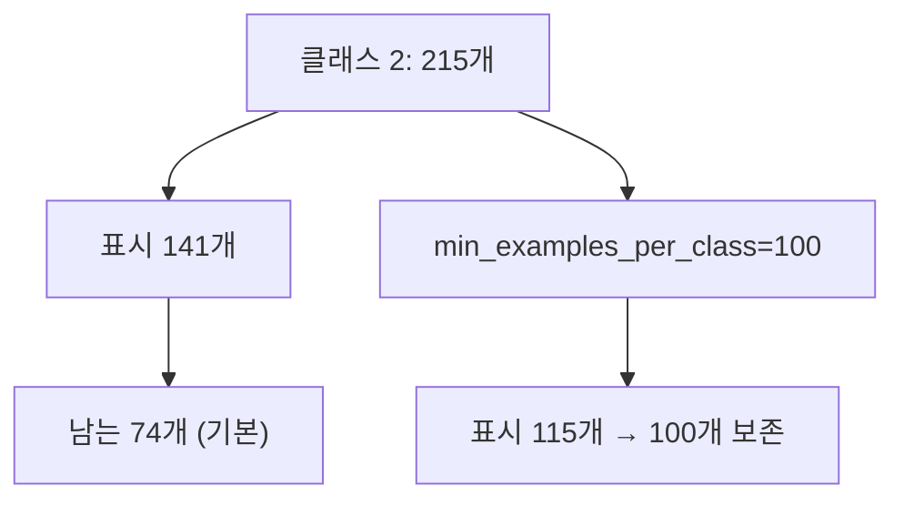

# 클래스별 최소 보존(min_examples_per_class)

> `min_examples_per_class`는 cleanlab `find_label_issues`의 옵션으로, 오류로 표시하고 남은 뒤에도 각 클래스에 최소 이만큼의 샘플이 남도록 표시를 제한한다. 희귀 클래스가 정리 과정에서 사라지는 것을 막는다.

## 쉽게 말하면
학급에서 문제 학생을 골라내더라도 "각 동아리에 최소 몇 명은 남긴다"는 규칙을 두는 것이다. 작은 동아리는 몇 명만 빠져도 사라지기 때문이다.

## 자세히
- **함수 시그니처(직접 확인, cleanlab 2.9.0)**: `find_label_issues(labels, pred_probs, *, filter_by='prune_by_noise_rate', frac_noise=1.0, num_to_remove_per_class=None, min_examples_per_class=1, ...)`. 기본값은 1이다. 클래스가 너무 작아서 표시가 제한되면 "May not flag all label issues in class: N, it has too few examples" 경고가 나온다.
- **직접 실험(cleanlab 2.9.0, 가상 3클래스 2,000개, 클래스 크기 1385/400/215, 라벨 15% 뒤집기, 로지스틱 회귀 5-fold 확률)**:

| min_examples_per_class | 클래스별 표시 수 (0/1/2) | 정리 뒤 남는 수 (0/1/2) |
| --- | --- | --- |
| 기본(1)·20 | 21 / 117 / 141 | 1364 / 283 / 74 |
| 100 | 21 / 117 / 115 | 1364 / 283 / 100 |

  기본값에서는 가장 작은 클래스 2(215개)에서 141개가 표시되어 74개만 남았다. `min_examples_per_class=100`으로 하자 표시가 115개로 줄어 100개가 남았다. 이 실험은 한 번의 가상 설정이며 다른 데이터에서는 달라진다.
- **해석**: 희귀 클래스는 모델 확률이 낮아 오류 후보로 많이 걸리기 쉽다(그만큼 오탐도 많다, [라벨 오류 오탐](#false-positive-label-issues)). 이런 클래스를 대량 삭제하면 학습 신호가 줄어든다([하드 샘플 제거 부작용](#hard-sample-removal)). 이 옵션은 표시된 후보를 삭제 후보로 쓸 때의 안전장치이고, 검수 목록은 별도로 전체를 볼 수 있다.
- **쓰는 법(해석)**: 삭제 전략에는 클래스별 현실적 하한(예: 학습에 필요한 최소 수)을 넣고, 검수는 전체 후보로 진행한다.

## 그림으로 보기



## 예시
```python
mask = find_label_issues(labels, pred_probs, min_examples_per_class=100)
```
- 교육 활용: 클래스 크기 표를 보고 "어느 클래스에 하한을 두겠는가"를 정하게 한다.

## 헷갈리는 것과 비교
| 개념 | 차이 |
| --- | --- |
| min_examples_per_class | 클래스별 최소 남는 수 보장 |
| num_to_remove_per_class | 클래스별 제거 수를 직접 지정 |
| frac_noise | 전체 표시 개수를 비례 축소 |
| [삭제 대신 보류](#quarantine-instead-of-delete) | 아예 삭제하지 않는 방법 |

## 더 읽을거리
- [cleanlab filter 문서](https://docs.cleanlab.ai/stable/cleanlab/filter.html) — 옵션 설명
