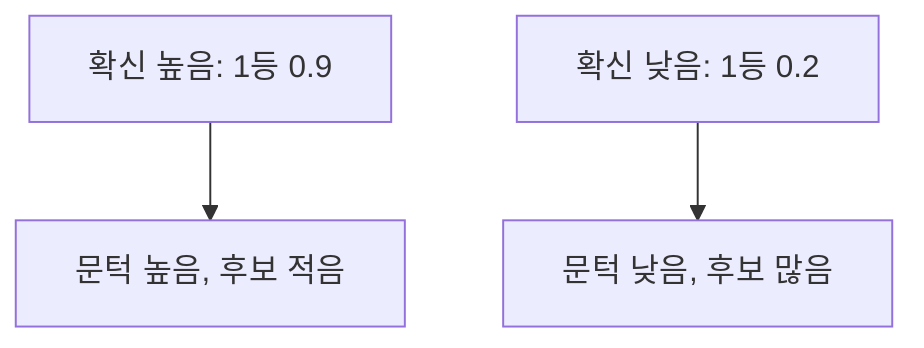

# min-p 샘플링

> 1등 토큰 확률에 비례하는 동적 문턱을 두어, 그보다 확률이 낮은 후보를 잘라내고 남은 것 중에서 뽑는 샘플링 방식. top-p보다 높은 온도에서 안정적이라고 주장된다.

## 쉽게 말하면
회식 메뉴를 고를 때 "1등 메뉴 인기의 10% 미만인 메뉴는 후보에서 뺀다"는 규칙이다. 1등이 압도적이면(확신 높음) 후보가 몇 개로 좁아지고, 1등이 별로 안 두드러지면(확신 낮음) 후보가 넓게 남는다. 상황에 맞춰 문턱이 저절로 움직인다.

## 자세히
논문 arXiv:2407.01082(Nguyen 외, 2024-07 제출, ICLR 2025 구두 발표, 확인 2026-11-12) 초록 기준.
- 핵심: "상위 토큰의 확률을 배율로 써서" 샘플링 문턱을 조정한다. 정확한 공식은 이번에 열어 본 초록에 없다. 일반적으로는 `문턱 = min_p × (최고 확률)`로 알려져 있다(추정).
- 비교: top-p는 누적 확률 기준, top-k는 개수 기준이라 모델의 확신도와 무관한 고정 규칙이다.
- 주장(논문): top-p 대비 품질과 다양성이 함께 좋아지며, 특히 높은 온도에서 top-p가 내는 비일관·반복 문제가 줄어든다. GPQA·GSM8K·AlpacaEval Creative Writing, Mistral·Llama 3(1B~123B)로 평가, 사람 평가에서도 선호됐다고 한다.
- 채택: Hugging Face Transformers, vLLM 등에 구현됐다고 한다.
- 이 결과는 저자 보고이며 독립 재현 여부는 확인하지 못했다.

## 그림으로 보기



## 예시
```python
model.generate(**inputs, do_sample=True, temperature=1.5, min_p=0.1)
```
창작 글쓰기에서 온도를 높여 다양성을 얻되, min_p로 엉뚱한 꼬리 토큰을 걸러 낸다(파라미터 지원은 라이브러리 버전에 따라 다르니 확인).

## 헷갈리는 것과 비교
| 방식 | 자르는 기준 |
|---|---|
| top-k | 상위 k개 고정 |
| top-p | 누적 확률 p까지 |
| min-p | 1등 확률 대비 비율 미만 제거 |
| [온도](#temperature-scaling) | 분포 전체 모양 변경(자르지 않음) |

## 더 읽을거리
- [Turning Up the Heat: Min-p Sampling (arXiv 2407.01082)](https://arxiv.org/abs/2407.01082) — 초록과 평가 결과
