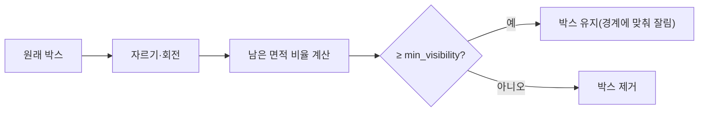
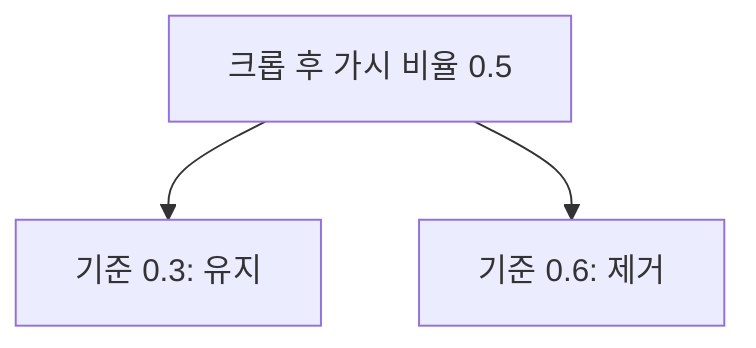

# min_visibility 필터

> 자르기·회전 같은 증강으로 **박스가 이미지 밖으로 잘려 일부만 남았을 때, 남은 면적 비율이 기준(min_visibility) 미만이면 그 박스를 정답에서 제거**하는 옵션이다. 거의 안 보이는 물체를 "있다"고 가르치는 잘못된 라벨을 막는다.

## 쉽게 말하면
사진을 잘라 내니 사람의 발끝만 남았다. 이걸 여전히 "사람"이라고 정답으로 적으면 모델은 발끝 한 조각을 사람으로 외운다. 절반 이상 보일 때만 정답으로 남기자는 규칙이다.

## 자세히
(Albumentations 2.0.8 `BboxParams` 설명과 직접 실행)
- 정의(문서): `min_visibility`는 변환 뒤 박스가 결과에 남기 위해 필요한 **원래 면적 대비 남은 면적 비율**(0~1, 기본 0). 같은 곳에 `min_area`(남은 픽셀 면적 최소값), `min_width`, `min_height`도 있다.
- 직접 실험: 640×480 이미지에서 `Crop(x_min=200, x_max=640)`으로 왼쪽 200픽셀을 잘랐다. 박스 5개의 남은 비율은 다음과 같다.

| 박스(pascal_voc) | 남는 부분 | 가시 비율 |
|---|---|---|
| 0: (100,50,300,250) | x 200~300 | 0.50 |
| 1: (150,300,250,400) | x 200~250 | 0.50 |
| 2: (0,0,100,100) | 없음 | 0 |
| 3: (190,60,210,100) | x 200~210 | 0.50 |
| 4: (195,300,400,400) | x 200~400 | 0.98 |
- 결과(남은 박스 번호): min_visibility 0.0 → [0,1,3,4], 0.3 → [0,1,3,4], **0.6 → [4]**, 0.9 → [4]. 완전히 밖으로 나간 박스 2는 0일 때도 사라진다.
- 기준 정하기(제안): 너무 높으면(0.9) 가장자리 물체가 대부분 사라져 학습 표본이 준다. 너무 낮으면(0) 조각 라벨이 남는다. 0.3~0.5에서 시작하고 데이터(작은 물체 비중)에 맞춰 조정한다. 작은 물체는 `min_area`와 함께 쓴다.
- 주의: 이 필터는 자르기로 줄어든 비율만 본다. 가림(occlusion)이나 흐림은 별도 문제다.

## 그림으로 보기



## 예시
```python
A.BboxParams(format='pascal_voc', label_fields=['labels'],
             min_visibility=0.4, min_area=64)
```
- 도로 사진을 무작위 크롭하는 차량 탐지 학습에서 반쯤 잘린 차는 남기고 바퀴만 남은 박스는 제거.
- 교육: 증강이 라벨과 이미지의 일치를 깰 수 있다는 점을 설명.

## 헷갈리는 것과 비교
| 개념 | 차이 |
|---|---|
| min_visibility | 원래 면적 대비 남은 비율 |
| min_area | 남은 절대 면적(픽셀) |
| 박스 클리핑 | 경계 밖 좌표를 이미지 안으로 자름 |
| [박스 좌표 형식](#bbox-coordinate-formats) | 이 필터 이전에 맞춰야 하는 전제 |

## 더 읽을거리
- [Albumentations 문서](https://albumentations.ai/docs/) — BboxParams의 min_visibility·min_area(설치해 확인).
