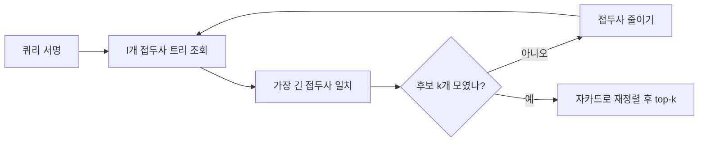
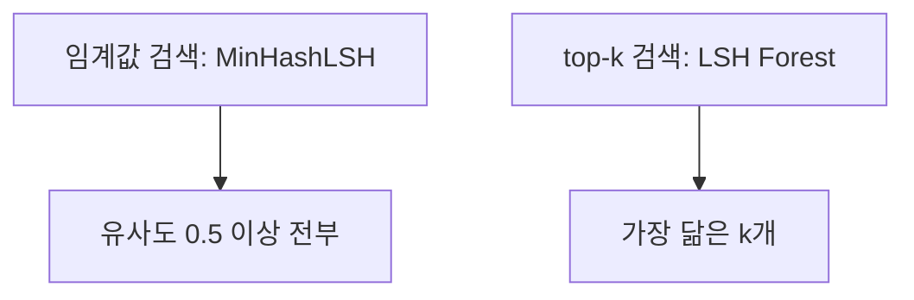

# MinHash LSH Forest

> 임계값 대신 **"가장 비슷한 상위 k개"**를 찾도록 만든 MinHash LSH 변형이다. 서명을 여러 접두사 트리에 넣어 두고, 긴 접두사부터 줄여 가며 후보 k개가 모일 때까지 넓힌다.

## 쉽게 말하면
일반 [MinHash LSH](#minhash-lsh)는 "유사도 0.5 넘는 것만 알려 줘"라는 문턱 검색이다. Forest는 "제일 닮은 5개만 알려 줘"다. 처음엔 이름이 길게 겹치는 사람만 찾고, 5명이 안 되면 앞 몇 글자만 맞아도 되도록 조건을 점점 풀어 5명을 채운다.

## 자세히
- 원 구조는 LSH Forest(Bawa 외, 2005). datasketch의 `MinHashLSHForest`가 MinHash 서명에 적용한다(문서 확인).
- 서명의 num_perm개 값을 `l`개(기본 8) 접두사 트리로 나눠, 각 트리의 최대 깊이는 num_perm/l이다.
- 쿼리: 모든 트리에서 가장 긴 접두사 일치를 찾고, 접두사를 줄이며 후보가 k개 모일 때까지 넓힌다. 문서는 2k개를 받아 정확한/추정 자카드로 **다시 정렬**해 상위 k개를 쓰라고 권한다.
- 반드시 `forest.index()`를 호출해야 검색된다(안 하면 키를 못 찾는다).
- 직접 실행(datasketch 2.0.0, num_perm=128): 기준 집합과 겹침이 55/60·45/60·30/60·15/60·5/60인 문서 5개(실제 자카드 0.85·0.66·0.38·0.25·0.14)와 무작위 노이즈 200개를 넣고 top-5를 물었다. 결과 `[noise42, d1, d0, d2, noise72]` — 가까운 d0·d1·d2는 모두 들어왔지만 **정렬은 보장되지 않고**(d1이 d0보다 앞) 노이즈 2개가 섞였다. 그래서 후보를 다시 정렬하는 단계가 필요하다. 1회 실행 결과이며 시드·데이터에 따라 다르다.
- 쓸 때: 임계값을 모르는 "유사 문서 추천"류. 임계값이 정해진 중복 제거에는 일반 LSH가 단순하다.

## 그림으로 보기

## 예시
- 새 문서와 가장 닮은 학습 문서 10개를 찾아 오염(contamination) 후보로 검토: `forest.query(mh, 20)` 후 재정렬 → 상위 10개.
- 교육: "문턱 검색 vs 순위 검색" 구분 예시.

## 헷갈리는 것과 비교
| 개념 | 차이 |
|---|---|
| MinHashLSH | 임계값 이상 모두 |
| LSH Forest | top-k, index() 필요, 재정렬 권장 |
| [벡터 검색(ANN)](#text-embedding) | 임베딩 벡터의 근사 최근접, 의미 유사 |

## 더 읽을거리
- [datasketch MinHash LSH Forest 문서](http://ekzhu.com/datasketch/lshforest.html) — index(), l, top-k 방식(열어 확인).
